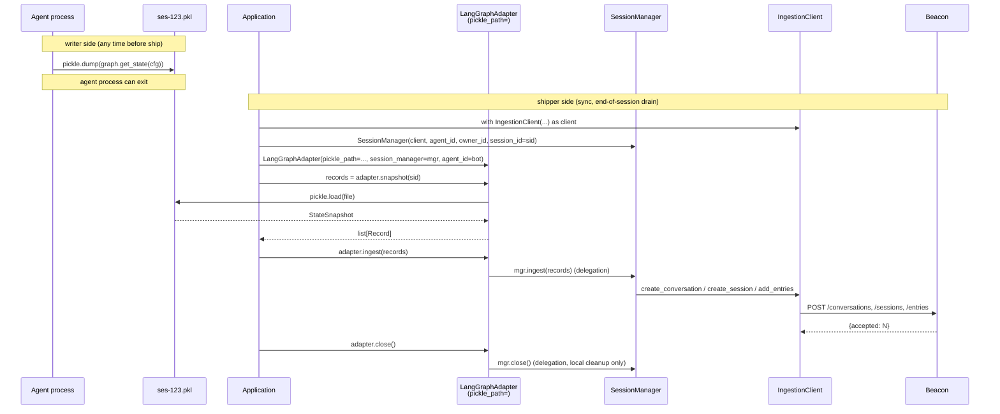

# Design — agent-context-sdk

**Authors:** Dhruv Kachhadia, Luke Shen, Sylvester Kpei
**Date:** 2026-06-23  
**Status:** Draft for team review  
**Branch:** `feature/adapter-hooks`

---

## Table of Contents

1. [Overview](#1-overview)
2. [Core SDK Design](#2-core-sdk-design)
3. [Retrieval Client Design](#3-retrieval-client-design) *(separate doc)*
4. [Eager Lifecycle Design](#4-eager-lifecycle-design) *(separate doc)*
5. [Claude Agent SDK Adapter Design](#5-claude-agent-sdk-adapter-design)
6. [LangGraph Adapter Design](#6-langgraph-adapter-design)
7. [Google ADK Adapter Design](#7-google-adk-adapter-design)
8. [AgentContextClient](#8-agentcontextclient)


---

## 1. Overview

### 1.1 Problem Statement

Agent frameworks (Claude Agent SDK, LangGraph, Google ADK) generate rich conversation data that needs to be ingested into Salesforce Data Cloud via the Beacon/Context Service APIs. Each framework has a different data model and hook system. We need:

- A **common core SDK** that handles Beacon API lifecycle (conversations, sessions, entries)
- **Framework-specific adapters** that extract and normalize conversation events into a common format

### 1.2 Beacon API Surface (Target)

The Context Service exposes these REST endpoints:

| Endpoint | Purpose |
|----------|---------|
| `POST /api/v1/agentic/conversations` | Create a conversation |
| `POST /api/v1/agentic/conversations/{id}/sessions` | Create a session |
| `POST /api/v1/agentic/conversations/{id}/entries` | Add entries to a session |
| `POST /api/v1/agentic/conversations/{id}/sessions/{id}/close` | Close a session |
| `POST /api/v1/agentic/conversations/{id}/close` | Close a conversation |

Required headers on all calls: `Authorization`, `Content-Type: application/json`, `dataspace`, `owner_id`, `registered_agent_id`

### 1.3 Beacon Entry Format (Verified Against E2E Tests + SKILL.md)

**Message entry:**
```json
{
  "id": "msg-a1b2c3d4",
  "interactionId": "turn-001",
  "participantId": "user-001",
  "content": "Hello, I need help with my order",
  "type": "user_message",
  "timestamp": "2026-06-08T20:00:00.000Z",
  "category": "Message"
}
```

**Trace entry (tool call):**
```json
{
  "id": "step-e5f6g7h8",
  "interactionId": "turn-001",
  "participantId": "agent-support-bot",
  "type": "tool_call",
  "timestamp": "2026-06-08T20:00:01.000Z",
  "category": "Trace",
  "variable": {"Name": "OrderLookup", "InputValueText": "{\"orderId\":\"12345\"}"}
}
```

**Trace entry (tool result):**
```json
{
  "id": "step-i9j0k1l2",
  "interactionId": "turn-001",
  "participantId": "agent-support-bot",
  "type": "tool_result",
  "timestamp": "2026-06-08T20:00:02.000Z",
  "category": "Trace",
  "variable": {"Name": "OrderLookup", "OutputValueText": "{\"status\":\"shipped\"}"}
}
```

**Trace entry (agent reasoning):**
```json
{
  "id": "step-m3n4o5p6",
  "interactionId": "turn-001",
  "participantId": "agent-support-bot",
  "type": "agent_reasoning",
  "timestamp": "2026-06-08T20:00:00.500Z",
  "category": "Trace",
  "variable": {"OutputValueText": "Look up the order status."}
}
```

**Key findings (verified against the live Beacon API):**

| Field | Status | Notes |
|-------|--------|-------|
| `id` | Optional | Entry ID. Beacon assigns one when omitted. The SDK omits it: Beacon dedupes on a client-supplied `id`, and adapter fallback ids repeat across turns. |
| `interactionId` | Optional | Groups entries belonging to the same turn. All entries in one turn should share the same `interactionId`. Generated by the adapter using UUID4 if not provided. |
| `participantId` | **Required** | Who produced this entry |
| `type` | **Required** | `user_message`, `agent_response`, `agent_reasoning`, `tool_call`, `tool_result` |
| `timestamp` | **Required** | ISO 8601 UTC with milliseconds |
| `category` | **Required** | `"Message"` or `"Trace"` |
| `content` | For Messages | Text content. Omit for Trace entries (use `variable` instead) |
| `variable` | For Traces | `{Name?, InputValueText?, OutputValueText?}` — not all keys required |
| `role` | **NOT on entries** | `role` lives on `participants` (in `create_session`), not on per-entry payloads. The live API accepts entries without it. |

**Critical constraints (verified against the live Beacon API):**
- `sessionId` MUST equal `conversationId` (local dev constraint, may differ in prod)
- Each entry MUST have `id`, `type`, `interactionId`, `participantId`, `timestamp`, `category`. `role` is supplied at session-participants level, not per entry.
- Entry ID prefixes by convention: `msg-` for Message-category entries, `step-` for Trace-category entries.
- Tool name appears in BOTH `tool_call.variable.Name` AND `tool_result.variable.Name` so downstream consumers can correlate the call with its result.

---

## 2. Core SDK Design

The core SDK is the **shared layer** that all adapters call into. It handles:
- Data normalization (Record)
- Beacon API lifecycle (conversations, sessions, entries)
- Transport (HTTP client)
- Delivery orchestration (when to POST)

### 2.1 Architecture Layers

```
┌─────────────────────────────────────────────────────────────┐
│                    Framework Adapter Layer                    │
│   (Claude / LangGraph / ADK)                                │
│                                                              │
│   Responsibility: Extract events → produce Records     │
└──────────────────────────────┬──────────────────────────────┘
                               │ list[Record]
                               ▼
┌─────────────────────────────────────────────────────────────┐
│                    Core SDK: Session Manager                  │
│                                                              │
│   Responsibility: Manage Beacon lifecycle                    │
│   • Lazy-create conversation + session on first records      │
│   • Transform Records → Beacon entry format            │
│   • Close session/conversation on explicit call              │
│   • Manager is mode-agnostic — adapter owns delivery timing │
└──────────────────────────────┬──────────────────────────────┘
                               │ HTTP
                               ▼
┌─────────────────────────────────────────────────────────────┐
│                    Core SDK: IngestionClient                  │
│                                                              │
│   Responsibility: HTTP transport to Context Service           │
│   • POST to each lifecycle endpoint                          │
│   • Auth headers                                             │
│   • Error mapping                                            │
└─────────────────────────────────────────────────────────────┘
```

### 2.2 Data Model

`Record` is the normalized event shape every adapter emits. Fields map 1:1 to the Beacon wire format — no translation layer needed.

```python
class Record(BaseModel):
    model_config = ConfigDict(extra="forbid", frozen=True)

    event_id: str               # Local id. Not sent — Beacon assigns entry ids.
    session_id: str             # Beacon session identifier
    agent_id: str               # Registered agent ID in Beacon
    event_type: str             # Beacon: "type". One of: user_message | agent_response | agent_reasoning | tool_call | tool_result
    participant_id: str | None  # Beacon: "participantId". Who produced this event.
    content: str | None         # Beacon: "content". Text for Message entries; null for Traces.
    category: str               # Beacon: "category". "Message" or "Trace".
    interaction_id: str | None = None  # Beacon: "interactionId". Groups entries in one turn. Optional per API; adapters should always populate via UUID4.
    variable: dict[str, Any] | None = None  # Beacon: "variable". For Traces: {Name?, InputValueText?, OutputValueText?}
    timestamp: datetime         # Beacon: "timestamp". ISO 8601 UTC.
    metadata: dict[str, Any] = Field(default_factory=dict)  # Adapter-internal extras (not sent to Beacon)
```

**`event_type` values (match Beacon wire `type` exactly — same vocabulary as the live API):**

| `event_type` | `category` | Description |
|-------------|-----------|-------------|
| `user_message` | `Message` | User's input text |
| `agent_response` | `Message` | Agent's output text |
| `agent_reasoning` | `Trace` | Agent's internal reasoning / thinking |
| `tool_call` | `Trace` | Agent invoked a tool |
| `tool_result` | `Trace` | Tool returned a result |

**`variable` shape (for Trace entries):**

| Key | Used by | Description |
|-----|---------|-------------|
| `Name` | `tool_call`, `tool_result` | Tool name. Present on both so downstream can correlate. |
| `InputValueText` | `tool_call` | JSON-encoded tool input |
| `OutputValueText` | `tool_result`, `agent_reasoning` | Tool output or reasoning text |

Beacon ingest projects these exact keys onto `ssot__InputValueText__c` / `ssot__OutputValueText__c`. The legacy aliases `InputValue` / `OutputValue` are not projected.

**`metadata` — adapter-internal only, never sent to Beacon:**

| Key | Type | Used by | Description |
|-----|------|---------|-------------|
| `tool_call_id` | `str \| None` | Tool entries | Links a `tool_result` back to its `tool_call`. Internal correlation only. |

### 2.3 Transport Layer — Sync and Async Stacks

The core SDK provides **two parallel transport stacks** — sync and async — so adapters can pick the right one for their framework's execution model:

```
┌───────────────────────────────────────────────────────────────┐
│                         Core SDK                               │
│                                                               │
│  ┌─────────────────────┐     ┌──────────────────────────┐    │
│  │   Sync Stack         │     │   Async Stack             │    │
│  │                      │     │                           │    │
│  │  SessionManager      │     │  AsyncSessionManager      │    │
│  │    .ingest(records)  │     │    .ingest(records)         │    │
│  │    .close()          │     │    .close()                │    │
│  │        │             │     │        │                   │    │
│  │        ▼             │     │        ▼                   │    │
│  │  IngestionClient     │     │  AsyncIngestionClient      │    │
│  │    requests.Session  │     │    httpx.AsyncClient        │    │
│  └─────────────────────┘     └──────────────────────────┘    │
│                                                               │
└───────────────────────────────────────────────────────────────┘
```

**Which adapter uses which stack:**

| Adapter | Stack | Why |
|---------|-------|-----|
| **Claude Agent SDK** | Async (`AsyncSessionManager` + `AsyncIngestionClient`) | Non-blocking delivery ensures next turn starts faster. See [Resilient Delivery Plan §4](./Resilient-Delivery-Plan.md#4-which-adapter-uses-which). |
| **LangGraph** (streaming, per-turn pattern) | Async (`AsyncSessionManager` + `AsyncIngestionClient`) | `astream_events` is async generator. Blocking inside it starves the event loop. |
| **LangGraph** (snapshot, end-of-session pattern) | Sync (`SessionManager` + `IngestionClient`) | Snapshot is a one-shot batch. No event loop needed. Blocking is acceptable. |
| **Google ADK** | Async (`AsyncSessionManager` + `AsyncIngestionClient`) | `Runner.run_async()` drives the event loop. Callbacks fire inside it — blocking HTTP stalls the agent. |
| **Test scripts** | Sync (`SessionManager` + `IngestionClient`) | Blocking is fine for tests. Simple to assert results immediately. |

> **Note:** All production adapters use `AsyncSessionManager` for non-blocking delivery. See [Resilient Delivery Plan](./Resilient-Delivery-Plan.md) for the full production-readiness specification including retries, callbacks, and error classification.

The two stacks share:
- Same lifecycle state machine (`Configured → Lifecycled → Closed`)
- Same `_to_beacon_entries()` transformation
- Same error types (`IngestionError`, `IngestionResponse`)
- Same endpoint paths

Only the I/O backend differs: `requests` (blocking) vs `httpx` (non-blocking).

#### 2.3.1 IngestionClient (Sync)

**Approach:** Evolve the existing `IngestionClient` to support the full Beacon lifecycle API. Same class name, same file (`client.py`). No new class — just add the lifecycle methods alongside the existing `post()` method.

```python
# src/agentic_context/client.py (evolved from placeholder)

class IngestionClient:
    """
    Sync HTTP client for the Context Service (Beacon) REST API.
    
    Handles all lifecycle endpoints:
    - Create/close conversations
    - Create/close sessions  
    - Add entries
    
    Single-purpose. No retry, no queue, no rate-limit handling.
    Use as a context manager so the connection pool closes cleanly.
    """
    
    def __init__(
        self,
        base_url: str,
        api_key: str,
        *,
        dataspace: str = "default",
        timeout: float = 10.0,
    ):
        self.base_url = base_url.rstrip("/")
        self.api_key = api_key
        self.dataspace = dataspace
        self.timeout = timeout
        self._session = requests.Session()
    
    def _headers(self, owner_id: str, agent_id: str) -> dict:
        return {
            "Authorization": f"Bearer {self.api_key}",
            "Content-Type": "application/json",
            "dataspace": self.dataspace,
            "owner_id": owner_id,
            "registered_agent_id": agent_id,
        }
    
    def create_conversation(
        self,
        conversation_id: str,
        owner_id: str,
        agent_id: str,
        *,
        name: str | None = None,
        owner_type: str = "individual",
    ) -> dict:
        """POST /api/v1/agentic/conversations"""
        payload = {
            "conversationId": conversation_id,
            "conversationOwnerId": owner_id,
            "ownerType": owner_type,
            "name": name or f"Conversation {conversation_id[:12]}",
            "channel": {"type": "web", "id": "agent-sdk"},
        }
        return self._post(
            "/api/v1/agentic/conversations",
            payload,
            owner_id=owner_id,
            agent_id=agent_id,
        )
    
    def create_session(
        self,
        conversation_id: str,
        session_id: str,
        owner_id: str,
        agent_id: str,
        *,
        participants: list[dict] | None = None,
    ) -> dict:
        """POST /api/v1/agentic/conversations/{id}/sessions"""
        payload = {
            "sessionId": session_id,
            "conversationOwnerId": owner_id,
            "ownerType": "individual",
            "participants": participants or [
                {"id": owner_id, "type": "individual", "role": "owner",
                 "startTime": datetime.now(timezone.utc).isoformat(), "orgId": "org-1"},
                {"id": agent_id, "type": "agent", "role": "participant",
                 "startTime": datetime.now(timezone.utc).isoformat()},
            ],
        }
        return self._post(
            f"/api/v1/agentic/conversations/{conversation_id}/sessions",
            payload,
            owner_id=owner_id,
            agent_id=agent_id,
        )
    
    def add_entries(
        self,
        conversation_id: str,
        session_id: str,
        entries: list[dict],
        owner_id: str,
        agent_id: str,
    ) -> dict:
        """POST /api/v1/agentic/conversations/{id}/entries

        Body shape verified against the live Beacon API:
        sessionId + conversationOwnerId + entries.
        """
        payload = {
            "sessionId": session_id,
            "conversationOwnerId": owner_id,    # required by Beacon
            "entries": entries,
        }
        return self._post(
            f"/api/v1/agentic/conversations/{conversation_id}/entries",
            payload,
            owner_id=owner_id,
            agent_id=agent_id,
        )
    
    def close_session(
        self,
        conversation_id: str,
        session_id: str,
        owner_id: str,
        agent_id: str,
    ) -> dict:
        """POST /api/v1/agentic/conversations/{id}/sessions/{id}/close"""
        return self._post(
            f"/api/v1/agentic/conversations/{conversation_id}/sessions/{session_id}/close",
            None,
            owner_id=owner_id,
            agent_id=agent_id,
        )
    
    def close_conversation(
        self,
        conversation_id: str,
        owner_id: str,
        agent_id: str,
    ) -> dict:
        """POST /api/v1/agentic/conversations/{id}/close"""
        return self._post(
            f"/api/v1/agentic/conversations/{conversation_id}/close",
            None,
            owner_id=owner_id,
            agent_id=agent_id,
        )
    
    def _post(self, path: str, payload: dict | None, *, owner_id: str, agent_id: str) -> dict:
        """Send POST request with standard headers."""
        resp = self._session.post(
            self.base_url + path,
            json=payload,
            headers=self._headers(owner_id, agent_id),
            timeout=self.timeout,
        )
        if not resp.ok:
            raise IngestionError(resp.status_code, resp.text)
        return resp.json() if resp.text else {}
```

#### 2.3.2 AsyncIngestionClient (Async)

Async sibling of `IngestionClient` using `httpx.AsyncClient`. Same four lifecycle methods, same endpoint paths, same auth, same error handling — only the I/O backend differs.

```python
# src/agentic_context/client_async.py

import httpx

class AsyncIngestionClient:
    """
    Async HTTP client for the Context Service (Beacon) REST API.
    
    Same surface as IngestionClient — only the I/O is non-blocking.
    Use inside an event loop. Pairs with AsyncSessionManager.
    """
    
    def __init__(
        self,
        base_url: str,
        api_key: str,
        *,
        dataspace: str = "default",
        timeout: float = 10.0,
        client: httpx.AsyncClient | None = None,
    ):
        self.base_url = base_url.rstrip("/")
        self.api_key = api_key
        self.dataspace = dataspace
        self.timeout = timeout
        self._client = client or httpx.AsyncClient(timeout=timeout)
        self._owns_client = client is None
    
    def _headers(self, owner_id: str, agent_id: str) -> dict:
        return {
            "Authorization": f"Bearer {self.api_key}",
            "Content-Type": "application/json",
            "dataspace": self.dataspace,
            "owner_id": owner_id,
            "registered_agent_id": agent_id,
        }
    
    async def create_conversation(
        self, conversation_id: str, owner_id: str, agent_id: str, **kwargs,
    ) -> dict:
        """POST /api/v1/agentic/conversations"""
        payload = {
            "conversationId": conversation_id,
            "conversationOwnerId": owner_id,
            "ownerType": kwargs.get("owner_type", "individual"),
            "name": kwargs.get("name") or f"Conversation {conversation_id[:12]}",
            "channel": {"type": "web", "id": "agent-sdk"},
        }
        return await self._post(
            "/api/v1/agentic/conversations", payload,
            owner_id=owner_id, agent_id=agent_id,
        )
    
    async def create_session(
        self, conversation_id: str, session_id: str, owner_id: str, agent_id: str, **kwargs,
    ) -> dict:
        """POST /api/v1/agentic/conversations/{id}/sessions"""
        payload = {
            "sessionId": session_id,
            "conversationOwnerId": owner_id,
            "ownerType": "individual",
            "participants": kwargs.get("participants") or [
                {"id": owner_id, "type": "individual", "role": "owner"},
                {"id": agent_id, "type": "agent", "role": "participant"},
            ],
        }
        return await self._post(
            f"/api/v1/agentic/conversations/{conversation_id}/sessions", payload,
            owner_id=owner_id, agent_id=agent_id,
        )
    
    async def add_entries(
        self, conversation_id: str, session_id: str, entries: list[dict],
        owner_id: str, agent_id: str,
    ) -> dict:
        """POST /api/v1/agentic/conversations/{id}/entries

        Body shape verified against the live Beacon API.
        """
        payload = {
            "sessionId": session_id,
            "conversationOwnerId": owner_id,
            "entries": entries,
        }
        return await self._post(
            f"/api/v1/agentic/conversations/{conversation_id}/entries", payload,
            owner_id=owner_id, agent_id=agent_id,
        )
    
    async def close_session(
        self, conversation_id: str, session_id: str, owner_id: str, agent_id: str,
    ) -> dict:
        """POST /api/v1/agentic/conversations/{id}/sessions/{id}/close"""
        return await self._post(
            f"/api/v1/agentic/conversations/{conversation_id}/sessions/{session_id}/close",
            None, owner_id=owner_id, agent_id=agent_id,
        )
    
    async def close_conversation(
        self, conversation_id: str, owner_id: str, agent_id: str,
    ) -> dict:
        """POST /api/v1/agentic/conversations/{id}/close"""
        return await self._post(
            f"/api/v1/agentic/conversations/{conversation_id}/close",
            None, owner_id=owner_id, agent_id=agent_id,
        )
    
    async def _post(self, path: str, payload: dict | None, *, owner_id: str, agent_id: str) -> dict:
        """Send async POST request with standard headers."""
        resp = await self._client.post(
            self.base_url + path,
            json=payload,
            headers=self._headers(owner_id, agent_id),
        )
        if resp.status_code >= 400:
            raise IngestionError(resp.status_code, resp.text)
        return resp.json() if resp.text else {}
    
    async def close(self):
        if self._owns_client:
            await self._client.aclose()
    
    async def __aenter__(self):
        return self
    
    async def __aexit__(self, *exc):
        await self.close()
```

**Why a separate class (not dual-mode):**
- Streaming adapters (LangGraph `astream_events`) yield inside an async loop. Calling sync `requests` blocks the event loop and starves other coroutines.
- The two clients share endpoint paths, `IngestionError`, and `IngestionResponse` — only the I/O layer differs. No duplicated business logic.
- Clean dependency story: adapters that only need sync don't pull in `httpx`.

### 2.4 Session Manager — Sync and Async (New — Core Addition)

**Why:** Adapters should not handle Beacon lifecycle directly (violates "don't import transport" rule). The Session Manager sits between the adapter and the IngestionClient, orchestrating the conversation/session lifecycle.

**Design principles:**
- **No in-memory buffering:** The SDK does NOT maintain an in-memory buffer of records. The framework's own state (LangGraph checkpointer, serialized state file on disk, etc.) is the durable buffer. The application reads it via `adapter.snapshot(sid)` when needed and hands the result to `adapter.ingest(records)`. The manager stays stateless.
- **One-directional flow:** `adapter → SessionManager → IngestionClient`. The manager never calls back into the adapter. The adapter owns timing; the manager owns lifecycle; the client owns HTTP.
- **Manager is mode-agnostic:** there is no `delivery_mode` flag. Whether records arrive once at end-of-session or many times per-turn is the application's call pattern, not manager state.

**Naming convention:** Both sync and async managers expose a single `ingest(records)` method. One name, one mental model — regardless of sync/async stack. Adapters always call `ingest()`; the manager always POSTs (no defer-then-flush behavior). Cadence is the adapter's concern.

#### 2.4.1 SessionManager (Sync)

Used by: Test scripts, LangGraph (snapshot / end-of-session caller pattern).

**Design rule: `conversation_id == session_id`.** One conversation = one session. Sessions do not need explicit closing. Returning users to the same `conversation_id` get past data without creating a new session (409 = success).

**Handles:**
- Lazy creation of conversation + session on first `ingest()` (using `conversation_id` as both)
- Eager lifecycle via `create_conversation(conversation_id)` for upfront setup
- Transforming Records → Beacon entry format
- Always POSTs on `ingest()` — no buffering, no mode flag
- Internal retry with exponential backoff for transient errors (3 attempts, 1s base)
- Optional observability callbacks (`on_success`, `on_error`, `on_retry`)
- Local cleanup via `close()` — no `close_session` call to Beacon

**Public API:**

```python
mgr = SessionManager(client, agent_id="...", owner_id="...", conversation_id=None, callbacks=None)
mgr.create_conversation("conv-id")  # Eager. 409 = returning user = success.
mgr.ingest(records)   # Blocking. Retries transient failures automatically.
mgr.close()           # Local cleanup. Idempotent. No close_session to Beacon.
```

> **Full implementation:** See [Resilient Delivery Plan §3.1](./Resilient-Delivery-Plan.md#31-sessionmanager--sync-blocking-with-retries) and source at `src/agentic_context/session.py`.

#### 2.4.2 AsyncSessionManager (Async, Non-Blocking)

Used by: ALL production adapters — Claude, LangGraph (streaming), Google ADK.

**Same unified model:** `conversation_id == session_id`. No explicit session close.

**Handles:**
- Everything SessionManager does, PLUS:
- **Non-blocking `ingest()`** via `asyncio.create_task()` — returns in < 1ms regardless of Beacon latency
- **Bounded fan-out** — pending tasks capped at 1000. On saturation, `ingest()` drops the new batch, logs `logger.error`, and fires `on_error(records, RuntimeError, attempts=0)` synchronously; the return is still non-blocking. Bounds memory during a Beacon outage rather than OOM-ing.
- **Lifecycle lock** (`asyncio.Lock`) for safe concurrent background task access
- **Pending task tracking** — `close()` flushes all in-flight deliveries before shutdown
- Internal retry with exponential backoff in background tasks

**Public API:**

```python
mgr = AsyncSessionManager(client, agent_id="...", owner_id="...", conversation_id=None, callbacks=None)
await mgr.create_conversation("conv-id")  # Eager. 409 = returning user = success.
await mgr.ingest(records)  # Non-blocking. Returns immediately. Delivery in background.
await mgr.close()          # Flush pending tasks. Local cleanup only. Must call on shutdown.
```

> **Full implementation:** See [Resilient Delivery Plan §3.2](./Resilient-Delivery-Plan.md#32-asyncsessionmanager--async-non-blocking-with-retries) for code, and [§5](./Resilient-Delivery-Plan.md#5-execution-flow-how-non-blocking-works) for the step-by-step execution flow diagrams including retry behavior.

#### 2.4.3 Caller Patterns (Replaces "Delivery Modes")

The manager has no `delivery_mode` flag and no notion of cadence. Both `ingest()` and `close()` always do the same thing:

| Method | Behavior |
|---|---|
| `ingest(records)` | Lazy-create lifecycle on first non-empty call, then POST `add_entries`. |
| `close()` | Local cleanup only. Flushes pending background tasks (async). Does NOT call `close_session`. Idempotent. |

The two real-world delivery patterns are **caller-side conventions**, not manager modes:

| Caller pattern | What the adapter does | Net Beacon traffic |
|---|---|---|
| **End-of-session drain** | App reads conversation state from its own source, transforms to `list[Record]`, calls `mgr.ingest(records)`, then `mgr.close()`. One `ingest` call. | conv + sess + entries (1 batch) |
| **Per-turn streaming** | `async for r in adapter.stream(...)`: adapter awaits `mgr.ingest([r])` per turn. Then `await adapter.close()`. | conv + sess + entries (× N turns) |

The manager is stateless and dumb. The adapter is smart about timing.

#### 2.4.4 Lifecycle State Machine

```
[Configured] ──ingest(records)──► [Lifecycled]     (create_conversation + create_session + add_entries)
                                       │              (conversation_id used as both conv and session ID)
                                       │ ingest(records)
                                       ▼
                                  [Lifecycled]     (add_entries only)
                                       │
                                       │ close()
                                       ▼
                                    [Closed]       (local cleanup — no close_session)
```

`Configured` = constructor ran, no Beacon calls yet.
`Lifecycled` = conversation + session exist server-side. `conversation_id == session_id`.
`Closed` = `close()` ran; further `ingest()` calls raise `RuntimeError`. No network call on close.

**Returning user flow:** If `create_conversation` or `create_session` returns HTTP 409 (already exists), the manager treats it as success and transitions to `Lifecycled` normally. This enables the "returning user" pattern where the same `conversation_id` is reused across adapter instances.

#### 2.4.5 What SessionManager does NOT do

- **Does not buffer records.** Every `ingest()` call POSTs immediately.
- **Does not call back into the adapter.** Flow is strictly one-directional: adapter → manager → client.
- **Does not decide when to ingest.** The adapter controls timing (per-turn vs end-session).
- **Does not auto-close.** `close()` is caller-driven.
- **Does not generate ids.** Caller-supplied; defaults documented above.
- **Does not import any framework.** Stays in core; consumes only `Record`.

> **Note:** Retry logic and non-blocking delivery have been added as a production-readiness enhancement. See [Resilient Delivery Plan](./Resilient-Delivery-Plan.md) for the full specification of internal retries, optional callbacks, and AsyncSessionManager's non-blocking `asyncio.create_task` delivery model.

#### 2.4.6 Async Flow Diagram (Non-Blocking — Production Implementation)

> **Updated:** The async flow is now fully non-blocking via `asyncio.create_task()`. See [Resilient Delivery Plan §5](./Resilient-Delivery-Plan.md#5-execution-flow-how-non-blocking-works) for detailed step-by-step diagrams and retry flow.

```
Async adapter yields record per turn
        │
        ▼
await mgr.ingest([record])
        │
        ├── asyncio.create_task(_deliver(records)) ← schedules background task
        ├── adds task to _pending_tasks set
        │
        └── RETURNS IMMEDIATELY ✓ (adapter/agent continues)

                                    Background task runs concurrently:
                                    ├── [first call] _ensure_lifecycle() (with asyncio.Lock)
                                    │       ├── await client.create_conversation(...)
                                    │       └── await client.create_session(conv_id, conv_id, ...)
                                    │         (conversation_id used as both conv + session ID)
                                    │
                                    ├── _to_beacon_entries([record])  ← pure, no I/O
                                    │
                                    └── await client.add_entries(...) with retry loop
                                        ├── success → on_success callback (if provided)
                                        └── failure → backoff → retry (up to 3 attempts)

...repeat per turn (each ingest fires its own background task)...

await mgr.close()
        │
        └── asyncio.wait(pending_tasks, timeout=30s) ← flush all in-flight
            (local cleanup only — no close_session call)
```

**Key point:** `ingest()` returns in < 1ms regardless of Beacon latency. Delivery runs in the background. The agent is never stalled. `close()` is the synchronization point — it waits for all pending deliveries to complete. Sessions do not need explicit closing.

#### 2.4.7 Dependency Direction (Critical Design Rule)

```
adapter  ──────►  SessionManager  ──────►  IngestionClient  ──────►  Beacon
         calls           calls                   calls
         ingest()        add_entries()           HTTP POST
         close()         (local cleanup)
```

The manager **never** calls back into the adapter. The adapter is responsible for:
1. Extracting data from the framework (transcript, state, etc.)
2. Transforming it into `Record` objects
3. Deciding WHEN to call `manager.ingest(records)` and `manager.close()`

This one-directional flow means:
- No circular imports
- No coupling between core SDK and any framework
- Easy to test each layer in isolation
- Clear ownership: adapter owns timing, manager owns lifecycle, client owns HTTP

### 2.5 Updated Core Public Surface

```python
# src/agentic_context/__init__.py (updated)

from .callbacks import IngestionCallbacks
from .client import IngestionClient, IngestionError, IngestionResponse
from .client_async import AsyncIngestionClient
from .session import AsyncSessionManager, SessionManager
from .models import Capabilities, Record, ContextSource

__all__ = [
    "AsyncIngestionClient",    # Async HTTP transport
    "AsyncSessionManager",     # Async, non-blocking lifecycle middleware
    "Capabilities",
    "IngestionCallbacks",      # Optional observability protocol
    "IngestionClient",
    "IngestionError",
    "IngestionResponse",
    "Record",
    "ContextSource",
    "SessionManager",          # Sync lifecycle middleware (with retries)
]
```

> See [Resilient Delivery Plan §6](./Resilient-Delivery-Plan.md#6-callbacks-optional-observability-hooks) for the `IngestionCallbacks` protocol specification and usage examples.

### 2.6 Core SDK File Layout (After Changes)

```
src/agentic_context/
├── __init__.py          # Updated: exports both sync + async stacks + IngestionCallbacks
├── _retry.py            # NEW: Internal retry policy (not exported, not configurable)
├── callbacks.py         # NEW: IngestionCallbacks protocol (optional observability)
├── models.py            # Unchanged: Record, Capabilities, ContextSource
├── client.py            # EVOLVED: IngestionClient (sync, lifecycle endpoints)
├── client_async.py      # NEW: AsyncIngestionClient (async, httpx)
├── session.py           # EVOLVED: SessionManager (sync + retries) + AsyncSessionManager (non-blocking + retries)
└── ship.py              # Deprecated: logic now lives in adapter.close()
```

> See [Resilient Delivery Plan §10](./Resilient-Delivery-Plan.md#10-file-changes) for details on the resilient delivery additions.

## 3. Retrieval Client Design

The read-side API (GET operations) is documented in a dedicated design document:

**→ [Retrieval-Design.md](./Retrieval-Design.md)**

### Summary

| Component | Purpose |
|-----------|---------|
| `RetrievalClient` | Sync GET client — `get_context`, `get_conversation`, `list_conversations` (internal Beacon endpoint names) |
| `AsyncRetrievalClient` | Async GET client (httpx) — same three endpoints |
| `SessionManager` integration | Pre-bound identity, best-effort semantics (never raises), zero-arg retrieval calls |
| 409 handling | `_ensure_lifecycle` treats HTTP 409 as success to prevent permanent wedging |

Key design decisions:
- **Separate class** from `IngestionClient` — different header patterns (§3.1 of Retrieval-Design.md)
- **Best-effort retrieval** — retrieval failure ≠ agent failure; returns `None`/`[]` on error
- **No retries on retrieval** — user-facing latency path; better to proceed without context
- **Normalization at HTTP boundary** — `list_sessions` always returns `list[dict]` regardless of API response shape

Added in **v0.4.0**. See [Retrieval-Design.md](./Retrieval-Design.md) for full API reference, header patterns, and usage examples.

---

## 4. Eager Lifecycle Design

The SessionManager's eager lifecycle method is documented in a dedicated design document:

**→ [Lifecycle-Design.md](./Lifecycle-Design.md)**

### Summary

| Method | Purpose |
|--------|---------|
| `create_conversation(conversation_id)` | Eagerly create conversation + session + participants before any message. Uses `conversation_id` as both conversation and session ID (unified). |

Key design decisions:
- **`conversation_id == session_id`** — one conversation = one session. No separate session management.
- **No `start_new_session()`** — removed. Sessions are not explicitly managed.
- **No explicit close** — `close()` is local cleanup only; no `close_session` to Beacon.
- **Lives on SessionManager** — single owner of all Beacon lifecycle; adapters remain thin wrappers
- **409 = success** — idempotent, safe to retry on network timeout. Enables "returning user" pattern.
- **Lock-protected (async)** — prevents races with concurrent `ingest()` calls

Updated in **v0.6.0** to unified conversation-session model. See [Lifecycle-Design.md](./Lifecycle-Design.md) for full API reference, usage examples, and interaction with lazy lifecycle.

---

## 5. Claude Agent SDK Adapter Design

The Claude Agent SDK adapter (`adapters/claude/src/agentic_context_claude/`) is a **single class, one instance per agent, managing N sessions internally**. It is the ONLY interface an agent uses — no direct client calls, no bypassing SessionManager, no external session/adapter pool.

The adapter package depends on `agentic_context` (core) and integrates with the Claude Agent SDK hook system. `claude_agent_sdk` itself is an **optional peer dependency** — lazy-imported only inside `hooks()`, so every other method works without it. No minimum SDK version is pinned; only the documented hook API (`UserPromptSubmit`, `Stop`) is used.

**Version:** 0.4.0 (one-instance-many-sessions, lazy lifecycle, hooks-first, optional HTTP observability)

> **What changed since 0.2.0** — The adapter no longer binds a single conversation/session at construction, and the old `delivery_mode` / `conversation_id` / `session_id` constructor args and the `start_new_session()` method are **gone**. One adapter now owns a `dict[session_id → SessionManager]` cache, every operation takes an explicit `session_id`, lifecycle is lazy (created on first ingest), and `hooks()` is the canonical integration. The old "method-binding" sync/async pattern is replaced — see §5.5.

### 5.0 Quick Start (Minimal Integration)

The entire integration is: **construct one adapter, then call `hooks()` per conversation.** Everything else is automatic.

```python
from claude_agent_sdk import ClaudeAgentOptions, query
from agentic_context_claude import ClaudeAdapter

# 1. One adapter for the whole agent process (reuse across all conversations).
adapter = ClaudeAdapter(
    agent_id="support-agent",          # must be registered in Beacon
    owner_id="default-owner",          # default owner; override per-session below
    base_url="https://beacon.example.com",
    api_key=token,
)

# 2. Per conversation — wire memory in one line.
hooks = adapter.hooks(session_id="conv-123", owner_id="user-456")
options = ClaudeAgentOptions(model="claude-sonnet-4-20250514", hooks=hooks)

async for msg in query(prompt=user_input, options=options):
    ...

# 3. On process shutdown.
await adapter.close()
```

`hooks()` wires both directions of memory:

- **UserPromptSubmit** → `get_context(session_id)` → injects prior memory as `additionalContext` before the model sees the turn.
- **Stop** → `push(session_id, input_data)` → parses the turn's transcript and ingests it to Beacon (fire-and-forget).

**Minimum requirements:**

| Requirement | Why |
|-------------|-----|
| `agent_id` registered in Beacon (with agent config) | `get_context()` returns HTTP 500 without it (handled gracefully as `None`, but no memory) |
| Valid Beacon `api_key` (Bearer token) | Tokens expire ~30 min — refresh via `update_token()` |
| `claude_agent_sdk` installed | Only for `hooks()`; all other methods work without it |
| One `session_id` per conversation | Unified model: `session_id == conversationId` in Beacon |

That is the complete happy path. The rest of this section is reference: the multi-session model (§5.1–5.5), the full method API (§5.6), the hooks internals (§5.7), and the Claude-specific transcript handling (§5.8+).

### 5.0.1 Single-Session and Multi-Session Use

The same class serves both shapes — the difference is purely how many `session_id`s you pass:

- **Single-session chat app (N=1):** call `adapter.hooks(session_id, owner_id)` once for the lone conversation. The adapter caches exactly one `SessionManager`. `get_context()` / `get_session()` with no argument resolve to that session. This is the common embedded-chatbot / Streamlit case and is fully supported.
- **Multi-session server (N>1):** one shared adapter handles every concurrent conversation; pass a distinct `session_id` to each `hooks()` call. **Always pass `session_id` explicitly** to `get_context()` / `get_session()` in this mode — the no-arg form resolves to the *most recently accessed* session, which is ambiguous under concurrency.

This is exactly how the support demo app (§5.9) runs: a single process-wide adapter, one `session_id` per chat thread.

### 5.1 Package Layout

```
adapters/claude/
├── pyproject.toml
├── src/agentic_context_claude/
│   ├── __init__.py           # Exports: ClaudeAdapter (only public symbol), __version__
│   ├── adapter.py            # ClaudeAdapter — one-instance-many-sessions, lazy lifecycle, hooks()
│   ├── parser.py             # TranscriptParser (internal)
│   └── transformer.py        # RecordTransformer (internal)
└── tests/
    ├── __init__.py
    ├── test_adapter.py       # 25 unit tests (sync + async)
    ├── test_hooks.py         # 15 unit tests for adapter.hooks()
    ├── test_parser.py        # 7 tests
    ├── test_transformer.py   # 7 tests
    └── fixtures/
        └── sample_transcript.jsonl
```

### 5.2 Claude Agent SDK Constraints

| Constraint | Impact on Adapter |
|------------|-------------------|
| Hooks: `UserPromptSubmit`, `PreToolUse`, `PostToolUse`, `Stop` | `UserPromptSubmit` enables context injection; `Stop` enables ingestion. `adapter.hooks()` wires both automatically. |
| `UserPromptSubmit` can return `additionalContext` | Adapter uses this to inject Beacon memory into Claude's context window before each turn |
| No mid-turn streaming hooks | Cannot ship events as they happen within a turn |
| Transcript JSONL is the data source | Append-only file the SDK writes per session |
| `Stop` hook `input_data` provides: `session_id`, `transcript_path`, `last_assistant_message` | Primary data extraction point |
| Agent response may not be flushed to transcript when Stop fires | Must use `last_assistant_message` from input_data for reliability |
| Production agents use FastAPI (async event loop) | Adapter must support async mode for non-blocking delivery |
| `claude_agent_sdk` is optional peer dependency | Lazy-imported only inside `hooks()`. Rest of adapter works without it. |

### 5.3 Architecture — One Adapter, Many Sessions

A single `ClaudeAdapter` instance lives for the lifetime of the agent process and owns an internal `dict[session_id → SessionManager]` cache. The first time a `session_id` is seen (via `hooks()`, `push()`, `ingest()`, `start_session()`, or a retrieval call), the adapter lazily constructs a `SessionManager` for it, binding that session's `owner_id`. One shared `IngestionClient`/`RetrievalClient` pair is reused across **all** sessions.

```
ClaudeAdapter (one per agent process)        ← Customer's ONLY touchpoint
├── .hooks(session_id, owner_id)             ← Primary integration: returns hooks dict for ClaudeAgentOptions
├── .start_session(session_id, owner_id=)    ← Optional eager lifecycle (hooks make this unnecessary)
├── .push(session_id, input_data)            ← Ingestion: from Stop hook (lazy lifecycle on first call)
├── .ingest(session_id, records)             ← Ingestion: direct Record list
├── .get_context(session_id=None)            ← Retrieval: session context
├── .get_session(session_id=None)            ← Retrieval: full session data
├── .list_sessions()                         ← Retrieval: all sessions for owner
├── .update_token(new_token)                 ← Token refresh (~30 min expiry)
├── .close()                                 ← Shutdown: close all sessions + shared clients
│
├── TranscriptParser                         ← Internal (shared): reads JSONL incrementally
├── RecordTransformer                        ← Internal (shared): entry → Record
├── _default_context_formatter               ← Internal: Beacon context → string
│
├── _ingestion_client / _retrieval_client    ← Internal: ONE shared pair for all sessions
│
└── _sessions: dict[str, SessionManager]     ← Internal: one manager per session_id
        │  (AsyncSessionManager when use_async=True, else SessionManager)
        └── each manager:
            ├── .create_session()            ← Eager lifecycle
            ├── .ingest(records)             ← Lazy lifecycle + POST entries
            ├── .get_context()               ← GET context  (by conversation_id + owner_id + agent_id)
            ├── .get_session()               ← GET session
            ├── .list_sessions()             ← GET all sessions
            └── .close()                     ← Local cleanup (no close_session to Beacon)
```

**Dependency direction:** `ClaudeAdapter → SessionManager → Client → Beacon` (one-directional, never backwards).

**What the customer NEVER touches:** SessionManager, IngestionClient, RetrievalClient, TranscriptParser, RecordTransformer. All internal.

**Why one shared client pair:** HTTP connection pooling and a single token to refresh (`update_token()` updates both clients in place). Per-session isolation lives in the `SessionManager` (owner/session binding), not in the transport.

### 5.4 Lazy Lifecycle

There is **no required setup call**. The Beacon conversation + session + participants are created on the **first ingest** for a session (typically the first `Stop` hook). `start_session()` exists only for the rare case where you want lifecycle objects to exist *before* the first message (e.g. a UI that displays a session ID immediately, or the Scenario-2 seed in §5.9 that must bind an owner before back-filling records).

- **409 (already exists) is treated as success** — a returning user re-using a `session_id` just works; re-seeding writes the entries again (`event_id` is not sent, so nothing is deduped).
- Lifecycle creation is **lock-protected** inside the manager so concurrent `ingest()` calls on a fresh session don't double-create.

### 5.5 Sync/Async Pattern — Internal Branch (no method binding)

> **Changed in 0.3.0.** Earlier versions bound separate `_sync_*` / `_async_*` implementations to public method names at construction. That is gone.

All public methods are declared **once** as `async def` and branch internally on `self._use_async`, delegating to the sync or async `SessionManager`:

```python
async def get_context(self, session_id=None):
    sid = session_id or self._last_session_id
    if not sid:
        return None
    manager = self._get_or_create_manager(sid)
    if self._use_async:
        return await manager.get_context()   # AsyncSessionManager → coroutine
    else:
        return manager.get_context()         # SessionManager → returns synchronously
```

- **`use_async=True` (default)** — FastAPI / production agents. Methods are awaited; ingestion is non-blocking (the manager schedules the POST via `asyncio.create_task`).
- **`use_async=False`** — Streamlit, scripts, CLIs. The methods are still `async def` but complete synchronously inside; in a purely sync caller, drive them with `asyncio.run(...)`. The **`hooks()` method is the exception**: it emits genuinely sync (`def`) callbacks when `use_async=False` and genuinely async (`async def`) callbacks when `True`, because the Claude Agent SDK invokes hook callbacks directly (see §5.7.6).

The mode is locked at construction via `use_async` and never changes.

### 5.5.1 Constructor

```python
class ClaudeAdapter:
    capabilities = Capabilities(working=True, persistent=False)

    def __init__(
        self,
        agent_id: str,
        *,
        owner_id: str,
        base_url: str,
        api_key: str,
        dataspace: str = "default",
        use_async: bool = True,
        http_observer: HttpObserver | None = None,
    ) -> None:
```

| Parameter | Purpose |
|-----------|---------|
| `agent_id` | Beacon-registered agent ID (must have agent config for `get_context()` to work) |
| `owner_id` | **Default** owner ID. Each `hooks()` / `start_session()` call may override it per session |
| `base_url` | Beacon API base URL |
| `api_key` | Bearer token for authentication |
| `dataspace` | Beacon dataspace name (default: `"default"`) |
| `use_async` | `True` (default) for FastAPI/async agents. `False` for sync (Streamlit, scripts) |
| `http_observer` | Optional callback fired for **every** Beacon HTTP call (request + response). For surfacing live Beacon traffic in a UI/console. Async-mode only. See §5.16.1 |

> **Migration from 0.2.0:** `delivery_mode`, `conversation_id`, and `session_id` are no longer constructor arguments. Delivery is always per-turn (each `Stop` hook ingests that turn). The conversation/session is identified per-call by `session_id`. There is no `start_new_session()` — just call `hooks()` / `push()` with a new `session_id`.

### 5.6 Public API Reference

In async mode (default) every method returns a coroutine — `await` it. In sync mode (`use_async=False`) the work completes synchronously. **All operations take an explicit `session_id`** (retrieval methods accept `None` to mean "the most recently accessed session" — convenient for single-session apps, ambiguous under concurrency).

#### Lifecycle (Optional — Eager)

```python
await adapter.start_session(session_id, owner_id=None, title="")
# → {"sessionId", "ownerId", "agentId"}
# Optional. Eagerly creates conversation + session + participants in Beacon,
# binding `owner_id` (defaults to the adapter's owner_id) for this session.
# Not needed with hooks — lifecycle is lazy. session_id maps to both Beacon's
# conversationId and sessionId (unified model).
```

#### Ingestion

```python
await adapter.push(session_id, input_data)
# input_data: {"session_id", "transcript_path", "last_assistant_message"}
# Parses the turn's new transcript lines, transforms to Records, ingests.
# Lazy lifecycle: first push for a session_id creates it. Called by the Stop hook.

await adapter.ingest(session_id, records)
# Direct Record list ingestion (bypasses transcript parsing).
# Use when you construct Records yourself (e.g. the Scenario-2 profile seed).
```

#### Retrieval

```python
await adapter.get_context(session_id=None)   # → dict | None (best-effort, never raises)
await adapter.get_session(session_id=None)   # → dict | None
await adapter.list_sessions()                # → list[dict] (empty list on error)
```

#### Token Management

```python
adapter.update_token(new_token)   # sync — no await
# Updates api_key on the shared ingestion + retrieval clients.
# Takes effect on next HTTP call (no in-flight impact). Call when Beacon token expires (~30 min).
```

#### Shutdown

```python
await adapter.close()
# Closes every cached SessionManager, then the shared HTTP clients. Per-session
# managers do a local cleanup only — there is no close_session call to Beacon.
```

#### Properties

```python
adapter.agent_id        # the Beacon agent ID (used by the seed module, etc.)
adapter.session_id      # most recently accessed session_id (last dict key) — backward-compat helper
```

### 5.7 TranscriptParser

**Purpose:** Efficiently read new data from the Claude transcript JSONL file.

The Claude Agent SDK writes one JSON line per event to an append-only file. The parser tracks byte offset to read only new lines since the last call — O(new_data) per turn regardless of total transcript size.

```python
class TranscriptParser:
    def read_incremental(self, path: str) -> list[dict]:
        """Read lines added since last call. Resets offset on path change."""

    def read_all(self, path: str) -> list[dict]:
        """Read entire transcript (e.g. for a full re-ingest)."""

    def reset(self) -> None:
        """Reset parser state."""
```

### 5.8 RecordTransformer

**Purpose:** Convert raw transcript JSON entries into normalized `Record` objects.

One JSONL entry can produce MULTIPLE records:
- An assistant entry with `[tool_use, text]` produces both tool_call + agent_response
- A user entry with `[tool_result, tool_result]` produces multiple tool_result records

Handles all Claude content block types:
- `text` → Message (`user_message` or `agent_response`)
- `tool_use` → Trace (`tool_call`)
- `tool_result` → Trace (`tool_result`)
- `thinking` → Trace (`agent_reasoning`)

Filters SDK-internal tools (e.g., `ToolSearch`) that don't represent customer interactions.

### 5.9 Delivery — Always Per-Turn

Delivery is always **per-turn**: each `Stop` hook ingests that turn's new transcript lines immediately. The old `end_session` batching mode is gone. For a session of N turns the call pattern is:

| Step | Calls |
|------|-------|
| First turn's `Stop` hook | create conversation + create session + add participants (lazy lifecycle) + POST entries |
| Each subsequent turn's `Stop` hook | POST entries only (session already exists; 409 on re-create is treated as success) |

In async mode (default) the POST is scheduled via `asyncio.create_task`, so `push()` returns immediately and never blocks the agent's response.

#### 5.9.1 Reference Integration — Support Demo App

The `support-claude-agent-sdk` demo (FastAPI + React) is the canonical reference for the multi-session model. Its wiring:

- **One shared adapter for the whole backend.** An `adapter_manager.get_adapter()` returns a single process-wide `ClaudeAdapter` (built once with `use_async=True`, the app's `agent_id`, a `"default"` owner, and a token from the auth manager). Every request reuses it — no per-conversation adapter, no pool.
- **`owner_id` per request via header.** The frontend sends `X-Demo-Owner-Id`; the backend resolves it (default `claude-adapter-tester`) and passes it to `adapter.hooks(conversation_id, owner_id, context_formatter=...)`. Owner is the memory partition key; `session_id == conversation_id` is the conversation key.
- **`session_id` per chat thread.** Each thread's UUID is the `session_id`. Lazy lifecycle means thread creation does no Beacon call — the first `Stop` hook creates the conversation.
- **One turn = one `run_agent_turn`.** It builds the system prompt, calls `adapter.hooks(...)`, hands the dict to `ClaudeAgentOptions`, and runs `query()`. The hooks do all Beacon I/O.

**Scenario 2 (day-zero CRM) — genuine pre-seeded recall.** Rather than stuffing a static CRM dict into the prompt, the demo pre-loads the customer's profile into Beacon under a fixed owner (`sarah.chen@pacificfinancial.com`) so the first message of a brand-new thread already recalls it via `get_context()`:

1. A seed module flattens the CRM profile into **discrete one-fact-per-entry records** (each fact = a tiny `user_message` question + `agent_response` answer pair, since the core `Record` model only has conversation event types). `event_id` is not sent, so re-seeding writes duplicates; seed once per owner.
2. Seeding calls `adapter.start_session(SEED_SESSION_ID, owner_id="sarah.chen@…")` **then** `adapter.ingest(SEED_SESSION_ID, records)` — the owner-binding order from §5.11's note.
3. On creating a "Day-Zero CRM" thread, the backend pins the owner to that identity and auto-seeds once (idempotent, guarded by an in-process set); a standalone script does the same for manual setup.
4. The agent learns the customer **only** through the `get_context()` hook — validated against live Beacon, the same cross-conversation path Scenarios 1 and 3 use. A `BEACON_ONLY` flag (default on) gates an optional static-dict injection, kept purely as a demo/offline escape hatch.

This demonstrates the SDK's onboarding story end-to-end: a single shared adapter, header-driven owners, lazy per-thread sessions, and day-zero recall with zero bespoke Beacon code in the app.

**API Console.** The demo passes an `http_observer` (§5.16.1) when building the shared adapter; the observer maps each Beacon HTTP event to a friendly label and broadcasts it over SSE to a live "Beacon API Console" panel. The audience sees the real REST choreography — the first-turn `Create Conversation → Create Session → Add Participants → Add Entries` burst, then `Get Context` on each turn — plus a synthetic "🧠 memory recalled" annotation emitted from the context formatter so retrieval hits/misses are visible. It stays adapter-only: the console observes the adapter's own HTTP clients and makes no side calls.

### 5.10 Per-Turn Flow Diagram

```
User sends message
        │
        ▼
UserPromptSubmit hook → adapter.get_context(session_id)
        │                  → inject prior memory as additionalContext
        ▼
Claude Agent SDK processes (model call + tools)
        │
        ▼
SDK writes to transcript.jsonl (append-only)
        │
        ▼
Stop hook fires with input_data:
  {session_id, transcript_path, last_assistant_message}
        │
        ▼
await adapter.push(session_id, input_data):
  1. parser.read_incremental(path) → new JSONL entries
  2. transformer.transform(entries) → records
  3. Filter out agent_response from transcript (flush race)
  4. Append agent_response from last_assistant_message (reliable source)
  5. manager.ingest(records):
     a. [First call for this session] create_conversation + create_session
        + add_participants (lazy, lock-protected)
     b. Transform records → Beacon entries
     c. POST /conversations/{id}/entries  (async: background task, non-blocking)
        │
        ▼
Returns immediately (non-blocking in async mode)
```

### 5.11 Multi-Session Memory Flow

With the unified model, "remembering across sessions" is just two `session_id`s under the **same `owner_id`** — Beacon's `get_context()` recalls prior sessions by owner. No explicit session-switching call exists.

```
Conversation A (session_id = "conv-A", owner_id = "user-1"):
  hooks = adapter.hooks("conv-A", owner_id="user-1")
  ...run turns... → Stop hooks ingest each turn to Beacon
        │
        ▼
Later — new conversation, same user:
Conversation B (session_id = "conv-B", owner_id = "user-1"):
  hooks = adapter.hooks("conv-B", owner_id="user-1")
        │
        ▼
  First turn → UserPromptSubmit → adapter.get_context("conv-B")
  # Beacon returns memory from conversation A (same owner) → agent recalls it!
```

This is exactly what the support demo's **Scenario 1 (multi-session)** and **Scenario 3 (cross-topic)** exercise, and both are validated against live Beacon. **Scenario 2 (day-zero)** is the same mechanism in reverse: a profile is *pre-seeded* under a known `owner_id` (via `start_session(owner_id=...)` then `ingest()`), so the very first turn of a brand-new conversation already recalls it through `get_context()` — no static prompt injection required. See §5.9.1.

> **Day-zero seeding note.** Because `SessionManager` binds `owner_id` at construction, seeding a profile for a specific owner must call `start_session(SEED_SESSION_ID, owner_id=<that owner>)` **before** `ingest()`. Going straight to `ingest()` on a fresh adapter would key the records to the adapter's default owner, and day-zero recall would silently return nothing.

### 5.12 Customer Usage — Async (FastAPI / Production, default)

```python
from claude_agent_sdk import ClaudeAgentOptions, query
from agentic_context_claude import ClaudeAdapter

# One adapter for the whole process (use_async=True is the default)
adapter = ClaudeAdapter(
    agent_id="support-agent",
    owner_id="default-owner",
    base_url="https://beacon.example.com",
    api_key=token,
)

# Per conversation — the entire integration is hooks()
async def run_turn(session_id: str, owner_id: str, user_input: str):
    options = ClaudeAgentOptions(
        model="claude-sonnet-4-20250514",
        hooks=adapter.hooks(session_id, owner_id),   # UserPromptSubmit + Stop wired
    )
    async for msg in query(prompt=user_input, options=options):
        ...   # UserPromptSubmit injects memory; Stop ingests the turn automatically

# Token refresh (Beacon tokens expire ~30 min)
adapter.update_token(refreshed_token)

# Process shutdown
await adapter.close()
```

### 5.13 Customer Usage — Sync (Streamlit, Scripts, CLIs)

Construct with `use_async=False`; `hooks()` then emits plain `def` callbacks the SDK can call directly. Drive the adapter's own coroutine methods with `asyncio.run(...)` where you need them outside hooks.

```python
from agentic_context_claude import ClaudeAdapter

adapter = ClaudeAdapter(
    agent_id="support-agent",
    owner_id="customer@corp.com",
    base_url="https://beacon.example.com",
    api_key="...",
    use_async=False,
)

# hooks() returns sync callbacks in this mode — pass straight to ClaudeAgentOptions
options = ClaudeAgentOptions(hooks=adapter.hooks("conv-1", "customer@corp.com"))

# When done
import asyncio
asyncio.run(adapter.close())
```

### 5.14 Error Handling

| Layer | Error | Behavior |
|-------|-------|----------|
| TranscriptParser | File not found | Raise `FileNotFoundError` |
| TranscriptParser | Malformed JSON line | Skip line, log warning, continue |
| RecordTransformer | Missing required fields | Skip entry, log warning |
| RecordTransformer | Unknown entry type | Skip silently (forward-compatible) |
| ClaudeAdapter | No transcript path in `push()` | Return early (no-op) |
| Retrieval | Any error in get_context/get_session | Return `None` / `[]` (best-effort, never raises) |
| SessionManager | HTTP 409 (already exists) | Treat as success (prevents permanent wedging) |
| SessionManager | Beacon POST fails (transient: 429, 5xx) | Retry with exponential backoff (up to 3 attempts) |
| SessionManager | Beacon POST fails (non-retryable: 400, 401, 403) | Raise `IngestionError` immediately |

### 5.15 Token Management

Beacon CDP tokens expire in ~30 minutes. The adapter provides `update_token()` which updates the `api_key` attribute on both ingestion and retrieval clients. Since clients read `api_key` on each HTTP request, the new token takes effect immediately on the next call.

```python
# In your token refresh callback (e.g. FastAPI middleware):
adapter.update_token(new_cdp_token)
```

### 5.16 Important: Agent Configuration for get_context()

The `get_context()` endpoint requires the `agent_id` to have a **registered agent configuration** in Beacon. Without it, Beacon returns HTTP 500 ("Failed to load agent configuration"). The adapter handles this gracefully (returns `None`), but context won't be available until the agent is configured.

To verify your agent is configured, test with:
```bash
curl -H "Authorization: Bearer $TOKEN" \
     -H "ctx-dataspace-ds_name: default" \
     "https://beacon.example.com/api/v1/agentic/context?conversation_id=X&owner_id=Y&agent_id=YOUR_AGENT&owner_type=individual"
```

### 5.16.1 HTTP Observability (`http_observer`)

**Added in v0.4.0.** An optional constructor callback that fires for **every**
Beacon HTTP call the adapter makes — both ingestion writes and retrieval reads.
This exists so a consumer (e.g. a demo UI or a request-tracing layer) can surface
live Beacon traffic *without* the SDK taking on any UI/transport concern, and
without the consumer making side calls.

**Why not the `IngestionCallbacks` protocol?** Callbacks (`on_success` /
`on_error` / `on_retry`) are the wrong layer for this: they are **ingestion-only**
(no visibility into `get_context()`), fire **once per batch** rather than per HTTP
call (so a first-turn `push()` that fans out into `create_conversation →
create_session → add_participants → add_entries` collapses to a single
`on_success`), and carry `records` + a status code rather than method/URL/latency.
Callbacks remain the right tool for delivery telemetry; `http_observer` is the
right tool for per-call HTTP visibility.

**Implementation — httpx `event_hooks`, confined to the adapter.** The adapter
builds its two httpx clients with `event_hooks={"request": [...], "response":
[...]}` and injects them through the clients' documented `client=` seam. **No
changes to the client/session/retrieval layers** — they already accept an
injected httpx client. The adapter owns these clients and closes them in
`close()`.

```python
HttpObserver = Callable[[dict], Any]   # sync or async; awaited if awaitable; must not raise

adapter = ClaudeAdapter(..., http_observer=on_beacon_call)

# Fired twice per call:
#   {"phase": "request",  "callId", "method", "url", "timestamp"}
#   {"phase": "response", "callId", "method", "url", "status", "latencyMs", "timestamp"}
#   (transport error → {"phase": "response", ..., "error": "..."})
```

**Design decisions:**
- **`callId`** (a short uuid) ties a request event to its response event.
- **`url` is path-only** — the query string is stripped before the event is built,
  so tokens / owner_ids in query params never leak to a UI.
- **Best-effort** — observer exceptions are swallowed (logged at debug). Like
  hooks, observability must never disrupt delivery.
- **Async-mode only** — wired via httpx async event hooks; in sync mode the
  adapter logs a warning and ignores the argument.
- **Generic & body-free** — the event carries metadata, not payloads. Labelling
  (e.g. "Add Entries" vs "Get Context") and any payload annotation are the
  consumer's job, mapping from `method` + `url`.

The support demo (§5.9.1) uses this to feed its **API Console**: the observer maps
each event to a friendly label and pushes it over SSE, so an audience watches the
real Beacon REST choreography happen in real time — all still routed through the
adapter.

### 5.17 Hooks API Design (`adapter.hooks()`)

The hooks API is the **primary** integration path for the Claude Agent SDK — the one-liner shown in §5.0 and §5.12. Instead of hand-writing `UserPromptSubmit` and `Stop` callbacks and threading `session_id` through them, the adapter generates closures (with `session_id`/`owner_id` captured) and returns a ready-made dict.

#### 5.17.1 What it collapses

Without `hooks()`, a customer would have to:
1. Write an `on_stop` callback that calls `adapter.push(session_id, input_data)`
2. Call `get_context(session_id)` before each turn and format the result into `additionalContext`
3. Wire both into `ClaudeAgentOptions(hooks=...)`

The `hooks()` method does all three in one call:

```python
options = ClaudeAgentOptions(
    model="claude-sonnet-4-20250514",
    hooks=adapter.hooks(session_id, owner_id),
)
```

#### 5.17.2 Architecture

```
adapter.hooks(session_id, owner_id)
    │
    ├── _get_or_create_manager(session_id, owner_id)   ← ensure this session is cached/bound
    │
    ├── Generates UserPromptSubmit callback (session_id captured in closure)
    │       │
    │       └── async def on_user_prompt_submit(input_data, tool_use_id, context):
    │               ctx = await self.get_context(session_id)
    │               formatted = context_formatter(ctx)
    │               return {"hookSpecificOutput": {"hookEventName": "UserPromptSubmit",
    │                                             "additionalContext": formatted}}
    │
    ├── Generates Stop callback (session_id captured in closure)
    │       │
    │       └── async def on_stop(input_data, tool_use_id, context):
    │               await self.push(session_id, input_data)
    │               return {}
    │
    └── Returns:
        {
            "UserPromptSubmit": [HookMatcher(matcher=".*", hooks=[on_user_prompt_submit])],
            "Stop": [HookMatcher(matcher=".*", hooks=[on_stop])],
        }
```

Each conversation gets its own `hooks()` call, so each callback closes over its own `session_id` — one shared adapter safely serves many concurrent conversations.

#### 5.17.3 Hook Callback Signatures

The Claude Agent SDK defines the hook callback interface as:

```python
async def hook_callback(input_data: dict, tool_use_id: str | None, context: dict) -> dict
```

- `input_data`: Contains SDK-provided fields (`session_id`, `transcript_path`, `cwd`, `prompt` or `last_assistant_message`)
- `tool_use_id`: Always `None` for `UserPromptSubmit` and `Stop` hooks (tool-use hooks get a real ID)
- `context`: SDK context dict (includes `signal` for cancellation)

**Return value for UserPromptSubmit:**

```python
{
    "hookSpecificOutput": {
        "hookEventName": "UserPromptSubmit",
        "additionalContext": str,  # Injected into Claude's context window
    }
}
```

The `additionalContext` string is prepended to the user's message in Claude's context — the model sees it as additional information available for the current turn.

**Return value for Stop:** Always `{}` (no output to influence the SDK's behavior).

#### 5.17.4 `_default_context_formatter`

Module-level pure function that converts Beacon's `get_context()` response into a human-readable string:

```python
def _default_context_formatter(context_payload: dict) -> str:
    """Format Beacon context payload as a string for additionalContext injection."""
    user_context = context_payload.get("userContext", [])
    if not user_context:
        return ""
    lines = ["[Memory from prior conversations]"]
    for entry in user_context:
        source_type = entry.get("sourceType", "Unknown")
        content = entry.get("entry", "")
        if isinstance(content, dict):
            content = json.dumps(content, indent=2)
        lines.append(f"- [{source_type}] {content}")
    return "\n".join(lines)
```

**Design decisions:**
- Returns empty string when no context exists — the hook then returns `{}` (no injection)
- Formats each context entry with its source type (`Profile`, `Conversation`, etc.) as a tag
- Handles both string and dict `entry` values (dicts get JSON-serialized)
- Customers can replace this with a custom formatter via the `context_formatter` kwarg

#### 5.17.5 Optional Peer Dependency Pattern

`claude_agent_sdk` is NOT a hard dependency of the adapter package. It is lazy-imported only inside `hooks()`:

```python
def hooks(self, session_id, owner_id=None, *, context_formatter=None):
    try:
        from claude_agent_sdk import HookMatcher
    except ImportError:
        raise ImportError(
            "claude_agent_sdk is required to use adapter.hooks(). "
            "Install it with: pip install claude-agent-sdk"
        )
    ...
```

This means:
- `pip install agent-context-sdk` does NOT pull in `claude_agent_sdk` (no framework SDK is a dependency); the adapter module still imports.
- The `claude-agent-sdk` is expected to already be present because you run Claude; if not, `pip install claude-agent-sdk` gets `hooks()` working. The adapter names the exact package to install if it's missing.
- All other adapter methods (`push`, `get_context`, `ingest`, etc.) work without `claude_agent_sdk`.
- Only `hooks()` requires it — and gives a clear error if missing.
- Testing the adapter (in CI or dev) doesn't require the Claude SDK venv.

#### 5.17.6 Error Handling in Hooks

Both hooks follow the **best-effort, never-raise** pattern:

```python
async def on_user_prompt_submit(input_data, tool_use_id, context):
    try:
        ctx = await self.get_context(session_id)
        if ctx:
            additional = formatter(ctx)
            if additional:
                return {"hookSpecificOutput": {...}}
    except Exception as e:
        logger.warning("hooks.UserPromptSubmit failed [session=%s]: %s",
                       session_id[:8], e)
    return {}

async def on_stop(input_data, tool_use_id, context):
    try:
        await self.push(session_id, input_data)
    except Exception as e:
        logger.warning("hooks.Stop push failed [session=%s]: %s",
                       session_id[:8], e)
    return {}
```

**Why never-raise:** A hook exception in the Claude Agent SDK would abort the entire agent turn. Memory is an enhancement — if Beacon is down or the token expired, the agent should still respond. The hooks log warnings for observability but never let infrastructure failures propagate to the user.

#### 5.17.7 Sync/Async Duality

The hooks match the adapter's mode (decided at construction):

- `use_async=True` → hooks are `async def` coroutines (use `await self.get_context(session_id)`, `await self.push(session_id, ...)`)
- `use_async=False` → hooks are regular `def` functions that drive the cached `SessionManager` directly (`manager.get_context()`, `manager.ingest(...)`)

This is handled inside `hooks()` with a branch on `self._use_async`. Both paths produce the same dict structure — the Claude Agent SDK accepts either form. This is the one place the sync/async split surfaces as different callable types, because the SDK invokes hook callbacks directly rather than awaiting adapter methods.

#### 5.17.8 Data Flow Diagram

```
Claude Agent SDK turn lifecycle:
━━━━━━━━━━━━━━━━━━━━━━━━━━━━━━━━━━━━━━━━━━━━━━━━━━━━━━━━

  User types message
        │
        ▼
  UserPromptSubmit hook fires
        │
        ├── adapter.get_context(session_id) → Beacon GET /agentic/context
        │       ← Returns: {"userContext": [{...}, {...}]}
        │
        ├── _default_context_formatter(payload) → str
        │       ← Returns: "[Memory from prior conversations]\n..."
        │
        └── Returns: {"hookSpecificOutput": {"additionalContext": ...}}
                │
                ▼
  Claude sees: user message + additionalContext (memory injected)
        │
        ▼
  Claude processes turn (model call + tool use)
        │
        ▼
  Claude writes to transcript.jsonl
        │
        ▼
  Stop hook fires with input_data:
    {session_id, transcript_path, last_assistant_message}
        │
        ├── adapter.push(session_id, input_data)
        │       ├── parser.read_incremental(path)
        │       ├── transformer.transform(entries)
        │       └── manager.ingest(records)  ← asyncio.create_task (non-blocking)
        │
        └── Returns: {} (immediately, push is fire-and-forget)
                │
                ▼
  Agent turn complete — response returned to user
```

#### 5.17.9 Testing Strategy

The hooks are tested at two levels:

1. **Unit tests** (15 tests in `test_hooks.py`): Mock `claude_agent_sdk.HookMatcher` at module level (since the SDK may not be installed in the test venv). Tests cover: structure (4), async UserPromptSubmit (5), async Stop (3), sync (2), integration with `ClaudeAgentOptions` (1).

2. **Mock pattern for `claude_agent_sdk`:**
```python
if "claude_agent_sdk" not in sys.modules:
    @dataclass
    class _MockHookMatcher:
        matcher: str | None = None
        hooks: list = field(default_factory=list)
        timeout: float | None = None
    mock_sdk = MagicMock()
    mock_sdk.HookMatcher = _MockHookMatcher
    sys.modules["claude_agent_sdk"] = mock_sdk
```

---

### 5.18 Transcript JSONL Format (Claude Agent SDK)

```jsonl
{"type":"user","uuid":"abc-123","timestamp":"2026-06-08T20:00:00Z","message":{"role":"user","content":"Hello"}}
{"type":"assistant","uuid":"def-456","timestamp":"2026-06-08T20:00:02Z","message":{"role":"assistant","content":[{"type":"text","text":"Hi! How can I help?"}],"model":"claude-sonnet-4-20250514","stop_reason":"end_turn"}}
{"type":"assistant","uuid":"ghi-789","timestamp":"2026-06-08T20:01:00Z","message":{"role":"assistant","content":[{"type":"tool_use","id":"toolu_001","name":"lookup_order","input":{"order_id":"ORD-1001"}}],"model":"claude-sonnet-4-20250514","stop_reason":"tool_use"}}
{"type":"user","uuid":"jkl-012","timestamp":"2026-06-08T20:01:01Z","message":{"role":"user","content":[{"type":"tool_result","tool_use_id":"toolu_001","content":[{"type":"text","text":"{\"status\":\"delivered\"}"}]}]}}
```

---

## 6. LangGraph Adapter Design

The LangGraph adapter (`adapters/langgraph/src/agentic_context_langgraph/`) is the first framework-specific consumer of the core SDK described in §2. This section covers everything LangGraph-specific. It does NOT re-explain the core SDK (data model, manager lifecycle, transport) — those live in §2 and apply identically to every adapter.

The adapter package depends on `agentic_context` (core) and `langchain_core` / `langgraph` (framework). Minimum upstream version: `langgraph>=0.2.0`.

### 4.1 Package Layout

```
adapters/langgraph/src/agentic_context_langgraph/
├── __init__.py        # Exports LangGraphAdapter + Event types only
├── adapter.py         # LangGraphAdapter + private _translate_* helpers + _ToolCaptureHandler
└── events.py          # TurnEvent / ToolEvent / ErrorEvent (frozen dataclasses)
```

Public surface from `__init__.py`:

```python
__all__ = ["ErrorEvent", "LangGraphAdapter", "ToolEvent", "TurnEvent"]
__version__ = "0.1.0"
```

Translation helpers stay private to `adapter.py` (`_translate_*` prefix). They are NOT re-exported. Once a second adapter exists (Claude SDK, ADK), helpers that turn out to be byte-identical may be lifted into `agentic_context/_helpers/` — until then, premature extraction risks designing around LangGraph's quirks.

### 4.2 Observation Events (`events.py`)

Three frozen dataclasses passed to user-supplied hooks. Observation-only — they never become `Record`s and never leave the process.

```python
@dataclass(frozen=True)
class TurnEvent:
    session_id: str
    inputs: Any
    turn_started_at: datetime

@dataclass(frozen=True)
class ToolEvent:
    session_id: str
    tool_name: str
    tool_call_id: str | None
    args: dict[str, Any] | None
    output: Any | None
    started_at: datetime
    ended_at: datetime | None         # None on tool start, populated on tool end

@dataclass(frozen=True)
class ErrorEvent:
    session_id: str
    phase: Literal["stream", "tool"]
    exception: BaseException
    occurred_at: datetime
```

Frozen because hooks must not mutate the payload. Plain dataclass (not Pydantic) because there's no transport boundary to validate at.

### 4.3 `LangGraphAdapter` Construction

```python
LangGraphAdapter(
    agent_id: str,
    *,
    session_manager: SessionManager | AsyncSessionManager,    # required
    graph: Any | None = None,
    pickle_path: str | Path | None = None,
    on_session_start: Callable[[str], None] | None = None,
    on_session_end:   Callable[[str], None] | None = None,
    on_turn_start:    Callable[[TurnEvent], None] | None = None,
    on_tool_start:    Callable[[ToolEvent], None] | None = None,
    on_tool_end:      Callable[[ToolEvent], None] | None = None,
    on_error:         Callable[[ErrorEvent], None] | None = None,
)
```

**Adapter is the public facade.** Application code calls methods on the adapter; the adapter delegates to the manager. The adapter imports `SessionManager` / `AsyncSessionManager` types from `agentic_context.session` (type-coupled, not implementation-coupled — adapter never reads Beacon paths or wire format). The manager is constructed by the caller and injected.

**XOR construction.** Exactly one of `graph` / `pickle_path` must be set. Both → `ValueError`. Neither → `ValueError`. The XOR is checked first thing in `__init__`.

**Why XOR.** A live graph can serve both `snapshot()` (via `graph.get_state(cfg)`) and `stream()` (via `astream_events`). A pickle file can only serve `snapshot()` — there's no graph to drive. Allowing both would create ambiguity (which source wins for `snapshot`?).

> **Security note (pickle mode).** `pickle.load` executes arbitrary code if the file is hostile. The adapter trusts the caller to have written the file themselves. The pickle path is intended for cross-process handoff where the writer and reader are under the same operator's control. If your input path is hostile, switch to the `graph=` codepath.

**`mode` property.** Returns `"stream"` if `graph` was supplied, else `"snapshot"`. Reflects construction, not capability — `graph=` adapters can also serve `snapshot()` from the live graph.

**`capabilities`.** Always `Capabilities(working=True, persistent=False)`. The adapter never reads from `BaseStore`; only the messages list is exposed through `astream_events` and `get_state`.

**Sync vs async pairing with the manager.**
- End-of-session drain pattern: pair `SessionManager` with the adapter; application calls `adapter.ingest(adapter.snapshot(sid))` then `adapter.close()`.
- Per-turn streaming pattern: pair `AsyncSessionManager` with the adapter; application iterates `async for r in adapter.stream(...)` and awaits `adapter.close()`.
- Mismatched pairings (sync manager + async streaming, or vice versa) surface immediately as type errors on the first call.

### 4.4 Translation — Adapter's Most Important Boundary

This is what lets the core SDK stay generic across LangGraph, Claude SDK, and Google ADK. Each framework names and shapes the same concepts differently. The adapter translates every framework-native concept into the standardized `Record` shape the manager consumes.

The middleware (`SessionManager` / `AsyncSessionManager`) never inspects framework objects. It only consumes `Record`. So the adapter's translation determines whether the middleware works correctly.

**Standardization table — LangGraph alongside the planned adapters:**

| Concept | LangGraph (this adapter) | Claude SDK (planned) | Google ADK (planned) | Standardized → `Record` |
|---|---|---|---|---|
| Conversation identifier passed to framework | `cfg = {"configurable": {"thread_id": session_id}}` | `conversation_id` arg / object attribute | `Session.id` on a `Session` object | Just `session_id: str` — no nesting, no native objects |
| Turn / message object | `BaseMessage` (`AIMessage`, `HumanMessage`, `ToolMessage`, `SystemMessage`) from `langchain_core` | Anthropic `Message` block / streaming event | ADK `Event` / `Content` / `Part` | `Record` |
| Role / participant | `msg.type` ∈ `{"human", "ai", "tool", "system"}` | `message.role` ∈ `{"user", "assistant"}` (+ tool blocks) | `event.author` / `Content.role` ∈ `{"user", "model", "function"}` | `participant_id` ∈ `{"human", "ai", "tool", "system"}` (canonicalized) |
| Content | `msg.content` (string OR list-of-blocks) | `message.content` (string OR list-of-blocks) | `Content.parts[].text` (multi-part) | `content: str` (joined / flattened to string) |
| Tool call | `AIMessage.tool_calls[]` | `tool_use` content block | `FunctionCall` part | metadata fields (`tool_name`, `tool_call_id`, `args`) |
| Tool result | `ToolMessage` | `tool_result` content block | `FunctionResponse` part | `Record` with `participant_id="tool"` |
| Native id | `msg.id` (often present, sometimes not) | `message.id` | `Event.id` / `invocation_id` | `event_id: str` (or generated `f"msg-{sid}-{idx}"` fallback) |
| Native timestamp | `msg.timestamp` if present, else state's `created_at` | `message.created_at` (server-stamped) | `Event.timestamp` | `timestamp: datetime` (UTC) |
| Streaming primitive | `astream_events(version="v3")` async generator | `messages.stream(...)` async iterator | `Runner.run_async(...)` async generator | adapter's own `async def stream(...)` |
| Snapshot primitive | `graph.get_state(cfg).values["messages"]` | reading the conversation log / transcript | `session_service.get_session(...)` | adapter's `def snapshot(sid) -> list[Record]` |

The crucial column is the rightmost. The middleware only sees that column.

**LangGraph's lucky coincidence:** `BaseMessage.type` already uses `"human"` / `"ai"` / `"tool"` / `"system"` — exactly the standardized vocabulary. **No role-canonicalization step is needed for LangGraph.** Claude SDK and ADK adapters won't be this lucky and will need real mapping tables.

#### 4.4.1 Translation Walkthrough — Code-Level Detail

**Session-id translation (one line, two call sites).**

```python
cfg = {"configurable": {"thread_id": session_id}}
```

That's the entire framework-direction translation. Appears once in `snapshot()` (passed to `graph.get_state(cfg)`) and once in `stream()` (passed to `astream_events(inputs, cfg, version="v3")`). The standardized `session_id: str` flows downstream of the adapter unchanged.

**Record translation — snapshot path (`BaseMessage` → `Record`):**

`event_type` and `category` depend on the message kind. The full mapping:

| LangGraph message | `event_type` | `category` | Has `variable`? |
|---|---|---|---|
| `HumanMessage` | `"user_message"` | `"Message"` | No |
| `AIMessage` (content only, no tool_calls) | `"agent_response"` | `"Message"` | No |
| `AIMessage.content` (alongside tool_calls — reasoning) | `"agent_reasoning"` | `"Trace"` | Yes — `{"OutputValueText": text}` |
| `AIMessage.tool_calls[i]` | `"tool_call"` | `"Trace"` | Yes — `{"Name": ..., "InputValueText": json.dumps(args)}` |
| `ToolMessage` | `"tool_result"` | `"Trace"` | Yes — `{"Name": ..., "OutputValueText": _tool_output_text(content)}` (str as-is, lists/dicts as JSON, capped at 2000 chars) |

Example for a `HumanMessage`:

```python
records.append(Record(
    event_id       = str(getattr(msg, "id", None) or f"msg-{session_id}-{idx}"),
    session_id     = session_id,                          # untranslated
    agent_id       = self.agent_id,
    event_type     = "user_message",                      # Beacon wire vocabulary
    participant_id = getattr(msg, "type", None),
    content        = str(getattr(msg, "content", "") or ""),
    category       = "Message",                           # first-class field per §2.2
    interaction_id = interaction_id,                      # required, per-turn
    variable       = None,
    metadata       = {},                                  # internal-only extras
    timestamp      = _resolve_created_at(msg, state),
))
```

**Record translation — streaming path (v3 aggregated message → `Record`):**

```python
text       = await message.text          # AsyncProjection → str
output_msg = await message.output        # AsyncProjection → BaseMessage
usage      = getattr(output_msg, "usage_metadata", None)

record = Record(
    event_id       = str(
        getattr(output_msg, "id", None)
        or getattr(message, "message_id", None)
        or f"msg-{session_id}-{idx}"
    ),
    session_id     = session_id,
    agent_id       = self.agent_id,
    event_type     = "agent_response",                    # streaming yields agent utterances only
    participant_id = "ai",
    content        = str(text),
    category       = "Message",                           # agent_response → Message
    interaction_id = self._current_interaction_id,
    variable       = None,
    metadata       = {                                    # adapter-internal extras only
        "node":  getattr(message, "node", None),
        "event": "utterance_complete",
        **({"usage": _coerce_metadata_value(usage)} if usage is not None else {}),
    },
    timestamp      = datetime.now(timezone.utc),
)
await self._mgr.ingest([record])
yield record
```

`Record` no longer hides Beacon vocabulary inside `metadata` — `category`, `interaction_id`, `variable` are first-class fields (§2.2). `metadata` carries adapter-internal extras only (LangGraph-specific things like `node` name, callback `usage`, or `tool_call_id` for correlation).

Streaming always sets `participant_id="ai"` because v3's `stream.messages` only yields aggregated agent utterances — human inputs were already in the graph state, and tool calls fire through `_ToolCaptureHandler` (separate hook flow, see §4.8).

#### 4.4.2 Translation Contract for the LangGraph Adapter

These rules apply to this adapter; future framework adapters will have analogous (not identical) versions.

| # | Rule | Why |
|---|---|---|
| 1 | `participant_id` MUST be one of `{"human", "ai", "tool", "system"}` or `None`. | Standardized vocabulary the manager passes through unchanged. LangGraph's `BaseMessage.type` already matches; pass it through. |
| 2 | `content` MUST be a `str` (or `None` if there's nothing to send). Never a list, never a dict. | The transport boundary is JSON; downstream consumers expect a string. Tool-call payloads ride in `variable`, not `content`. |
| 3 | `event_id` MUST be deterministic across re-reads of the same session. | Local identity (logs, callbacks). `event_id` is not sent, so it does not prevent duplicates on re-ship, but the same messages must still produce the same ids. The fallback `f"msg-{sid}-{idx}"` satisfies this when `msg.id` is missing. |
| 4 | `session_id` MUST be the caller's string, untranslated. | The manager keys all four lifecycle calls on this string. Putting `thread_id` here would break Beacon's session correlation. |
| 5 | `timestamp` MUST be timezone-aware UTC. | Pydantic accepts naive datetimes but serializes them ambiguously. The helper `_resolve_created_at` fills tz when missing. Streaming uses `datetime.now(timezone.utc)`. |
| 6 | `metadata` MUST be JSON-serializable (no model objects, no datetimes, no bytes). | The manager's `_to_beacon_entries` JSON-encodes; non-serializable values raise. Use `_coerce_metadata_value` for nested provider-specific structures. |
| 7 | If a turn produces multiple records (rare for LangGraph; only the tool-callback path), they MUST be in chronological order in the list passed to `mgr.ingest(...)`. | Order is preserved through transport; downstream consumers depend on it. |
| 8 | The adapter MUST NOT import from `agentic_context.session` other than `SessionManager` / `AsyncSessionManager` types. | Adapter stays type-coupled, not implementation-coupled. The manager's wire format is opaque to the adapter. |
| 9 | The adapter MUST NOT POST directly via the client — only via `mgr.ingest(...)`. | Lifecycle (`create_conversation` / `create_session` / `close_session`) is the manager's responsibility; calling the client directly skips the lazy lifecycle and breaks Beacon's expected ordering. |

#### 4.4.3 Common Pitfalls (LangGraph-Specific)

**Pitfall 1 — passing the cfg dict instead of `session_id`.** The temptation: "I already have `cfg = {'configurable': {'thread_id': sid}}` — let me hand that to the manager too." Don't. The manager takes a flat string. Hand it `session_id`, not `cfg`.

**Pitfall 2 — forgetting to `await` `message.text` / `message.output`.** Both are `AsyncProjection`. `str(message.text)` without `await` returns a `repr` like `<AsyncProjection at 0x…>`. Records ship; content is garbage. Always `await` first, then `str()`.

**Pitfall 3 — concatenating tool-call payloads into `content`.** LangGraph's `AIMessage.content` is sometimes a list of blocks when tool calls are present. Snapshot mode (§4.13.4) walks `tool_calls[]` and emits a *separate* `Record` per tool call with `event_type="tool_call"`, `category="Trace"`, and the call payload in `variable` (`{"Name": ..., "InputValueText": ...}`). Do NOT smash it into `content`. `content` is for Message-category text only; Trace-category entries leave `content=None` and use `variable` instead.

**Pitfall 4 — using `state.created_at` blindly.** It's the snapshot's creation time, not any individual message's time. Per-message `msg.timestamp` is preferred when available. The `_resolve_created_at` helper falls back to state, then to now. Don't shortcut to `datetime.now()` in snapshot mode — it makes re-shipped sessions look like they all happened at one instant.

**Pitfall 5 — mutating records after handing to the manager.** `Record` is `frozen=True`, so the model itself is fine. But if the adapter holds a reference to the records list it passed and modifies it (`records.append(...)` after `await mgr.ingest(records)`), the list it sent may have been consumed by then or may not. **Don't reuse the list.** Build a fresh list per call.

**Pitfall 6 — assuming `BaseMessage.id` is always present.** It is for LangChain-emitted messages; it isn't for caller-injected ones (e.g., `("human", "hi")` shorthand in inputs). The fallback `f"msg-{session_id}-{idx}"` covers this. Do NOT skip the fallback — letting `event_id` be empty or `None` will fail Pydantic validation at `Record(...)` construction.

**Pitfall 7 — mixing snapshot and streaming patterns on one adapter instance.** A single adapter instance is paired with one manager (sync or async, never both). If you need both end-of-session snapshot and per-turn streaming on the same conversation, that's two managers and two adapters wired to the same `graph`. Don't try to multiplex.

#### 4.4.4 Translation Helpers (Private to `adapter.py`)

Module-level pure functions, prefixed with `_`, not exported.

```python
# adapter.py — private module-level helpers

from datetime import datetime, timezone
from typing import Any
from agentic_context import Record


def _translate_session_id(session_id: str) -> dict[str, Any]:
    """Standardized session_id (str) → LangGraph cfg shape."""
    return {"configurable": {"thread_id": session_id}}


def _translate_event_id(framework_id: Any, session_id: str, idx: int) -> str:
    """Stable event_id with deterministic fallback when framework didn't supply one."""
    if framework_id is not None:
        return str(framework_id)
    return f"msg-{session_id}-{idx}"


def _translate_role(framework_role: str | None) -> str | None:
    """LangGraph BaseMessage.type → standardized participant_id.

    LangGraph happens to use the canonical vocabulary already
    ('human' | 'ai' | 'tool' | 'system'), so this is identity. Other adapters
    will need real mapping tables here.
    """
    return framework_role


def _translate_content(framework_content: Any) -> str:
    """Framework-native content → flat string. Tool-call payloads belong in
    metadata, not content; see Pitfall 3."""
    return str(framework_content or "")


def _resolve_created_at(msg: Any, snapshot_state: Any) -> datetime:
    """Best-effort timestamp resolution for snapshot mode.

    Order: msg.timestamp → snapshot_state.created_at → datetime.now(UTC).
    Always returns timezone-aware UTC.
    """
    msg_ts = getattr(msg, "timestamp", None)
    if isinstance(msg_ts, datetime):
        return msg_ts if msg_ts.tzinfo else msg_ts.replace(tzinfo=timezone.utc)

    snap_ts = getattr(snapshot_state, "created_at", None)
    if isinstance(snap_ts, datetime):
        return snap_ts if snap_ts.tzinfo else snap_ts.replace(tzinfo=timezone.utc)
    if isinstance(snap_ts, str):
        try:
            parsed = datetime.fromisoformat(snap_ts.replace("Z", "+00:00"))
            return parsed if parsed.tzinfo else parsed.replace(tzinfo=timezone.utc)
        except ValueError:
            pass

    return datetime.now(timezone.utc)


def _coerce_metadata_value(value: Any) -> Any:
    """JSON-safe coercion for metadata values.

    Used for LangGraph usage_metadata (provider-specific objects). Bools /
    numerics / strings pass through; dicts and lists recurse; everything else
    becomes str(value).
    """
    if value is None or isinstance(value, (bool, int, float, str)):
        return value
    if isinstance(value, dict):
        return {str(k): _coerce_metadata_value(v) for k, v in value.items()}
    if isinstance(value, (list, tuple)):
        return [_coerce_metadata_value(v) for v in value]
    return str(value)


def _safe_call(hook: Callable | None, *args: Any) -> None:
    """Invoke hook if non-None. Catches and logs any exception. The stream
    loop never aborts because of a bad user hook."""
    if hook is None:
        return
    try:
        hook(*args)
    except Exception:
        logger.exception("agentic_context hook raised; continuing")
```

### 4.5 `snapshot(session_id) -> list[Record]`

> **Today vs planned.** This section describes the **current** snapshot behavior — one `Record` per `BaseMessage`, no decomposition of `AIMessage.tool_calls[]`. The **planned** extension (decompose tool calls, emit `agent_reasoning` records, emit `tool_result` records) is in §4.13.4. Both behaviors share the same flowchart and read path; the difference is the `for` loop body.

```mermaid
flowchart TD
    Start(["snapshot(session_id)"])
    HasGraph{graph is not None?}
    GetState["state = graph.get_state(cfg)<br/>cfg = configurable.thread_id = sid"]
    LoadPickle["state = pickle.load(file)"]
    Walk["for idx, msg in state.values&#91;'messages'&#93;"]
    Build["Record<br/>event_id = msg.id or msg-{sid}-{idx}<br/>participant_id = msg.type<br/>content = str(msg.content)<br/>timestamp = _resolve_created_at"]
    Return(["list&#91;Record&#93; chronological"])

    Start --> HasGraph
    HasGraph -->|"graph= mode"| GetState
    HasGraph -->|"pickle_path= mode"| LoadPickle
    GetState --> Walk
    LoadPickle --> Walk
    Walk --> Build
    Build --> Walk
    Build --> Return
```



**Read path.**
- `graph=` mode: `cfg = {"configurable": {"thread_id": session_id}}`, `state = self._graph.get_state(cfg)`.
- `pickle_path=` mode: `state = pickle.load(open(self._pickle_path, "rb"))`.

**Walk.** `messages = state.values.get("messages", []) or []`. The adapter relies on LangGraph's `add_messages` reducer guaranteeing chain order (append-only); chronological order falls out for free.

**Full implementation (today's behavior):**

```python
def snapshot(self, session_id: str) -> list[Record]:
    # 1. Translate session_id → LangGraph cfg (graph= mode only)
    if self._graph is not None:
        cfg = _translate_session_id(session_id)
        state = self._graph.get_state(cfg)
    else:
        # pickle_path= mode: load StateSnapshot from disk
        assert self._pickle_path is not None
        with self._pickle_path.open("rb") as f:
            state = pickle.load(f)

    # 2. Walk messages in chain order; build one record per BaseMessage
    messages = (state.values or {}).get("messages", []) or []
    interaction_id = f"turn-{session_id}-snapshot"   # one shared id for the whole replay

    return [
        self._record_from_message(
            msg,
            session_id=session_id,
            idx=idx,
            snapshot_state=state,
            interaction_id=interaction_id,
        )
        for idx, msg in enumerate(messages)
    ]
```

`_record_from_message` is the per-message builder (full body in §4.4.4). It uses `_translate_event_id`, `_translate_role`, `_translate_content`, and `_resolve_created_at` for the framework→standardized projection.

The whole call is synchronous — `snapshot()` is a regular `def`, `graph.get_state` is sync, `pickle.load` is sync. Pairs with the sync `SessionManager` for the end-of-session drain pattern: the application calls `adapter.snapshot(sid)`, hands the result to `adapter.ingest(records)` (which delegates to `mgr.ingest`), then calls `adapter.close()` (which delegates to `mgr.close()`).

**Empty-session behavior.** If the session was never invoked, `state.values["messages"]` is empty and `snapshot()` returns `[]`. `adapter.ingest([])` is a no-op, so `_ensure_lifecycle` doesn't run and no Beacon traffic happens. `adapter.close()` then issues nothing (`_session_created` is False) — clean no-op end-to-end.

### 4.6 `stream(inputs, session_id) -> AsyncIterator[Record]`

Async generator. Available only when constructed with `graph=`; on `pickle_path=` it raises `ValueError("stream() requires graph=...")`.

> **Today vs planned.** This section describes the **current** streaming behavior: `user_message` extracted from `inputs`, `agent_reasoning` / `agent_response` from the `stream.messages` projection, and `tool_call` / `tool_result` from `_ToolCaptureHandler` (§4.8), all ingested as one batch per turn. §4.13 keeps the earlier design notes for the lower-level v3 event path.

```mermaid
sequenceDiagram
    participant User
    participant Adapter as LangGraphAdapter
    participant Hooks as Hooks
    participant Graph as graph.astream_events&#40;v3&#41;
    participant Handler as _ToolCaptureHandler
    participant Mgr as AsyncSessionManager

    User->>Adapter: async for r in stream(inputs, sid)
    Adapter->>Hooks: on_session_start(sid)
    Adapter->>Hooks: on_turn_start(TurnEvent)
    Adapter->>Adapter: cfg.callbacks = [_ToolCaptureHandler] (always)
    Adapter->>Adapter: register turn batch in _active_turns
    Adapter-->>User: yield user_record (buffered, not yet sent)
    Adapter->>Graph: await astream_events(inputs, cfg, version=v3)
    loop async for message in stream.messages
        Graph->>Handler: on_tool_start / on_tool_end / on_tool_error
        Handler->>Handler: buffer tool_call / tool_result
        Handler->>Hooks: on_tool_start / on_tool_end / on_error(phase=tool)
        Adapter->>Handler: drain() — yield buffered tool records
        Adapter->>Adapter: await message.text / message.output
        Adapter-->>User: yield agent_reasoning or agent_response
    end
    Adapter->>Handler: drain() — yield remaining tool records
    alt graph raises
        Adapter->>Hooks: on_error(phase=stream)
    end
    Note over Adapter,Mgr: finally (success, graph error, or aclose)
    Adapter->>Mgr: await mgr.ingest(turn_records) — one /entries POST
    Note over Adapter: graph error (if any) re-raises after the ingest
    User->>Adapter: await close() / end_session(sid)
    Note over Adapter,Mgr: flush any turn abandoned without aclose, then close managers
```



Async throughout — `adapter.stream()` is `async def`, `astream_events` is awaited, `message.text` / `message.output` are `AsyncProjection` and must be awaited, `mgr.ingest()` / `mgr.close()` are awaited.

**Implementation outline (today's behavior, abridged):**

```python
handler = _ToolCaptureHandler(self, session_id, interaction_id)
cfg["callbacks"] = [handler]
turn = _TurnBatch(session_id, owner, handler)
self._active_turns.add(turn)
completed = False
try:
    if user_record is not None:
        turn.records.append(user_record)
        yield user_record
    try:
        stream = await self._graph.astream_events(inputs, cfg, version="v3")
        async for message in stream.messages:
            for r in handler.drain():          # tools since the last message
                turn.records.append(r); yield r
            text, output_msg = await message.text, await message.output
            if text:
                record = ...                   # reasoning or response
                turn.records.append(record); yield record
        for r in handler.drain():
            turn.records.append(r); yield r
    except Exception as exc:
        _safe_call(self._on_error, ErrorEvent(..., phase="stream", ...))
        raise
    completed = True
finally:
    if turn.flushed:                           # close()/end_session() sent it
        self._report_records_after_flush(turn) # on_error(phase="ingest") if any
    elif completed:
        await self._flush_turn(turn)           # raises on ingest failure
    else:
        await self._flush_turn_reporting(turn) # on_error(phase="ingest"), no raise
```

`_flush_turn` ingests a turn once (the `flushed` flag makes the generator's `finally` and `close()` / `end_session()` safe to race) and first adds an error `tool_result` for any tool still pending (e.g. cancelled). If another task is still driving a turn that `close()` / `end_session()` flushed, records produced afterwards are not ingested; the `finally` reports them to `on_error(phase="ingest")`. `close()` and `end_session()` flush unfinished turns before closing managers, so a caller that `break`s without `aclose()` still lands its partial turn.

#### Where does `user_message` come from in streaming mode?

`astream_events(version="v3").messages` only yields **agent utterances** — the user's input goes in via `inputs` (the function argument) and the framework doesn't echo it back. So the adapter has to extract `user_message` itself, **before** driving the framework.

Convention: LangGraph applications typically pass user input via `inputs={"messages": [("human", "...")]}` or `inputs={"messages": [HumanMessage(content="...")]}`. The adapter's `_record_from_user_input` helper looks at `inputs["messages"]` (when present), pulls the last `human`-role message, and builds a `user_message` `Record` for it:

```python
def _record_from_user_input(
    self,
    inputs: Any,
    *,
    session_id: str,
    idx: int,
    interaction_id: str,
) -> Record | None:
    """Extract the user's message from `inputs` and build a user_message record.

    Returns None if `inputs` doesn't contain a recognizable user message
    (e.g., the application is driving the graph with an internal trigger).
    """
    if not isinstance(inputs, dict):
        return None
    messages = inputs.get("messages") or []
    if not messages:
        return None

    last = messages[-1]
    # LangGraph accepts either tuple form ("human", text) or BaseMessage instances.
    if isinstance(last, tuple) and len(last) == 2 and last[0] == "human":
        text = str(last[1])
    elif isinstance(last, BaseMessage) and last.type == "human":
        text = str(last.content or "")
    else:
        return None    # not a user-input turn; skip user_message emission

    return Record(
        event_id       = f"msg-user-{session_id}-{self._turn_idx}",
        session_id     = session_id,
        agent_id       = self.agent_id,
        event_type     = "user_message",
        participant_id = self._user_participant_for(session_id),  # see §4.13.6 Concern 7
        content        = text,
        category       = "Message",
        interaction_id = interaction_id,
        variable       = None,
        metadata       = {},
        timestamp      = datetime.now(timezone.utc),
    )
```

**Returns `None` when there's no user message.** Some agent runs are internal (a scheduler kicked off the graph; nobody "said" anything). In that case the adapter skips the `user_message` and goes straight to the `agent_response`.

**`participant_id` for the user record.** `agent_id` identifies the bot, not the user, so the adapter needs another source for "who is the user?". The implementation uses `self._user_participant_id` when the application supplies it. Otherwise it uses the turn's resolved `owner_id` (per-turn owner, then the constructor owner, then the injected manager's `owner_id`), because Beacon marks an entry `role="owner"` only when `participantId == ownerId`. It falls back to a literal `"user"` only when no owner resolves. This is the same gap §4.13.6 Concern 7 / §11.8 documents.

**Records per turn.** A ReAct turn yields, in order: `user_message` (from `inputs`), `agent_reasoning` (when the tool-calling message has text), `tool_call` / `tool_result` per tool, and `agent_response`. All share the turn's `interaction_id`, and all are ingested together in one batch when the turn ends.

#### Why v3, not v2

- `astream_events(version="v2")` yields one event per low-level lifecycle moment — `on_chat_model_start`, `on_chat_model_end`, `on_tool_end`, etc. A single turn produces many events. Posting per event = many HTTP calls per turn = unfriendly to rate limits.
- `astream_events(version="v3")` exposes a `stream.messages` async iterator that yields **once per aggregated agent utterance**. The text is fully assembled by the time you get the message. It yields once per model call (one LLM round-trip), not once per turn.
- v3 is marked `LangChainBetaWarning` upstream. The adapter's `pyproject.toml` filters that warning so `filterwarnings = ["error"]` in tests stays clean.
- If the v3 protocol changes, the adapter is the only file that needs updating — the `Record` shape downstream is unaffected.

#### How v3 streaming actually handles a turn — protocol mechanics

Worth being precise about what "one turn" means in v3 because the high-level iterator hides a lot. Concretely a turn is **one round-trip from human input to fully-aggregated agent reply**, possibly with intermediate tool calls. The v3 protocol exposes two views of it:

**View A — `stream.messages` (high-level, what `stream()` uses today):**

```
Application: graph.astream_events(inputs, cfg, version="v3")  ← one call per turn
   │
   ▼
Stream object exposes .messages — an async iterator
   │
   ▼
async for message in stream.messages:
    # YIELDS ONCE per model call (one aggregated LLM round-trip).
    # If the agent calls a tool then replies, you get TWO messages:
    # the tool-calling message, then the final reply. Tool execution
    # itself is not in this iterator.
```

So the loop body runs once per model call. Tool events are not in this iterator — the adapter gets them from `_ToolCaptureHandler` (LangChain callbacks) and yields them between messages.

**View B — `async for event in stream` (low-level, used by §4.13.3):**

Every framework lifecycle moment surfaces as a typed event:

```python
async for event in stream:
    etype = event["event"]
    # Examples of etype:
    #   on_chat_model_start    — LLM call begins
    #   on_chat_model_stream   — token chunk (many per LLM call)
    #   on_chat_model_end      — LLM call finishes (carries final output)
    #   on_tool_start          — tool runnable begins
    #   on_tool_end            — tool finishes successfully
    #   on_tool_error          — tool raised
    #   on_chain_start / end   — node lifecycle
    # ... and ~20 more types
```

For one turn with one tool call, the lower-level event sequence is roughly:
```
on_chat_model_start  →  on_chat_model_stream...  →  on_chat_model_end  (intermediate, contains tool_call)
on_tool_start  →  on_tool_end                                              (the tool runs)
on_chat_model_start  →  on_chat_model_stream...  →  on_chat_model_end  (final reply)
```

**Which view §4.6 (today) uses:** View A. Simple but only sees the final agent message per turn.
**Which view §4.13.3 (planned) uses:** View B. Sees every intermediate event, classifies `on_chat_model_end` outputs as reasoning vs reply, captures everything Beacon needs.

Tool events ARE captured today even on View A, but through a side channel: LangChain's callback system (`BaseCallbackHandler`). The adapter always registers `_ToolCaptureHandler` on `cfg["callbacks"]`; tool callbacks fire alongside the message iterator, and the handler buffers `tool_call` / `tool_result` records that `stream()` yields and ingests with the rest of the turn (§4.8).

#### `AsyncProjection` gotcha

`await message.text` and `await message.output` — both are `AsyncProjection` objects, NOT plain values. `str(message.text)` without awaiting returns a repr, not the text. (See Pitfall 2.)

#### Error handling

A single `try/except Exception` wraps the whole `astream_events` loop. On exception, fire `on_error(phase="stream", exception=exc)` and re-raise. The adapter does not swallow stream-level errors — it only swallows hook errors via `_safe_call`.

Tool-level errors come through a separate path: `_ToolCaptureHandler.on_tool_error` fires `on_error(phase="tool")` (skipped for `GraphBubbleUp` — `interrupt()` and handoff `Command`s are control flow). Ingest problems the adapter reports rather than raises use `phase="ingest"`. The phase distinction lets observers tell graph, tool and ingest errors apart.

### 4.7 `close()` — local cleanup AND fires `on_session_end`

`adapter.close()` is the only end-of-session method. It does two things:

1. Delegates to `mgr.close()`, which drains pending deliveries and releases connections (idempotent). Nothing is sent to Beacon; sessions are never explicitly closed.
2. Fires the optional `on_session_end` user hook for in-process observability.

```python
def close(self) -> None:
    self._mgr.close()                              # local cleanup (no Beacon call)
    _safe_call(self._on_session_end, self._last_session_id)  # observability (no-op if no hook)
```

The second step is a no-op when the user didn't register `on_session_end`. When a hook IS registered, it fires after the manager's local cleanup, so observers can log / emit metrics / close OTel spans at the end of the session.

**Idempotence:** `close()` inherits its idempotence from the manager's `_closed` flag. A second call is a no-op for both the manager cleanup and the hook fire.

**Why one method and not two.** An earlier draft of the design exposed `session_ended(sid)` as a separate method that fired the hook in-process without touching Beacon. In practice the two operations always pair: the application has one end-of-session moment per session. Splitting them into separate methods (with the implicit invitation to call them in different orders) created a confusing surface where readers conflated `session_ended()` with `close()`. Folding the hook fire into `close()` collapses the public surface to one obvious endpoint.

If you have a real use case for firing `on_session_end` *without* closing Beacon (e.g., logging an abandoned session that you intend to resume later), call your hook callable directly — it's the same callable you registered. The SDK does not provide a separate fire-only method.

### 4.8 Hook System and `_ToolCaptureHandler`

The adapter exposes six optional hooks. All six auto-fire from inside the adapter at well-defined moments — none require the caller to fire them manually.

| Hook | Auto-fires when | Caller-driven? |
|---|---|---|
| `on_session_start(session_id)` | First call to `stream(...)` for a session | No |
| `on_session_end(session_id)` | Auto-fires inside `adapter.close()` after the Beacon close completes | No |
| `on_turn_start(TurnEvent)` | Each `stream(...)` call, after `on_session_start`, before the graph runs | No |
| `on_tool_start(ToolEvent)` | A LangChain tool runnable starts (callback-driven) | No |
| `on_tool_end(ToolEvent)` | The same tool ends successfully | No |
| `on_error(ErrorEvent)` | Graph raises (`phase="stream"`), tool raises (`phase="tool"`), or ingesting a turn cut short fails (`phase="ingest"`) | No |

All hook invocations go through `_safe_call`: if the hook raises, the exception is logged via `logger.exception` and swallowed. **A bad hook never aborts a stream.**

#### `_ToolCaptureHandler(BaseCallbackHandler)`

Bridges LangChain's callback system into the adapter's tool hooks. Always registered on `cfg["callbacks"]`: it buffers `tool_call` / `tool_result` records for the turn, which `stream()` yields in order and ingests with the rest of the turn in one batch. The tool hooks are observation only. It sets `ignore_llm` / `ignore_chat_model` / `ignore_chain` / `ignore_retriever` / `ignore_retry` / `ignore_custom_event` so LangChain doesn't dispatch non-tool events to it (`ignore_agent` stays False — it gates the `on_tool_*` events). `OutputValueText` is the tool's content, capped at 2000 characters.

**State.** `self._starts: dict[UUID, tuple[str, dict[str, Any] | None, datetime]]`. Maps each tool's `run_id` from `on_tool_start` to its `(name, args, started_at)`. On `on_tool_end` / `on_tool_error`, the entry is popped and the matched start info is included in the resulting `ToolEvent` so callers see consistent name/args across the start/end pair.

| LangChain callback | Adapter hook fired | Notes |
|---|---|---|
| `on_tool_start(serialized, input_str, *, run_id, inputs, ...)` | `on_tool_start(ToolEvent)` | `args` prefers structured `inputs`; falls back to `{"input": input_str}`. |
| `on_tool_end(output, *, run_id, ...)` | `on_tool_end(ToolEvent)` | Looks up `_starts[run_id]` for matched name/args. |
| `on_tool_error(error, *, run_id, ...)` | `on_error(ErrorEvent, phase="tool")` | Pops the start entry and buffers an error `tool_result` (`"Tool raised <Type>"` — type only, `metadata["error"]=True`); no `on_tool_end` fires. A `GraphBubbleUp` (`interrupt()`) only pops the start entry. Tools still pending when the turn is flushed get a `"Tool did not finish before the turn ended"` error result. |

Tool events depend on the tool being a real LangChain runnable (`@tool` decorator or equivalent). Plain Python functions called from inside a node do not fire tool callbacks.

### 4.9 End-to-End Flows (LangGraph-Specific)

The two patterns sit on top of the manager / client described in §2. Only the LangGraph-specific moves are shown here.

#### 4.9.1 Snapshot — Pickle Path (Cross-Process)



Two processes, four synchronous POSTs (`create_conversation`, `create_session`, `add_participants`, `add_entries`). The application drives the drain — `adapter.snapshot()` returns records, `adapter.ingest(records)` POSTs them, `adapter.close()` does local cleanup only. The manager never reaches back into the adapter.

**Where's the buffer?** The serialized state file on disk IS the buffer. The SDK holds zero records in memory across the writer/shipper handoff. Records exist only as transients while `adapter.ingest(records)` is in flight. Re-running the shipper against the same file writes duplicate entries — `event_id` is not sent.

#### 4.9.2 Snapshot — Live Graph (In-Process)

Same shape as 4.9.1, except `adapter.snapshot(sid)` calls `graph.get_state(cfg)` directly instead of loading serialized state from disk. No file I/O, no security caveat about deserialization. Same `SessionManager`, same caller pattern, same four POSTs.

**Where's the buffer?** LangGraph's checkpointer is the buffer — durable, owned by the framework, queried on demand. The SDK still holds zero records in memory between turns; `adapter.snapshot(sid)` materializes the list only when the application asks for it.

#### 4.9.3 Streaming — Per Turn (Async)

```mermaid
sequenceDiagram
    participant App as Application<br/>(async)
    participant Adapter as LangGraphAdapter<br/>(graph=)
    participant Mgr as AsyncSessionManager
    participant Client as AsyncIngestionClient
    participant Graph as graph.astream_events&#40;v3&#41;
    participant Server as Beacon

    App->>Client: async with AsyncIngestionClient(...) as client
    App->>Mgr: AsyncSessionManager(client, agent_id, owner_id)
    App->>Adapter: LangGraphAdapter(graph=g, session_manager=mgr, agent_id=bot)
    App->>Adapter: async for r in adapter.stream(inputs, sid)
    Adapter->>Graph: await astream_events(inputs, cfg, version=v3)
    loop one iteration per turn
        Graph-->>Adapter: aggregated message
        Adapter->>Adapter: await message.text / message.output
        Adapter->>Adapter: build Record (participant_id=ai)
        Adapter->>Mgr: await mgr.ingest([record])
        alt first ingest
            Mgr->>Client: await create_conversation / create_session
            Client->>Server: POST /conversations, /sessions
        end
        Mgr->>Client: await add_entries(...)
        Client->>Server: POST /entries
        Adapter-->>App: yield record (observable)
    end
    App->>Adapter: await adapter.close()
    Adapter->>Mgr: await mgr.close() (drain, local only)
```



Per turn: one `add_entries` POST. First turn additionally pays for two lifecycle creates. Session end makes no Beacon call. All async — the event loop is free between awaits.

### 4.10 LangGraph-Specific Constraints

- **No in-memory buffering anywhere in the SDK.** The serialized state file (snapshot mode, cross-process) or the LangGraph checkpointer (snapshot mode, in-process) is the durable buffer. Streaming mode POSTs per turn with no intermediate state. Records are produced, handed off, and forgotten — neither the adapter nor the manager keeps a list.
- **Manager is cadence-agnostic.** There is no `delivery_mode` flag. Whether the adapter calls `mgr.ingest()` once with a full transcript (snapshot pattern) or many times per turn (streaming pattern) is the adapter's choice. The manager always POSTs whatever it's given.
- **Working tier only.** `astream_events` does not surface store writes; `state.values["messages"]` is what both modes walk. `Capabilities(working=True, persistent=False)`.
- **No cursor.** The streaming model relies on the caller driving turn-by-turn. There is no "resume from last record" mechanism in this adapter today.
- **The adapter does not own the graph's lifecycle.** If you abort the loop, the graph aborts. If your loop survives the graph, you'll see clean termination.
- **`pickle_path=` mode rejects `stream()`.** Calling `stream()` on a pickle-mode adapter raises `ValueError`. Check `adapter.mode == "stream"` before calling if you accept either construction path from upstream code.
- **Order is preserved** by `add_messages` semantics — the messages list is append-only across the chain.

### 4.11 Verification Checklist (LangGraph)

When integrating, verify in this order:

**Snapshot (pickle path, cross-process):**
1. Build a tiny graph with a checkpointer, invoke once, persist `graph.get_state(cfg)` to a tmp file with `pickle.dump`.
2. `LangGraphAdapter(pickle_path=tmp, agent_id="bot", session_manager=mgr).snapshot(sid)` returns N records, all chronologically ordered.
3. `adapter.ingest(records); adapter.close()` POSTs four times to Beacon.

**Snapshot (live graph, in-process):**
1. Build a tiny graph with a checkpointer, invoke once.
2. `LangGraphAdapter(graph=g, session_manager=mgr, agent_id="bot").snapshot(sid)` returns the same shape.
3. `adapter.ingest(records); adapter.close()` POSTs four times.

**Streaming:**
1. Build a graph with a `FakeListChatModel(responses=["hello"])`.
2. `async for r in adapter.stream(inputs, sid):` yields exactly 1 record per turn, `r.content == "hello"`.
3. After one turn: 4 POSTs (create_conversation, create_session, add_participants, add_entries). `await adapter.close()` adds none. Total 4.
4. Two turns followed by close: 5 POSTs (1 create_conv + 1 create_sess + 1 add_participants + 2 add_entries).

**Hooks:**
1. Wire all six hooks. Run a tool-graph turn. Verify start/end pairs match on `tool_call_id` and `started_at`.
2. Make a hook raise. Confirm the stream still yields its records.
3. Force a node to raise. Confirm `on_error(phase="stream")` fires once with the original exception.

**Translation contract:**
1. Static: `isinstance(adapter, ContextSource)` passes. (There is no separate stream Protocol — streaming is duck-typed.)
2. Dynamic: round-trip every emitted record — `Record.model_validate(r.model_dump(mode="json"))` matches the original.

If any of those fail, the bug is in the adapter, not the wiring.

### 4.12 Versioning Posture (LangGraph Adapter)

The adapter is tied to LangGraph's API. We pin a minimum version (`langgraph>=0.2.0`); breaking changes upstream that affect us land in adapter patch releases.

- **Snapshot path:** API-stable. Adapter changes here are minor unless `Record` changes (which is a core SDK semver concern, not adapter).
- **Streaming path:** tracks v3 (beta upstream). v3 protocol churn lands as adapter patches. We do NOT consider v3 churn a breaking change of the SDK as a whole.

The translation table in §4.4 is a stable contract: as long as `BaseMessage.type` keeps using the canonical role vocabulary, the LangGraph translation stays a thin one. If LangGraph changes the role names, that's an adapter patch.

### 4.13 Tool Trace + Agent Reasoning Ingestion (Planned)

> **Superseded: streaming ingest.** This section predates the shipped design. Where it gates `_ToolCaptureHandler` on hooks, ingests `user_message` before the graph runs, or ingests tool records fire-and-forget via `_schedule_ingest` / `_safe_ingest`, the shipped behaviour is §4.6 + §4.8: the handler is always registered, and every record of a turn is ingested as one batch when the turn ends, raises, or is closed early.

This section documents the design for emitting `tool_call`, `tool_result`, and `agent_reasoning` records to Beacon. **Today, the adapter only emits `user_message` and `agent_response` records** — tool invocations and the agent's intermediate reasoning are observed via hooks but never become `Record`s. Beacon's wire format (Design.md §1.3) supports all five entry types; this section closes the gap on the producer side.

The implementation breaks into four pieces, designed to be done together. **`Record` does not change** — every new record fits the existing schema by populating `metadata` differently.

#### 4.13.1 What Beacon Receives Today vs After

**Today** (both delivery patterns, one full turn with a tool call):

```
[user_message, agent_response]    ← only 2 records ship
```

**After** — both delivery patterns (snapshot and streaming) produce the same five-record sequence per turn:

```
[user_message, agent_reasoning, tool_call, tool_result, agent_response]    ← all 5 ship
```

This matches the live Beacon API's per-turn shape.

All five records in one turn share the same `interactionId` so Beacon can group them server-side.

**Parity across delivery patterns:**

| Record type | Snapshot mode (Pieces 3+4) | Streaming mode (Pieces 1+2+4) |
|---|---|---|
| `user_message` | ✅ from `HumanMessage` | ✅ from input + on_chat_model_start |
| `agent_reasoning` | ✅ when `AIMessage` has both `content` and `tool_calls[]` | ✅ from intermediate `on_chat_model_end` events |
| `tool_call` | ✅ decomposed from `AIMessage.tool_calls[]` | ✅ from `_ToolCaptureHandler.on_tool_start` |
| `tool_result` | ✅ from `ToolMessage` | ✅ from `_ToolCaptureHandler.on_tool_end` |
| `agent_response` | ✅ from `AIMessage` with `content` and no `tool_calls` | ✅ from final `on_chat_model_end` event |

Both modes use the same default heuristic for reasoning detection ("AI text alongside tool calls = reasoning, AI text alone = final reply"). Both honor the same override path: `reasoning_classifier` constructor kwarg. See §4.13.6 (Concerns) for the heuristic's known limits.

#### 4.13.2 Piece 1 — Tool Calls and Tool Results in Streaming Mode

`_ToolCaptureHandler` already sees every `on_tool_start` / `on_tool_end` callback. Today it fires user observation hooks. The change: also build `Record`s and ingest them via `mgr.ingest`.

```python
class _ToolCaptureHandler(BaseCallbackHandler):
    def on_tool_start(self, serialized, input_str, *, run_id,
                      parent_run_id=None, tags=None, metadata=None,
                      inputs=None, **kwargs):
        tool_name = serialized.get("name") or "unknown"
        args = inputs if inputs is not None else {"input": input_str}

        record = Record(
            event_id=f"step-tool-call-{run_id}",
            session_id=self._session_id,
            agent_id=self._adapter.agent_id,
            event_type="tool_call",                                  # Beacon wire vocabulary
            participant_id=self._adapter.agent_id,
            content=None,
            category="Trace",                                        # first-class field per §2.2
            interaction_id=self._adapter._current_interaction_id,
            variable={
                "Name": tool_name,
                "InputValueText": json.dumps(_coerce_metadata_value(args)),
            },
            metadata={                                               # adapter-internal only
                "tool_call_id": str(run_id),                         # used to correlate result→call
            },
            timestamp=datetime.now(timezone.utc),
        )

        # Bridge sync callback → async manager via fire-and-forget task.
        # See "Concerns" in §4.13.6 for error handling.
        asyncio.create_task(self._safe_ingest([record]))

        # Existing user-hook firing stays for in-process observability.
        _safe_call(self._adapter._on_tool_start, ToolEvent(...))

    def on_tool_end(self, output, *, run_id, **kwargs):
        # Look up matched name from on_tool_start (already in self._starts)
        tool_name = self._starts.get(run_id, ("unknown", None, None))[0]

        record = Record(
            event_id=f"step-tool-result-{run_id}",
            session_id=self._session_id,
            agent_id=self._adapter.agent_id,
            event_type="tool_result",                                # Beacon wire vocabulary
            participant_id=self._adapter.agent_id,
            content=None,
            category="Trace",                                        # first-class field per §2.2
            interaction_id=self._adapter._current_interaction_id,
            variable={
                "Name": tool_name,                                   # match the call (correlation)
                "OutputValueText": str(output),
            },
            metadata={                                               # adapter-internal only
                "tool_call_id": str(run_id),
            },
            timestamp=datetime.now(timezone.utc),
        )
        asyncio.create_task(self._safe_ingest([record]))
        _safe_call(self._adapter._on_tool_end, ToolEvent(...))

    async def _safe_ingest(self, records):
        """Wrap mgr.ingest so fire-and-forget tasks don't lose errors silently."""
        try:
            await self._adapter._mgr.ingest(records)
        except Exception as exc:
            _safe_call(
                self._adapter._on_error,
                ErrorEvent(
                    session_id=self._session_id,
                    phase="tool",
                    exception=exc,
                    occurred_at=datetime.now(timezone.utc),
                ),
            )
```

The `tool_name` shows up in **both** `tool_call.variable.Name` and `tool_result.variable.Name` — Beacon's reference payloads do this so downstream consumers can correlate the call with its result without parsing the `tool_call_id` linkage.

#### 4.13.3 Piece 2 — Agent Reasoning in Streaming Mode

This is the structural piece. `stream.messages` (the v3 high-level iterator the adapter uses today) only yields aggregated agent utterances — the final reply, not the reasoning. To capture reasoning, the adapter has to listen to **lower-level v3 events** instead.

**The refactor:** swap the `async for message in stream.messages` loop for `async for event in stream` and case-split on event types:

```python
async def stream(self, inputs, session_id):
    # ... session translation, hook firing, callback registration ...

    self._current_interaction_id = f"turn-{session_id}-{self._turn_idx}"
    self._turn_idx += 1

    try:
        stream = await self._graph.astream_events(inputs, cfg, version="v3")
        idx = 0
        async for event in stream:
            etype = event["event"]

            if etype == "on_chat_model_end":
                # Could be reasoning OR the final reply. Heuristic:
                # if a tool callback fires after this, it's reasoning;
                # if no tool callback follows, it's the final reply.
                # In practice we use a simpler convention: emit BOTH a
                # reasoning record and an agent_response record, and
                # let the application's consumer decide based on
                # whether tools fired in the same interaction_id.
                # (See §4.13.6 — heuristic limitations.)
                output = event["data"]["output"]
                text = self._extract_text(output)
                if text and self._has_pending_tool_calls(output):
                    record = self._record_from_reasoning(text, session_id, idx)
                    await self._mgr.ingest([record])
                    yield record
                elif text:
                    record = self._record_from_agent_response(text, session_id, idx)
                    await self._mgr.ingest([record])
                    yield record

            # Tool events still flow through _ToolCaptureHandler (Piece 1)
            # — registered on cfg["callbacks"]. We don't double-handle here.

            idx += 1

    except Exception as exc:
        _safe_call(self._on_error, ErrorEvent(..., phase="stream"))
        raise
```

**`_record_from_reasoning(text, session_id, idx)`** builds:

```python
Record(
    event_id=f"step-reasoning-{session_id}-{idx}",
    session_id=session_id,
    agent_id=self.agent_id,
    event_type="agent_reasoning",                            # Beacon wire vocabulary
    participant_id=self.agent_id,
    content=None,                                            # reasoning text rides in `variable`
    category="Trace",                                        # first-class field per §2.2
    interaction_id=self._current_interaction_id,
    variable={"OutputValueText": _translate_content(text)},
    metadata={},                                             # no internal extras for reasoning
    timestamp=datetime.now(timezone.utc),
)
```

#### 4.13.4 Piece 3 — Tool Calls, Tool Results, and Agent Reasoning in Snapshot Mode

`state.values["messages"]` already contains `AIMessage.tool_calls[]` and `ToolMessage` instances. The current snapshot walks them and emits one `Record` per `BaseMessage`. The change has three parts:

1. Decompose `AIMessage.tool_calls[]` into separate `tool_call` records.
2. Translate `ToolMessage` into `tool_result` records.
3. **Classify `AIMessage.content` as either `agent_reasoning` (when accompanied by `tool_calls`) or `agent_response` (when standalone).**

```python
def snapshot(self, session_id: str) -> list[Record]:
    # ... read state ...
    messages = (state.values or {}).get("messages", []) or []
    records: list[Record] = []
    interaction_id = f"turn-{session_id}-snapshot"   # one shared id for the whole replay

    for idx, msg in enumerate(messages):
        if isinstance(msg, AIMessage):
            # AIMessage with tool_calls AND content: content is reasoning.
            # AIMessage with tool_calls only:        no captured reasoning.
            # AIMessage with content only:           it's the final agent reply.
            if msg.tool_calls:
                # Default heuristic: AI text alongside tool calls = reasoning.
                # Override path: self._reasoning_classifier (constructor kwarg).
                if msg.content and self._classify_as_reasoning(msg):
                    records.append(self._record_from_reasoning(
                        text=str(msg.content), session_id=session_id, idx=idx,
                        snapshot_state=state, interaction_id=interaction_id,
                    ))
                # One record per tool call attached to this AIMessage
                for tc in msg.tool_calls:
                    records.append(self._record_from_tool_call(
                        tc, session_id=session_id, idx=idx,
                        snapshot_state=state, interaction_id=interaction_id,
                    ))
            else:
                # Standalone AI text — final reply for this turn.
                if msg.content:
                    records.append(self._record_from_agent_response(
                        msg, session_id=session_id, idx=idx,
                        snapshot_state=state, interaction_id=interaction_id,
                    ))

        elif isinstance(msg, ToolMessage):
            records.append(self._record_from_tool_message(
                msg, session_id=session_id, idx=idx,
                snapshot_state=state, interaction_id=interaction_id,
            ))

        else:
            # HumanMessage, SystemMessage, etc. — plain Message-category record
            records.append(self._record_from_message(
                msg, session_id=session_id, idx=idx,
                snapshot_state=state, interaction_id=interaction_id,
            ))
    return records


def _classify_as_reasoning(self, msg: AIMessage) -> bool:
    """Decide whether AIMessage.content is reasoning or just incidental text.

    Default heuristic: presence of tool_calls means content is reasoning.
    Override via the `reasoning_classifier` constructor kwarg — same kwarg
    used by streaming mode (Piece 2), so behavior stays symmetric.
    """
    if self._reasoning_classifier is not None:
        return self._reasoning_classifier(msg) == "reasoning"
    return True   # default: tool_calls present + content present → reasoning
```

Three new record-builders join `_record_from_message` / `_record_from_v3_message`. **All `Record` fields below are first-class per §2.2 — `category`, `interaction_id`, `variable` are NOT buried in `metadata`. `metadata` carries only adapter-internal correlation keys (`tool_call_id`).**

- **`_record_from_tool_call(tc, ...)`** — input: a tool-call dict from `AIMessage.tool_calls[]`. Builds `event_type="tool_call"`, `category="Trace"`, `variable={"Name": tc["name"], "InputValueText": json.dumps(tc["args"])}`, `metadata={"tool_call_id": tc["id"]}`.
- **`_record_from_tool_message(msg, ...)`** — input: `ToolMessage`. Builds `event_type="tool_result"`, `category="Trace"`, `variable={"Name": msg.name or "unknown", "OutputValueText": _tool_output_text(msg.content)}`, `metadata={"tool_call_id": msg.tool_call_id}`.
- **`_record_from_reasoning(text, ...)`** — same builder used by Piece 2 (streaming). Builds `event_type="agent_reasoning"`, `category="Trace"`, `variable={"OutputValueText": text}`, `metadata={}`. Shared between snapshot and streaming so the wire shape is identical regardless of source.

**`agent_reasoning` recoverability — what works and what doesn't:**

| AIMessage shape in snapshot | What gets emitted |
|---|---|
| `content="..."` + `tool_calls=[...]` | `agent_reasoning` (text), then one `tool_call` per entry |
| `content=""` + `tool_calls=[...]` | Tool calls only (no reasoning record — agent didn't persist reasoning text) |
| `content="..."` + `tool_calls=[]` | `agent_response` |
| `content=""` + `tool_calls=[]` | No record (degenerate case) |

The middle row is the one real snapshot-mode gap: when the agent emits tool calls without persisting reasoning text into `AIMessage.content`, the reasoning is unrecoverable from `state.values["messages"]`. This is a LangGraph-state limitation, not an SDK design choice. Streaming mode (Piece 2) catches reasoning even in this case via the lower-level event stream — that's the one capability streaming has that snapshot cannot match.

#### 4.13.5 Piece 4 — Per-Turn `interaction_id` Plumbing

`interaction_id` is a first-class field on `Record` (§2.2). It is optional in the Beacon API but adapters must always populate it (UUID4 generated per turn) so Beacon can group all records in one turn server-side. All records produced during one turn — `agent_reasoning` + `tool_call` + `tool_result` + `agent_response` — must share the same `interaction_id`.

The adapter holds turn state:

```python
class LangGraphAdapter:
    def __init__(self, ...):
        # ... existing init ...
        self._current_interaction_id: str | None = None
        self._turn_idx = 0

    async def stream(self, inputs, session_id):
        # At the start of each stream() call (one stream() = one turn):
        self._current_interaction_id = f"turn-{session_id}-{self._turn_idx}"
        self._turn_idx += 1
        # ... drive astream_events; all records produced this turn use _current_interaction_id ...
```

Every record-builder method takes `interaction_id` (or reads `self._current_interaction_id`) and stamps it into the `Record.interaction_id` field directly (first-class per §2.2 — not buried in `metadata`). `_ToolCaptureHandler` reads it via `self._adapter._current_interaction_id` (already has the back-reference).

In **snapshot mode**, there's only one "interaction" — the whole replay. The adapter generates a single `interaction_id` per `snapshot()` call and stamps it on every record produced. Future improvement: walk message metadata to detect turn boundaries (`HumanMessage` markers between agent batches) and split into per-turn `interaction_id`s; out of scope today.

#### 4.13.6 Concerns and Limitations

**Concern 1 — Fire-and-forget POSTs from sync callbacks (Piece 1).**

LangChain callbacks (`on_tool_start`, `on_tool_end`) are sync methods. The async manager requires `await`. The bridge is `asyncio.create_task(mgr.ingest(...))` — schedule the coroutine without awaiting it.

Implications:
- The callback returns *before* the POST completes. Errors land in unawaited tasks unless we wrap. The `_safe_ingest` helper above catches and routes to `on_error(phase="tool")` so they're at least visible.
- If the event loop is canceled before tasks finish, in-flight tool records are lost.
- Backpressure is gone — many concurrent tool calls = many concurrent POSTs. Mitigation: bounded concurrency via `asyncio.Semaphore` if it becomes a real problem; for now we accept the tradeoff.

**Concern 2 — Ordering at Beacon.**

Tool records (Piece 1, scheduled via `create_task`) and agent text records (Pieces 2/3, awaited in the main loop) are scheduled through different code paths. They may **arrive out-of-order at Beacon** within the same turn.

The fix is **server-side reconstruction**: Beacon's `interactionId` groups entries from one turn, and `timestamp` orders them within the group. Downstream consumers must reconstruct logical order by `(interactionId, timestamp)`, not by arrival order.

This is **not a fix the SDK controls** — it's a Beacon contract. Open question for the Beacon team: "If we send `[tool_call, agent_response, tool_result]` (out-of-order arrival), with proper interactionId and timestamp, do consumers see them in correct logical order `[tool_call, tool_result, agent_response]`?"

If the answer is no, Piece 1 has to serialize ingestion through a queue (much bigger change).

**Concern 3 — Reasoning-vs-reply heuristic (Piece 2).**

`on_chat_model_end` fires for both intermediate reasoning and final replies. Distinguishing them is implicit. The heuristic above (`_has_pending_tool_calls(output)`) checks whether the model output includes tool calls — if yes, it's reasoning; if no, it's the final reply. This works for ReAct-style agents but breaks for:

- Agents that interleave reasoning ↔ tool calls multiple times per turn
- Agents that produce a "plan" upfront and execute later
- Multi-agent systems where one agent's "reasoning" is another's input

**Mitigation:** make the heuristic configurable via an adapter constructor kwarg (`reasoning_classifier: Callable[[Any], Literal["reasoning", "reply"]] | None = None`). Default heuristic ships in the adapter; advanced callers override. Out of scope for v1; revisit if it becomes a real problem.

**Concern 4 — Scope creep into broader tracing.**

Once we ingest `agent_reasoning`, the natural next ask is `agent_planning`, `agent_self_correction`, `agent_subgraph_invocation`, etc. Each is a real concept in agentic systems. **The adapter ships exactly the five entry types Beacon's wire format supports today** (Design.md §1.3): `user_message`, `agent_response`, `agent_reasoning`, `tool_call`, `tool_result`. Anything beyond that requires a Beacon API update first.

**Concern 5 — Snapshot mode reasoning capture has one narrow gap.**

Snapshot mode now emits `agent_reasoning` records when the agent's reasoning text is persisted in `AIMessage.content` alongside `tool_calls[]` (Piece 3). It does NOT capture reasoning when:
- The agent emitted reasoning as token streams that were never persisted to a `BaseMessage`.
- Reasoning was stored in `additional_kwargs` or a custom state field instead of `content`.

For typical ReAct-style LangGraph agents (the dominant pattern), reasoning is persisted in `AIMessage.content` and snapshot captures it cleanly. For agents that route through alternate state shapes, snapshot will undercount reasoning records. Streaming mode (Piece 2) catches both cases via the lower-level v3 event stream — that's the one capability streaming has that snapshot cannot match.

**Concern 6 — Reasoning heuristic is shared between modes.**

Both Piece 2 (streaming) and Piece 3 (snapshot) use the same default heuristic: "AI text alongside tool calls = reasoning, AI text alone = final reply." For agents that put their final reply in an `AIMessage` with tool_calls (e.g., "Here's your answer, and I'll also kick off X for follow-up"), this misclassifies the reply as reasoning. The mitigation is the same in both modes: the `reasoning_classifier: Callable[[Any], Literal["reasoning", "reply"]] | None = None` constructor kwarg. Default heuristic ships in the adapter; advanced callers override. Behavior is symmetric across modes.

#### 4.13.7 What This Adds to the Adapter Surface

The public API gains one new optional constructor kwarg (`reasoning_classifier`). Internally, `__init__` adds three new instance variables (`_current_interaction_id`, `_turn_idx`, `_reasoning_classifier`); `snapshot` is rewritten to decompose `AIMessage.tool_calls[]` and classify AI text; `stream` is refactored from `stream.messages` to a raw v3 `async for event in stream` loop; and four new private record-builder methods are added (`_record_from_tool_call`, `_record_from_tool_message`, `_record_from_reasoning`, `_record_from_agent_response`). The adapter's external surface — `snapshot`, `ingest`, `stream`, `close` — is unchanged.

```python
LangGraphAdapter(
    agent_id: str,
    *,
    session_manager: SessionManager | AsyncSessionManager,
    graph: Any | None = None,
    pickle_path: str | Path | None = None,
    # NEW — used by both snapshot and streaming reasoning detection:
    reasoning_classifier: Callable[[Any], Literal["reasoning", "reply"]] | None = None,
    # ... existing on_* hook kwargs ...
)
```

What changes inside `adapter.py`:

| Component | Change |
|---|---|
| `LangGraphAdapter.__init__` | Add `self._current_interaction_id`, `self._turn_idx`, and `self._reasoning_classifier` state |
| `LangGraphAdapter.snapshot` | Branch on `AIMessage` / `ToolMessage`; classify AI text via `_classify_as_reasoning`; emit additional record types; thread `interaction_id` through |
| `LangGraphAdapter.stream` | Switch from `stream.messages` iterator to full v3 `async for event in stream`; emit reasoning + final-reply records using the same classifier |
| `LangGraphAdapter._classify_as_reasoning` | New helper. Default: `True` when `tool_calls` present; override via `reasoning_classifier`. |
| `_ToolCaptureHandler.on_tool_start` / `on_tool_end` | Build `Record`s and `asyncio.create_task(self._safe_ingest([record]))` — alongside existing user hook firing |
| `_record_from_tool_call`, `_record_from_tool_message`, `_record_from_reasoning`, `_record_from_agent_response` | New private record-builder methods. `_record_from_reasoning` is shared between snapshot (Piece 3) and streaming (Piece 2) so the wire shape is identical regardless of source. |
| `_safe_ingest` | New helper on `_ToolCaptureHandler` for fire-and-forget error handling |

What changes in `events.py`: nothing. `TurnEvent`, `ToolEvent`, `ErrorEvent` continue to serve user hooks unchanged.

What changes in `models.py` (core SDK): nothing. `Record` is unchanged. Every new record type fits the existing schema by populating `metadata` differently.

#### 4.13.8 Verification Checklist (Tool + Reasoning)

When implementing, verify in this order:

**Streaming, single tool call:**
1. Build a graph with one tool runnable (`@tool`-decorated function).
2. Run one turn that triggers the tool.
3. `async for r in adapter.stream(inputs, sid)` yields records.
4. Confirm Beacon received: `user_message`, `agent_reasoning`, `tool_call`, `tool_result`, `agent_response` — five records, all sharing the same `interactionId`.
5. Confirm `tool_call.variable.Name == tool_result.variable.Name`.
6. Confirm `tool_call_id` on the call matches `tool_call_id` on the result.

**Streaming, multi-tool turn:**
1. Build a graph that calls two tools in one turn.
2. Confirm 7 records: user_message, reasoning, tool_call_A, tool_result_A, tool_call_B, tool_result_B, agent_response — all with same `interactionId`.

**Snapshot (full reasoning + tool capture):**
1. Build a graph + invoke once with a tool call. Verify the resulting `state.values["messages"]` contains an `AIMessage` with both `content="..."` (reasoning) and `tool_calls=[...]`.
2. `adapter.snapshot(sid)` returns: `user_message` (from HumanMessage), `agent_reasoning` (from AIMessage.content alongside tool_calls), `tool_call` (from AIMessage.tool_calls[0]), `tool_result` (from ToolMessage), `agent_response` (from final AIMessage with content but no tool_calls). All five records share one `interactionId`.
3. `adapter.ingest(records); adapter.close()`. Confirm Beacon receives the full five-record sequence.

**Snapshot (degenerate case — agent didn't persist reasoning text):**
1. Build a graph that produces an `AIMessage` with `content=""` and `tool_calls=[...]`.
2. `adapter.snapshot(sid)` returns: `user_message`, `tool_call` (no reasoning), `tool_result`, `agent_response`. Four records, not five.
3. This is the documented snapshot-mode gap (Concern 5). Streaming mode would have caught reasoning via lower-level events.

**Snapshot (`reasoning_classifier` override):**
1. Build a graph where an `AIMessage` has both content and tool_calls but the content is actually the final reply (atypical agent shape).
2. Construct adapter with `reasoning_classifier=lambda msg: "reply"`.
3. Confirm `adapter.snapshot(sid)` emits `agent_response` (not `agent_reasoning`) for that AIMessage's content. Tool calls still flow as tool_call records.

**Error path:**
1. Force a tool to raise. Confirm:
   - `tool_call` record was ingested before the failure.
   - `on_error(phase="tool")` fires with the exception.
   - No `tool_result` record is ingested.
   - Stream continues / fails per the existing error policy.

**Cross-turn `interaction_id` isolation:**
1. Run two turns in one session.
2. Confirm turn 1's records share `interactionId="turn-{sid}-0"`, turn 2's records share `interactionId="turn-{sid}-1"`. No mixing.

#### 4.13.9 Implementation Order

When this is built, do it in this order to limit blast radius:

1. **Piece 4 first** (`interaction_id` plumbing) — small, no new records yet, sets up the field.
2. **Piece 3** (snapshot mode tool ingestion) — synchronous, no async/threading complexity, easy to test in isolation.
3. **Piece 1** (streaming mode tool ingestion via `_ToolCaptureHandler`) — introduces fire-and-forget pattern and `_safe_ingest`.
4. **Piece 2** (streaming mode reasoning via v3 event stream) — the biggest refactor; do last so the heuristic can be tested against the already-working tool ingestion.

Each piece is independently testable. Pieces 1 + 3 + 4 alone deliver "see what tool was called and what came back." Adding Piece 2 delivers "see why the agent called the tool" via reasoning capture.

---
## 7. Google ADK Adapter Design

The Google ADK adapter (`adapters/adk/src/agentic_context_adk/`, imported as `agentic_context_adk`) is a framework-specific consumer of the core SDK described in §2. This section covers everything Google ADK-specific. It does NOT re-explain the core SDK (data model, manager lifecycle, transport) — those live in §2 and apply identically to every adapter.

The adapter ships inside the single `agent-context-sdk` distribution and depends on `agentic_context` (core) and the Google ADK Python framework (`google-adk>=2.1.0`, not bundled — bring your own). Only the four documented ADK callback hooks are used — no internal ADK APIs.

---

### 5.1 Package Layout

```
adapters/adk/
├── pyproject.toml
├── src/agentic_context_adk/
│   ├── __init__.py           # Exports: GoogleAdkAdapter (only public symbol)
│   └── adapter.py            # GoogleAdkAdapter — all logic in one file
├── examples/
└── tests/
    ├── __init__.py
    └── test_adapter.py
```

No `parser.py` or `transformer.py` — ADK gives structured objects directly via callbacks, so record construction happens inline in the callback handlers.

---

### 5.2 Google ADK Constraints

| Constraint | Impact on Adapter |
|---|---|
| 4 callbacks: `before_model`, `after_model`, `before_tool`, `after_tool` | Full turn visibility. Turn-end detected in `after_model` when `is_tool_call=False`. |
| `Runner.run_async()` drives the event loop | ADK is async-native. Callbacks fire inside the running loop. Blocking HTTP inside a callback stalls the agent. Must use `AsyncSessionManager`. |
| No session-start or session-end callback | Session start is lazy (first `ingest()`). Session end is explicit — application calls `await mgr.close()`. |
| `callback_context.session_id` available in model callbacks | `tool_context.session_id` available in tool callbacks. Session ID is always accessible. |
| `llm_request.contents` holds full message history | Last user message extracted from the most recent `role="user"` content block. |
| `llm_response.content.parts` holds response parts | Tool calls detected by presence of `function_call` parts. Final reply = no `function_call` parts. |

---

### 5.3 Architecture — Callback Wrapper Pattern

**Design goal:** Wrap each of the four ADK callbacks. The adapter buffers records within a turn and flushes the whole batch at turn end via `mgr.ingest()`. One object, four wrappers.

**Customer wires it like this:**

```python
adapter = GoogleAdkAdapter(
    agent_id="taskflow-agent",
    owner_id="user@example.com",
    session_manager=mgr,
)

agent = LlmAgent(
    model="gemini-2-flash",
    before_model_callback=adapter.wrap_before_model(),
    after_model_callback=adapter.wrap_after_model(),
    before_tool_callback=adapter.wrap_before_tool(),
    after_tool_callback=adapter.wrap_after_tool(),
)
```

**Ownership chain:**

```
GoogleAdkAdapter                       ← Customer's only touchpoint
├── .wrap_before_model()               ← Wraps existing callback or replaces it
├── .wrap_after_model()
├── .wrap_before_tool()
├── .wrap_after_tool()
│
├── _buffers: dict[session_id → list[Record]]   ← In-flight turn buffer
├── _interaction_ids: dict[session_id → str]           ← Current turn's interaction_id
│
└── AsyncSessionManager (ASYNC)        ← Lifecycle orchestration
    └── AsyncIngestionClient           ← HTTP to Beacon
```

> **Why async stack?** ADK's `Runner.run_async()` drives an event loop that is already running when callbacks fire. Calling sync `requests` inside a callback blocks the loop and stalls the agent's response. `AsyncSessionManager` + `asyncio.create_task()` hands the POST off to the loop without blocking the callback return.

---

### 5.4 Turn Detection

ADK fires callbacks in this sequence for one user turn:

```
Turn N:
  before_model [round 1]     → user_message buffered; new interaction_id generated
  after_model  [round 1]     → agent_reasoning buffered; is_tool_call=True → no flush
  before_tool × N            → tool_call buffered per tool
  after_tool × N             → tool_result buffered per tool
  after_model  [final round] → agent_response buffered; is_tool_call=False → FLUSH
```

Turn end is detected in `_on_after_model` when `is_tool_call=False` (no `function_call` parts in the response). At that point `_on_turn_end(session_id)` fires:

```python
def _on_turn_end(self, session_id: str) -> None:
    records = list(self._buffers.pop(session_id, []))
    if not records:
        return
    loop = asyncio.get_running_loop()
    loop.create_task(self._async_ingest(records))
```

`create_task` schedules `mgr.ingest(records)` as a non-blocking coroutine. The callback returns immediately; the POST runs concurrently in the event loop.

---

### 5.5 Session Lifecycle

Two lifecycles operate at different granularities:

**Turn lifecycle (adapter-owned):**
- Detected via callback sequence (§5.4)
- `interaction_id` generated fresh in `before_model`, shared across all records in that turn
- Buffer flushed at turn end via `create_task(mgr.ingest(records))`

**Beacon session lifecycle (SessionManager-owned):**
- **Start:** lazy — first `ingest()` call triggers `create_conversation()` + `create_session()`
- **Each turn:** `add_entries()` with the turn's records
- **End:** explicit — application calls `await mgr.close()` (local cleanup; no Beacon call)

ADK has no session-end callback. The application is responsible for calling `mgr.close()` when the conversation ends:

```python
try:
    async for event in runner.run_async(...):
        pass
finally:
    await mgr.close()
```

---

### 5.6 Record Construction per Callback

All records in one turn share the same `interaction_id` (generated once in `before_model`).

#### `before_model` → `user_message`

```python
Record(
    event_id=...,
    session_id=session_id,
    agent_id=self.agent_id,
    event_type="user_message",
    category="Message",
    interaction_id=self._interaction_ids[session_id],
    participant_id=self.owner_id,
    content=<last user text from llm_request.contents>,
    variable=None,
    metadata={"source": "before_model_callback"},
    timestamp=datetime.now(tz=timezone.utc),
)
```

#### `after_model` → `agent_reasoning` (is_tool_call=True) or `agent_response` (is_tool_call=False)

When `is_tool_call=True`, Gemini produced intermediate reasoning before calling a tool — maps to `agent_reasoning` (`category="Trace"`, `variable` carries the text). When `is_tool_call=False`, it's the final reply — maps to `agent_response` (`category="Message"`, `content` carries the text).

**`is_tool_call=True` → `agent_reasoning`:**

```python
Record(
    event_id=...,
    session_id=session_id,
    agent_id=self.agent_id,
    event_type="agent_reasoning",
    category="Trace",
    interaction_id=self._interaction_ids[session_id],
    participant_id=self.agent_id,
    content=None,
    variable={"OutputValueText": <joined text from llm_response.content.parts>},
    metadata={"source": "after_model_callback", ...tokens},
    timestamp=datetime.now(tz=timezone.utc),
)
```

**`is_tool_call=False` → `agent_response`:**

```python
Record(
    event_id=...,
    session_id=session_id,
    agent_id=self.agent_id,
    event_type="agent_response",
    category="Message",
    interaction_id=self._interaction_ids[session_id],
    participant_id=self.agent_id,
    content=<joined text from llm_response.content.parts>,
    variable=None,
    metadata={"source": "after_model_callback", ...tokens},
    timestamp=datetime.now(tz=timezone.utc),
)
```

#### `before_tool` → `tool_call`

```python
Record(
    event_id=...,
    session_id=session_id,
    agent_id=self.agent_id,
    event_type="tool_call",
    category="Trace",
    interaction_id=self._interaction_ids[session_id],
    participant_id=self.agent_id,
    content=None,
    variable={"Name": tool.name, "InputValueText": json.dumps(args)},
    metadata={"source": "before_tool_callback"},
    timestamp=datetime.now(tz=timezone.utc),
)
```

#### `after_tool` → `tool_result`

```python
Record(
    event_id=...,
    session_id=session_id,
    agent_id=self.agent_id,
    event_type="tool_result",
    category="Trace",
    interaction_id=self._interaction_ids[session_id],
    participant_id=self.agent_id,
    content=None,
    variable={"Name": tool.name, "OutputValueText": <str(tool_response)[:2000]>},
    metadata={"source": "after_tool_callback", "duration_ms": <int>},
    timestamp=datetime.now(tz=timezone.utc),
)
```

---

### 5.7 `GoogleAdkAdapter` — Public API

```python
class GoogleAdkAdapter:
    def __init__(
        self,
        agent_id: str,
        owner_id: str,               # identifies the human; used as participant_id on user_message
        *,
        session_manager: AsyncSessionManager,
    ) -> None

    def wrap_before_model(self, existing: Callable | None = None) -> Callable
    def wrap_after_model(self, existing: Callable | None = None) -> Callable
    def wrap_before_tool(self, existing: Callable | None = None) -> Callable
    def wrap_after_tool(self, existing: Callable | None = None) -> Callable
```

Each `wrap_*` method accepts an optional `existing` callback. If provided, it is called first; the adapter's logic runs after. This allows composing the adapter with pre-existing application callbacks without losing either.

`session_manager` is injected at construction. Once `AsyncSessionManager` + `AsyncIngestionClient` land in master, the constructor will accept `base_url` / `api_key` / `dataspace` directly and instantiate the manager internally.

---

### 5.8 Sync vs Async Detection

The adapter detects at construction whether the injected session manager's `ingest` is async:

```python
self._is_async = inspect.iscoroutinefunction(
    getattr(session_manager, "ingest", None)
)
```

In practice, ADK always uses the async path. The detection makes the adapter safe to test with a sync mock.

---

### 5.9 Per-Turn Flow Diagrams

#### Simple turn (no tools)

```
User: "What tickets are overdue?"
        │
        ▼
ADK: before_model(ctx, llm_request)
  → new interaction_id generated
  → user_message buffered
        │
        ▼
ADK calls Gemini
        │
        ▼
ADK: after_model(ctx, llm_response)  [is_tool_call=False]
  → agent_response buffered
  → _on_turn_end()
      → create_task(mgr.ingest([user_message, agent_response]))
                    │ (non-blocking, runs concurrently)
                    ▼
          [first call] create_conversation() + create_session()
          add_entries([user_message, agent_response]) → Beacon
```

#### Turn with tools

```
User: "Create a ticket for the login bug"
        │
        ▼
before_model  → user_message buffered, new interaction_id
        │
        ▼
after_model [is_tool_call=True]  → agent_reasoning buffered, no flush
        │
        ▼
before_tool(create_ticket, args) → tool_call buffered
        │
        ▼
ADK runs create_ticket()
        │
        ▼
after_tool(create_ticket, response) → tool_result buffered
        │
        ▼
after_model [is_tool_call=False]  → agent_response buffered → _on_turn_end()
  → create_task(mgr.ingest([
        user_message,
        agent_reasoning,
        tool_call,
        tool_result,
        agent_response
    ]))
    → add_entries(5 records) → Beacon
```

All 5 records share the same `interaction_id`. Beacon groups them server-side.

> **Why `agent_reasoning` not `agent_response` on the tool-call round?** When `after_model` fires with `is_tool_call=True`, Gemini has produced an intermediate response explaining its intent to call a tool — this is reasoning, not a final reply. The Beacon wire format (§1.3) has a dedicated `agent_reasoning` entry type with `category="Trace"` for exactly this. The final reply (when `is_tool_call=False`) is the true `agent_response` with `category="Message"`.

---

### 5.10 Customer Usage — Complete Example

```python
import asyncio
from agentic_context_adk import GoogleAdkAdapter
from google.adk.agents import LlmAgent
from google.adk.runners import Runner

async def main():
    adapter = GoogleAdkAdapter(
        agent_id="taskflow-agent",
        owner_id="user@example.com",
        base_url="https://beacon.example.com",
        api_key="...",
        dataspace="default",
    )

    agent = LlmAgent(
        model="gemini-2-flash",
        before_model_callback=adapter.wrap_before_model(),
        after_model_callback=adapter.wrap_after_model(),
        before_tool_callback=adapter.wrap_before_tool(),
        after_tool_callback=adapter.wrap_after_tool(),
    )

    runner = Runner(agent=agent, ...)

    try:
        async for event in runner.run_async(
            user_id="user@example.com",
            session_id="ses-001",
            new_message="What tickets are overdue?",
        ):
            pass
    finally:
        await adapter.close()

asyncio.run(main())
```

**Customer imports: 1** — `GoogleAdkAdapter` only. `AsyncIngestionClient` and `AsyncSessionManager` are instantiated internally.

---

### 5.11 Translation Table — ADK Concepts → Beacon Wire

| ADK concept | ADK source | Beacon field | Notes |
|---|---|---|---|
| Session ID | `callback_context.session_id` | `session_id` | Passed through unchanged |
| User text | `llm_request.contents[-1].parts[*].text` where `role="user"` | `content` | Last user content block |
| Agent text | `llm_response.content.parts[*].text` | `content` | Joined across parts |
| Tool name | `tool.name` | `variable.Name` | On both `tool_call` and `tool_result` |
| Tool input | `args` dict | `variable.InputValueText` | JSON-encoded |
| Tool output | `tool_response` | `variable.OutputValueText` | Truncated to 2000 chars |
| Is tool call | `function_call` in `llm_response.content.parts` | — | Turn-end detection only; not sent to Beacon |
| Token usage | `llm_response.usage_metadata` | `metadata` | Internal only, not sent to Beacon |

---

### 5.12 Error Handling

| Layer | Error | Behavior |
|---|---|---|
| Callback extraction | `session_id` missing from context | Return early (no-op) |
| Callback extraction | Malformed `llm_request` / `llm_response` | Catch, log warning, skip record |
| Turn end | No running event loop | Log warning, records for that turn lost |
| `mgr.ingest()` | Beacon POST fails (`IngestionError`) | Logged via `logger.exception`; not re-raised (adapter never crashes the agent) |

`event_id` is not sent on the wire (Beacon assigns entry ids), so nothing is deduped. Retrying a turn that failed mid-POST can write duplicate entries.

---

### 5.13 Verification Checklist

**Simple turn (no tools):**
1. Wire adapter to a fake agent that returns plain text.
2. One turn produces 2 records: `user_message` + `agent_response`, both with the same `interaction_id`.
3. After turn: 3 Beacon calls (create_conversation, create_session, add_entries).
4. Second turn: 1 Beacon call (add_entries only — lifecycle already created).

**Turn with tools:**
1. Wire adapter to an agent that calls one tool.
2. One turn produces 5 records: `user_message`, `agent_reasoning` (tool call round), `tool_call`, `tool_result`, `agent_response` (final).
3. All 5 share the same `interaction_id`.
4. `tool_call.variable.Name == tool_result.variable.Name`.

**Session close:**
1. After all turns, call `await mgr.close()`.
2. No request reaches Beacon (sessions are never explicitly closed).
3. Further `mgr.ingest()` calls raise `RuntimeError`.

**Existing callback composition:**
1. Pass an existing callback to `adapter.wrap_before_model(existing=my_callback)`.
2. Confirm both `my_callback` and the adapter's logic run; neither is dropped.

---

## 8. AgentContextClient

> **Preview.** Exported from `agentic_context` but not yet semver-committed.

`AgentContextClient` (`src/agentic_context/ace_sdk_client.py`) is the SDK’s
**adapter-free client**: use Beacon memory without `ClaudeAdapter`,
`LangGraphAdapter`, or another framework adapter. It sits on the same
`SessionManager` / `RetrievalClient` / `IngestionClient` stack as §5–§7, and
exposes five host/model operations that bundle the Beacon calls (so callers
do not set `event_type`, `participant_id`, or `category` themselves).
Customer integration guide: [AGENT_CONTEXT_CLIENT.md](AGENT_CONTEXT_CLIENT.md).

This module has no LLM or agent-framework imports. The host wires the
methods however it wants (direct calls, hooks, MCP, …) — see the two demos.

### 8.1 Why split lifecycle from mid-turn tools

Making the LLM responsible for session open and turn logging is fragile:
if the model forgets a tool call, the session has no memory and no
participants, or a turn is never written. Those decisions belong to the
platform (hooks / host nodes), not to the model.

Mid-turn reads are the opposite: the model should decide whether it needs
prior memory or a context pack for the current ask — the same pattern as
Claude adapter tools (`recall_customer_context` / `get_context_pack`).

| Layer | AgentContextClient API | When it fires | Who decides |
|-------|------------------|---------------|-------------|
| Lifecycle | `start_conversation` | Session open / first inbound turn | Host |
| Lifecycle | `ingest_customer_message` | Inbound user turn (before the model runs) | Host |
| Lifecycle | `ingest_agent_message` | Outbound agent turn (after the model finishes) | Host |
| Mid-turn tools | `ace_get_context` | Model invokes mid-turn | Model |
| Mid-turn tools | `ace_get_context_pack` | Model invokes mid-turn | Model |

`start_conversation` seeds via `get_initial_context` (AgentContextClient helper
name) — on the wire that is `POST /api/v1/agentic/context`, not a GET.
Use `reset()` only when tearing down the whole client (local cleanup; no
Beacon close), matching adapter `close()` hygiene.

### 8.2 What each operation does on Beacon

| AgentContextClient | Type | Beacon operations |
|--------------|------|-------------------|
| `start_conversation` | Pre-session lifecycle | Auth (if needed) → `POST /api/v1/agentic/context` → `GET /api/v1/agentic/runtime-context-packs` → `create_conversation` → `add_participants` → `create_session`. Returns seed `context` + `system_prompt_suffix` for the host to inject. |
| `ingest_customer_message` | Pre-turn lifecycle | `POST …/entries` with customer participant |
| `ingest_agent_message` | Post-turn lifecycle | `POST …/entries` with agent participant |
| `ace_get_context` (via `call_tool`) | Mid-turn tool | `POST /api/v1/agentic/context` — memory block for the model |
| `ace_get_context_pack` (via `call_tool`) | Mid-turn tool | `POST /api/v1/agentic/context` with `context_pack` — packed rows for the model |

`tool_specs()` returns JSON Schema for the two mid-turn tools only.
`call_tool(name, arguments)` dispatches them. Host lifecycle methods are
**not** routed through `call_tool`. Skill id: `ace-mid-turn-tools`
(`tool_skill_dir()` / packaged under `agentic_context/skills/`).

### 8.3 Host wiring patterns

Same AgentContextClient APIs; different host glue:

1. **Direct method calls** — host nodes / callbacks call
   `start_conversation` / `ingest_customer_message` /
   `ingest_agent_message`; mid-turn tools are ordinary framework tools
   whose bodies call `call_tool`. Demo: `examples/client_direct_demo/`
   (LangGraph host).
2. **Hooks + MCP tools** — lifecycle in host hooks; mid-turn tools exposed
   as MCP. Demo: `examples/client_hooks_demo/` (Claude Agent SDK host).

LangGraph and Claude Agent SDK are demo hosts only — any runtime with
lifecycle callbacks and tool registration can use the same client.

### 8.4 Turn data flow

```
Host opens session
      │
      ▼
start_conversation
      ├── auth (if needed)
      ├── POST /api/v1/agentic/context
      ├── GET  /api/v1/agentic/runtime-context-packs
      ├── create conversation / participants / session
      └── return system_prompt_suffix ──► host injects into system prompt
      │
      ▼
User turn arrives
      │
      ├── ingest_customer_message ──► POST /entries (customer)
      │
      ▼
Model runs
      ├── (optional) ace_get_context       ──► POST /api/v1/agentic/context
      ├── (optional) ace_get_context_pack  ──► POST /api/v1/agentic/context (+ pack)
      └── produces assistant text
      │
      ▼
ingest_agent_message ──► POST /entries (agent)
```

### 8.5 Mid-turn tool status envelopes

| `status` | Meaning | Model action |
|----------|---------|--------------|
| `ok` | Payload in `context` | Use it |
| `not_ready` | Transport / preview failure | Use conversation context; do not retry repeatedly |
| `invalid_pack` | Unknown pack id | Choose from `valid_pack_ids` |

Do not pass `owner_id` or `agent_id` into mid-turn tools — identity is
bound at `start_conversation` / `authenticate`.

### 8.6 Trade-offs

- **All five as model tools:** maximum model control, but the LLM becomes
  responsible for compliance (what gets logged, when sessions open). Easy
  to skip a write.
- **Lifecycle on the host + two mid-turn tools:** cleaner compliance, less
  fragile logging, matches the Claude adapter pattern. Two wiring paths
  (hooks/nodes for lifecycle, tools for mid-turn) must both be installed.

AgentContextClient ships the second shape.

### 8.7 Minimal host sketch

```python
from agentic_context import AgentContextClient

ace = AgentContextClient()
opened = ace.start_conversation(
    conversation_id=session_id, title=title, auth=auth, agent_id=agent_id,
)
# Inject opened["system_prompt_suffix"]; register ace.tool_specs()

ace.ingest_customer_message(user_text, session_id)
# run model; on tool call: ace.call_tool(name, arguments)
ace.ingest_agent_message(agent_reply, session_id)
```

---


## Context policies (LangGraph adapter)

### Problem

The LangGraph adapter's all-in-one construction path calls `GET /agentic/context` automatically before every user turn that warrants it. "Warrants it" is the question. Calling on every turn yields the freshest context but doubles the per-turn HTTP cost. Calling once per session yields the cheapest cost but misses mid-session updates. Different customer scenarios sit in different points on that curve, and the adapter cannot pick a single right answer.

The decision is factored into a `ContextPolicy` Protocol, defaulted to a sensible cheap option, and otherwise opt-in. The policy is consulted **only on the all-in-one construction path**; the `make_context_node` and manual `AsyncRetrievalClient.get_context` paths are unchanged — customers using those paths choose when to fetch by where they place the call.

### Protocol

```python
@runtime_checkable
class ContextPolicy(Protocol):
    def should_fetch(
        self,
        *,
        session_id: str,
        turn_idx: int,
        last_user_text: str | None,
        last_payload: dict | None,
        last_fetched_at: datetime | None,
    ) -> bool: ...
```

The adapter tracks `(turn_idx, last_user_text, last_payload, last_fetched_at)` per `session_id` in a small dict on the adapter instance and feeds them into `should_fetch` on each `stream()` call. A `True` triggers `GET /agentic/context`; the result is rendered via `context_to_system_message` (header + facts + optional conversation_summary + summary), prepended as `SystemMessage(id="agentic-memory-context")`, and the LangGraph `add_messages` reducer keeps it in state so subsequent turns see the same block without further fetches.

### Built-in implementations

| Policy | Slug | Behavior | Tradeoff |
|--------|------|----------|----------|
| `SessionFirstPolicy` (default) | `"session_first"` | Fetch only when `last_fetched_at is None` (first turn of a session). | 1 GET per session. Relies on `add_messages` keeping the SystemMessage in state. |
| `EveryTurnPolicy` | `"every_turn"` | Always `True`. | +1 GET per turn. Stable id makes the reducer replace not duplicate. |
| `TimeDecayPolicy(ttl_seconds=60)` | `"time_decay"` | True when `last_fetched_at is None or now - last_fetched_at >= ttl`. | Bounded freshness. |
| `TopicShiftPolicy(embedder, threshold=0.7)` | `"topic_shift"` | Cosine similarity of new user text vs cached `summary` < threshold. Falls back to "fetch on first only" with no embedder. | Only re-fetches on real topic pivots. Requires an embedder callable. |

### Why `SessionFirstPolicy` is the default

The three target bug-bash scenarios — TC-MS-01 (multi-session memory), TC-CRM-01 (day-zero CRM), TC-XT-01 (cross-topic application) — all pass under `SessionFirstPolicy` because the injected `SystemMessage` survives in the LangGraph `add_messages` state for the duration of the session. The cross-session memory effect comes from Beacon's `userContext` field, which already aggregates facts across all prior conversations for the same owner, so a single fetch on turn 1 of session 2 surfaces session-1 facts. Higher-fidelity policies (`every_turn`, `time_decay`) trade GET cost for surfacing mid-session updates — that matters for live multi-agent systems but is unnecessary for the bug-bash targets.

`SessionFirstPolicy` is therefore the cheapest policy that passes all three scenarios, which makes it the right default. Customers who need stronger freshness guarantees opt in via a slug or a custom `ContextPolicy` instance.

### Failure handling

A failed fetch (network outage, 4xx, 5xx, parse error) is logged via the module logger and swallowed inside `_maybe_fetch_and_inject_context`. The graph still runs that turn with whatever was in `inputs["messages"]`. This matches the existing `make_context_node` semantics — Beacon outage degrades gracefully instead of aborting the user-facing turn.

---
