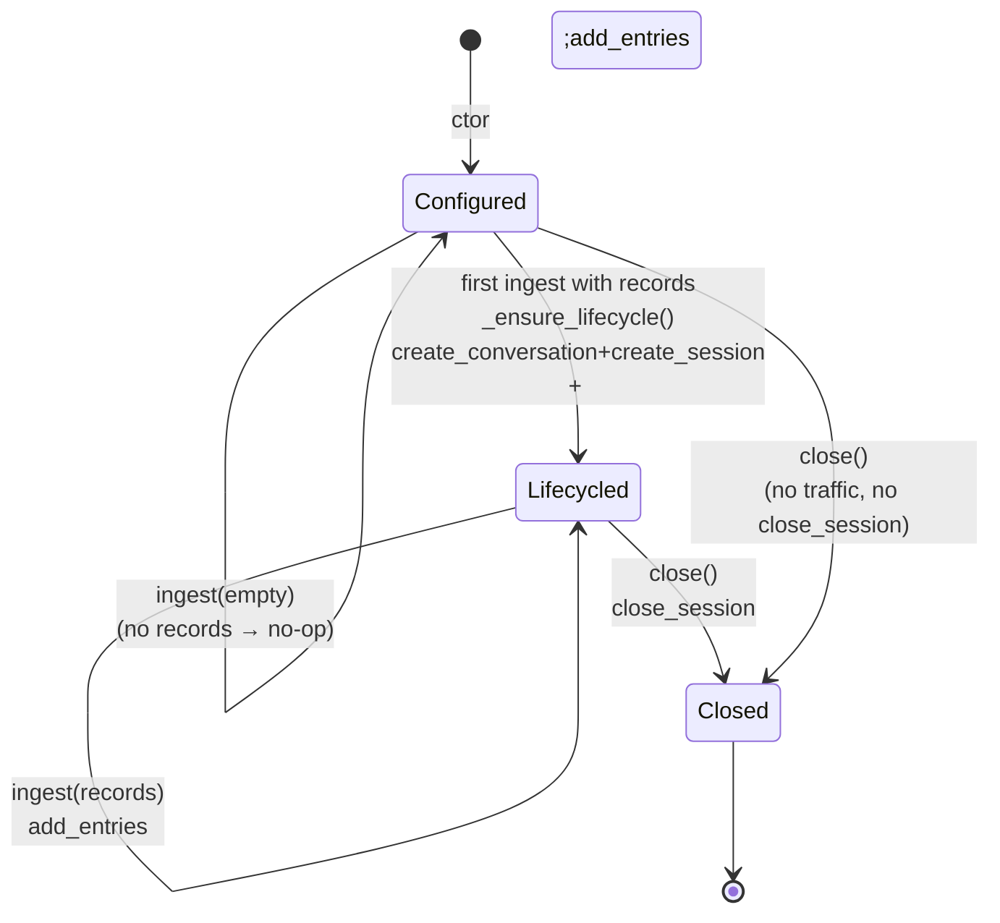
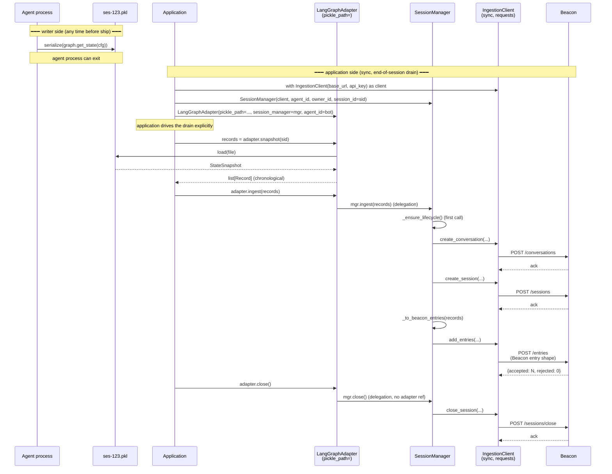

# Low-Level Design — LangGraph Adapter & Core Transport

**Scope.** This document describes the in-process design of the LangGraph adapter (`adapters/langgraph/`) and how it interacts with the framework-agnostic core (`src/agentic_context/`). It is a per-file walkthrough plus the wiring between them. It is not a usage guide — for that, see `docs/DEVELOPER_GUIDE.md`.

**Audience.** Engineers extending the adapter, debugging integration issues, or porting the same pattern to a new framework (Claude SDK, Google ADK).

**Status.** Reflects branch `feature/langgraph-adapter` at the time of writing. Core SDK version `0.1.0`, LangGraph adapter version `0.1.0`.

> **In-flight architectural change.** This LLD has been updated for an upcoming refactor that introduces `session.py` as a session-lifecycle middleware between adapters and the HTTP transport. `ship.py` and `stream.py` are folded into `session.py`. `IngestionClient` grows from a single `post()` method into a four-method Beacon lifecycle (`create_conversation`, `create_session`, `add_entries`, `close_session`). The wire format becomes Beacon's entry shape (`participantId`, `category`, `type`, …) instead of `Record.model_dump`. Source files have not yet been changed; this doc captures the target design for review.

> **Superseded: session close.** This LLD predates the decision that sessions are never explicitly closed. Wherever it says `close()` POSTs `close_session`, the shipped behaviour is local cleanup only (drain pending deliveries, release connections) with no Beacon call, and the lifecycle also includes `add_participants`. See `docs/Design.md` for the current contract.

> **Superseded: streaming ingest.** Wherever this LLD gates `_ToolCaptureHandler` on a tool/error hook being set, ingests `user_message` before the graph runs, or ingests tool records fire-and-forget via `_safe_ingest`, the shipped behaviour differs: the handler is always registered, every record of a turn (including an error `tool_result` when a tool raises) is ingested as one batch — one `/entries` POST per turn — when the turn ends, raises, or is closed early, and `close()` / `end_session()` flush any unfinished turn. See `docs/Design.md` §4.6 and §4.8.

---

## 1. System overview

The SDK has two layers:

1. **Core (`agentic_context`)** — framework-agnostic. Defines the data model, the adapter contract, and HTTP transport. Imports nothing framework-specific.
2. **Adapter (`agentic_context_langgraph`)** — framework-bound. Reads framework state, normalizes it into core records. Never imports the transport.

The split is enforced by import direction: adapters import core; core never imports adapters. New frameworks plug in by adding a new sibling package next to `agentic_context_langgraph`.

```mermaid
flowchart LR
    G["LangGraph state<br/>state.values&#91;'messages'&#93;<br/>━━━━━━━━━━━<br/>BaseMessage objects"]

    subgraph snap["━━━ SYNC path — caller pattern: end-of-session drain ━━━"]
        direction LR
        AS["LangGraphAdapter (sync)<br/>━━━━━━━━━━━<br/>PUBLIC facade:<br/>snapshot(sid) → list&#91;Record&#93;<br/>ingest(records) → delegates<br/>close() → delegates<br/>━━━━━━━━━━━<br/>caller does:<br/>adapter.ingest(adapter.snapshot(sid))<br/>adapter.close()"]
        RS["list&#91;Record&#93;<br/>━━━━━━━━━━━<br/>full session,<br/>chronological"]
        SM["SessionManager (sync)<br/>━━━━━━━━━━━<br/>OWNS Beacon API:<br/>• endpoint paths<br/>• body shapes (_to_beacon_entries)<br/>• lifecycle ordering<br/>• idempotence flags<br/>━━━━━━━━━━━<br/>ingest(records) — POSTs<br/>close() — close_session"]
        IC["IngestionClient (sync)<br/>━━━━━━━━━━━<br/>generic HTTP transport<br/>post(path, body) → IngestionResponse<br/>━━━━━━━━━━━<br/>requests.Session<br/>auth + timeout + error mapping<br/><i>knows nothing about Beacon</i>"]
        AS -->|"snapshot reads<br/>+ caller drains"| RS
        RS -->|"adapter.ingest()<br/>delegates to mgr"| SM
        SM -->|"post(path, body)<br/>×4 calls"| IC
    end

    subgraph stream["━━━ ASYNC path — caller pattern: per-turn streaming ━━━"]
        direction LR
        AT["LangGraphAdapter (async)<br/>━━━━━━━━━━━<br/>PUBLIC facade:<br/>stream(inputs, sid) — async-gen<br/>(internally calls mgr.ingest per turn)<br/>close() → delegates<br/>━━━━━━━━━━━<br/>caller does:<br/>async for r in adapter.stream(...): ...<br/>await adapter.close()"]
        RT["Record<br/>━━━━━━━━━━━<br/>one per turn,<br/>yielded live"]
        ASM["AsyncSessionManager<br/>━━━━━━━━━━━<br/>OWNS Beacon API:<br/>• endpoint paths<br/>• body shapes (_to_beacon_entries)<br/>• lifecycle ordering<br/>• idempotence flags<br/>━━━━━━━━━━━<br/>await ingest(records) — POSTs<br/>await close() — close_session"]
        AC["AsyncIngestionClient<br/>━━━━━━━━━━━<br/>generic HTTP transport<br/>await post(path, body) → IngestionResponse<br/>━━━━━━━━━━━<br/>httpx.AsyncClient<br/>auth + timeout + error mapping<br/><i>knows nothing about Beacon</i>"]
        AT -->|"yield<br/>per turn"| RT
        RT -->|"adapter internally<br/>awaits mgr.ingest"| ASM
        ASM -->|"await post(path, body)<br/>×1–4 calls"| AC
    end

    EP["Beacon<br/>━━━━━━━━━━━<br/>POST /conversations<br/>POST /sessions<br/>POST /entries<br/>POST /sessions/close<br/><sub>(paths TBD — confirm with Beacon API)</sub>"]

    G -.->|"graph.get_state(cfg)"| AS
    G -.->|"astream_events"| AT
    IC ==>|"sync HTTPS"| EP
    AC ==>|"async HTTPS"| EP

    classDef data fill:#fef3c7,stroke:#b45309,color:#000
    classDef syncCode fill:#dbeafe,stroke:#1e40af,color:#000
    classDef asyncCode fill:#dcfce7,stroke:#15803d,color:#000
    classDef mw fill:#ede9fe,stroke:#6d28d9,color:#000
    classDef remote fill:#fee2e2,stroke:#991b1b,color:#000
    class G,RS,RT data
    class AS,IC syncCode
    class AT,AC asyncCode
    class SM,ASM mw
    class EP remote
```



**Reading the diagram.** Strict layer isolation — each layer knows only the next one down:

| Layer | Knows about | Does NOT know about |
|---|---|---|
| **Application** | adapter | manager, client, Beacon |
| **Adapter (blue/green)** | manager + framework | client, Beacon endpoint paths |
| **Manager (purple)** | client + `Record` | framework, adapter |
| **Client (blue/green)** | HTTP | Beacon paths/bodies, manager, framework |

The application only ever calls methods on the **adapter**. The adapter is the public facade. The manager is an implementation detail behind it.

Two caller patterns:

- **Top lane (sync, end-of-session drain).** Application calls `adapter.snapshot(sid)` to read the framework state, hands the resulting `list[Record]` back to `adapter.ingest(records)`, then calls `adapter.close()`. The adapter delegates to `SessionManager.ingest(records)` which lazy-creates the conversation+session and POSTs the entries through the generic `IngestionClient.post(path, body)`. `close()` issues `close_session`. All blocking via `requests`.
- **Bottom lane (async, per-turn streaming).** Application iterates `async for r in adapter.stream(inputs, sid):`. Inside the loop, the adapter generates each `Record` and awaits `mgr.ingest([r])` itself before yielding. Manager lazy-creates on first call, then `add_entries` per turn through `AsyncIngestionClient.post(path, body)`. Application closes the session by awaiting `adapter.close()`. All non-blocking via `httpx`.

Yellow = data in transit. Blue/green = sync vs async transport stacks. **Purple = SessionManager middleware — owns all Beacon API knowledge.** Red = remote sink.

The same `Record` shape flows on both paths and the same `SessionManager._to_beacon_entries(...)` translates it to Beacon's entry shape regardless of which adapter produced it — that is what keeps the middleware framework-agnostic across LangGraph, Claude SDK, and Google ADK.

**Key invariants.**
- The application calls `adapter.snapshot()`, `adapter.ingest()`, `adapter.stream()`, `adapter.close()` — and nothing else from the SDK.
- `LangGraphAdapter.snapshot()` and `LangGraphAdapter.stream()` produce `Record` objects and nothing else. `adapter.ingest()` and `adapter.close()` are thin delegations to the manager.
- The adapter does not POST. It holds a `SessionManager` reference and delegates.
- `SessionManager` does not import any framework. It only consumes `Record` and produces Beacon entries. **It does not call back into the adapter** — the application drains the adapter explicitly via `adapter.ingest(adapter.snapshot(sid))` for the end-of-session pattern.
- `IngestionClient` does not import any Beacon-specific knowledge. It exposes one generic `post(path, body)` method; all paths and body shapes live in the manager. Renaming a Beacon endpoint changes one constant in `session.py`, never the client.
- **No in-memory record buffer anywhere in the SDK.** For end-of-session draining, the adapter re-reads framework state when the application asks. For per-turn streaming, each record is shipped immediately and forgotten.

---

## 2. Core: file-by-file

### 2.1 `src/agentic_context/models.py`

Defines the entire stable data surface.

| Symbol | Type | Purpose |
|---|---|---|
| `Record` | `BaseModel` (Pydantic 2, `extra="forbid"`, `frozen=True`) | Normalized event the adapters emit and the transport ships. |
| `Capabilities` | `BaseModel` (frozen) | Declares which tiers the adapter produces. Currently `working: bool`, `persistent: bool`. |
| `ContextSource` | `Protocol` (`@runtime_checkable`) | The snapshot contract: `agent_id`, `capabilities`, `snapshot(session_id) -> list[Record]`. |

> Note: there is no separate `MemoryStream` Protocol on master. Adapters that stream expose a duck-typed `async def stream(inputs, session_id) -> AsyncIterator[Record]` — same signature across adapters by convention, not contract.

**`Record` defaults on master** (`src/agentic_context/models.py`):

- `interaction_id: str | None = None` — optional with default; the LangGraph adapter still stamps every record per turn.
- `category: str = "Message"` — default; the adapter sets it explicitly per record type (`"Message"` / `"Trace"`).
- `participant_id: str | None = None` — optional with default; adapter sets it per record (`user`/`ai`/`agent_id`).

The defaults exist to tolerate Records produced elsewhere (test fixtures, future external producers). The adapter never relies on them.

**`Record` schema.**

```python
event_id: str          # adapter-stable local id; not sent on the wire
session_id: str        # caller-supplied
agent_id: str          # set on the adapter
event_type: str        # free-form; "message" today
participant_id: str | None    # role: "human" / "ai" / "tool" / "system"
content: str | None    # always coerced to str | None at the boundary
metadata: dict[str, Any]      # JSON-safe, default {}
timestamp: datetime
```

Why `extra="forbid"` and `frozen=True`: unknown fields are validation errors, not silent drops; immutability lets us share records across async boundaries without defensive copies.

Why expose `ContextSource` plus a duck-typed `stream()`: some adapters do snapshot only (e.g. cross-process serialized handoff), some stream only, some do both. `ContextSource` is the only Protocol because all adapters can produce snapshots; streaming adds an async-iterator method without a separate contract type. `LangGraphAdapter` is the both-mode case.

### 2.2 `src/agentic_context/client.py`

Sync HTTP transport. The class name **stays** `IngestionClient` (we are not renaming to `BeaconClient`), but its surface grows from one method (`post`) to four lifecycle methods aligned with Beacon's conversation/session model.

```python
class IngestionClient:
    def __init__(self, base_url: str, api_key: str | None = None, *,
                 timeout: float = 10.0, session: requests.Session | None = None)

    def create_conversation(self, conversation_id: str, owner_id: str, agent_id: str) -> IngestionResponse
    def create_session(self, conversation_id: str, session_id: str,
                       owner_id: str, agent_id: str) -> IngestionResponse
    def add_entries(self, conversation_id: str, session_id: str,
                    entries: list[dict], *, owner_id: str, agent_id: str) -> IngestionResponse
    def close_session(self, conversation_id: str, session_id: str,
                      *, owner_id: str, agent_id: str) -> IngestionResponse

    def __enter__ / __exit__ / close()
```

**Behaviors.**

- All four methods POST to Beacon. Endpoint paths (TBD — confirm with the Beacon API team):
  - `POST {base_url}/conversations`
  - `POST {base_url}/sessions`
  - `POST {base_url}/entries`
  - `POST {base_url}/sessions/close`
- The `entries` argument to `add_entries` is the Beacon wire shape (`participantId`, `category`, `type`, `role`, `variable`, `content`, `timestamp`, `id`) — NOT raw `Record` JSON. The middleware (`SessionManager`) does the `Record → entry` translation; the client only ships what it's given.
- Auth: `Authorization: Bearer <api_key>` if set on every request.
- Errors: any non-2xx on any of the four methods raises `IngestionError(status_code, body)`. No retry, no backoff.
- Connection pooling: uses an injected `requests.Session` if provided, otherwise creates and owns one. `close()` only closes the session if the client owns it.
- Non-2xx detection uses `response.ok` (status < 400).

**No `post()` method.** The single-endpoint `post(records)` API is removed. Callers go through `SessionManager`.

**Response model.** `IngestionResponse` keeps `extra="allow"` and the same fields. Each lifecycle call returns its own response. The fields `accepted`, `rejected`, `errors` are most meaningful on `add_entries`; the create/close calls typically return acks with mostly-empty fields.

### 2.3 `src/agentic_context/client_async.py`

Async sibling of `client.py` over `httpx.AsyncClient`. Same four-method surface, same wire shape, same auth, same response shape — only the I/O backend differs.

```python
class AsyncIngestionClient:
    def __init__(self, base_url: str, api_key: str | None = None, *,
                 timeout: float = 10.0, client: httpx.AsyncClient | None = None)

    async def create_conversation(self, conversation_id: str,
                                  owner_id: str, agent_id: str) -> IngestionResponse
    async def create_session(self, conversation_id: str, session_id: str,
                             owner_id: str, agent_id: str) -> IngestionResponse
    async def add_entries(self, conversation_id: str, session_id: str,
                          entries: list[dict], *, owner_id: str, agent_id: str) -> IngestionResponse
    async def close_session(self, conversation_id: str, session_id: str,
                            *, owner_id: str, agent_id: str) -> IngestionResponse

    async def __aenter__ / __aexit__ / close()
```

**Why a separate class instead of dual-mode.**

- Streaming adapters yield in an async loop; calling sync `requests` from inside an asyncio loop blocks the event loop and can starve other tasks.
- The two clients share endpoint paths, `IngestionError`, and `IngestionResponse` — only the I/O layer differs. No duplicated logic.
- Error detection differs subtly: sync uses `response.ok`, async uses `response.status_code >= 400`. Both reject any 4xx/5xx.

**Constraint.** Callers must use the async client inside an event loop. Pairs with `AsyncSessionManager`, never with sync `SessionManager`.

### 2.4 `src/agentic_context/session.py` (NEW)

Session-lifecycle middleware. Replaces `ship.py` and `stream.py` (both deleted). Two classes — sync (`SessionManager`) and async (`AsyncSessionManager`) — that sit between the adapter and the HTTP client and own the Beacon conversation/session lifecycle.

The sync class is the spiritual successor to the deleted snapshot helper; the async class to the deleted streaming helper. Same naming convention as the rest of the core: when streaming forces async, you get an `Async…` sibling. Both classes expose the same per-record entry point — `ingest(records)` — because the verb is honest in both cases (sync vs async is a property of the class type, not the method name). Master removed the module-level helpers entirely; callers inline the two- or three-line patterns shown in §2.4.7.

#### 2.4.1 What the middleware does

- Owns Beacon's four-step lifecycle: `create_conversation` → `create_session` → `add_entries` (1..N) → `close_session`.
- Lazy-creates the conversation and session on the first POST so callers don't have to think about ordering.
- Translates `Record` → Beacon entry shape via `_to_beacon_entries`. This is the **only** place where the SDK speaks Beacon's wire vocabulary.
- Holds **no in-memory record buffer.** State is minimal: lifecycle flags + ids.
- **Does not call back into the adapter.** The application drives the drain explicitly via `adapter.ingest(adapter.snapshot(sid))` for the end-of-session pattern. The manager only POSTs what it's given.
- The per-record entry point is `ingest(records)` (sync on `SessionManager`, async on `AsyncSessionManager`). Whether to call it once with a full transcript, many times per turn, or zero times then close, is a caller choice — not a manager mode.

#### 2.4.2 Class implementations

Both classes expose `ingest(records)` and `close()`. There is no `delivery_mode` flag — whether records arrive once at end-of-session, per turn, or in any other cadence is a caller pattern, not manager state. The manager just POSTs what it's given.

```python
from __future__ import annotations

from typing import Any

from .client import IngestionClient
from .client_async import AsyncIngestionClient
from .models import Record


class SessionManager:
    """Sync middleware. Pairs with sync IngestionClient.

    Owns Beacon's four-step lifecycle. Does NOT know about adapters or
    frameworks; consumes only ``Record``.
    """

    def __init__(
        self,
        client: IngestionClient,
        *,
        agent_id: str,
        owner_id: str,                                      # required (Beacon multi-tenancy)
        conversation_id: str | None = None,                 # defaults to session_id
        session_id: str | None = None,                      # defaults to first record's session_id
    ) -> None:
        self._client = client
        self._agent_id = agent_id
        self._owner_id = owner_id
        self._conversation_id = conversation_id
        self._session_id = session_id
        # State (minimal — no record buffer)
        self._conversation_created = False
        self._session_created = False
        self._closed = False

    def ingest(self, records: list[Record]) -> None:
        """POST a batch of records.

        Lazy-creates the conversation+session on the first call. Subsequent
        calls only POST add_entries. Whether the caller invokes this once
        with a full transcript or many times per turn is the caller's choice.
        """
        if self._closed:
            raise RuntimeError("Session already closed")
        if not records:
            return

        # Capture ids from the first record if the constructor didn't supply them.
        if self._session_id is None:
            self._session_id = records[0].session_id
        if self._conversation_id is None:
            self._conversation_id = self._session_id

        self._ensure_lifecycle()
        entries = self._to_beacon_entries(records)
        self._client.add_entries(
            self._conversation_id,
            self._session_id,
            entries,
            owner_id=self._owner_id,
            agent_id=self._agent_id,
        )

    def close(self) -> None:
        """Terminate the session in Beacon. Idempotent — re-close is no-op.

        Issues close_session ONLY if the session was actually created
        server-side (via ingest() or explicit create_session()). Manager
        does NOT call back into any adapter; the caller is responsible for
        having ingested whatever records they want before close().
        """
        if self._closed:
            return
        if self._session_created:
            self._client.close_session(
                self._conversation_id,
                self._session_id,
                owner_id=self._owner_id,
                agent_id=self._agent_id,
            )
        self._closed = True

    def create_session(self) -> None:
        """Explicit lifecycle entry. Idempotent.

        Useful when the caller wants the session row to exist server-side
        before any records arrive. Requires session_id to be set (either
        in the constructor or set externally before calling).
        """
        if self._session_id is None:
            raise ValueError("session_id is required before create_session()")
        if self._conversation_id is None:
            self._conversation_id = self._session_id
        self._ensure_lifecycle()

    def close_session(self) -> None:
        """Alias for close(). Kept for symmetry with create_session()."""
        self.close()

    def _ensure_lifecycle(self) -> None:
        """Lazy-create conversation + session on first POST. Idempotent."""
        if not self._conversation_created:
            self._client.create_conversation(
                self._conversation_id,
                self._owner_id,
                self._agent_id,
            )
            self._conversation_created = True
        if not self._session_created:
            self._client.create_session(
                self._conversation_id,
                self._session_id,
                self._owner_id,
                self._agent_id,
            )
            self._session_created = True

    @staticmethod
    def _to_beacon_entries(records: list[Record]) -> list[dict[str, Any]]:
        """Translate Record → Beacon entry shape.

        The only place where SDK vocabulary meets Beacon's wire vocabulary.
        Adapters opt into Beacon's richer schema by populating
        ``Record.metadata`` with optional fields (``category``,
        ``beacon_type``, ``role``, ``variable``).
        """
        entries: list[dict[str, Any]] = []
        # Wire shape verified against the live Beacon API.
        # `role` is NOT a per-entry field — it lives on `participants` in
        # create_session, not on entries.
        for r in records:
            entry: dict[str, Any] = {
                "id": r.event_id,
                "interactionId": r.metadata.get("interaction_id", ""),
                "participantId": r.participant_id or r.agent_id,
                "timestamp": r.timestamp.isoformat(),
                "category": r.metadata.get("category", "Message"),
                "type": r.metadata.get("beacon_type", "user_message"),
            }
            if r.content:
                entry["content"] = r.content
            if r.metadata.get("variable") is not None:
                entry["variable"] = r.metadata["variable"]
            entries.append(entry)
        return entries


class AsyncSessionManager:
    """Async middleware. Pairs with AsyncIngestionClient.

    Same lifecycle, state machine, and entry transformation as
    SessionManager — only the I/O wiring is async.
    """

    def __init__(
        self,
        client: AsyncIngestionClient,
        *,
        agent_id: str,
        owner_id: str,
        conversation_id: str | None = None,
        session_id: str | None = None,
    ) -> None:
        self._client = client
        self._agent_id = agent_id
        self._owner_id = owner_id
        self._conversation_id = conversation_id
        self._session_id = session_id
        self._conversation_created = False
        self._session_created = False
        self._closed = False

    async def ingest(self, records: list[Record]) -> None:
        if self._closed:
            raise RuntimeError("Session already closed")
        if not records:
            return

        if self._session_id is None:
            self._session_id = records[0].session_id
        if self._conversation_id is None:
            self._conversation_id = self._session_id

        await self._ensure_lifecycle()
        entries = self._to_beacon_entries(records)
        await self._client.add_entries(
            self._conversation_id,
            self._session_id,
            entries,
            owner_id=self._owner_id,
            agent_id=self._agent_id,
        )

    async def close(self) -> None:
        if self._closed:
            return
        if self._session_created:
            await self._client.close_session(
                self._conversation_id,
                self._session_id,
                owner_id=self._owner_id,
                agent_id=self._agent_id,
            )
        self._closed = True

    async def create_session(self) -> None:
        if self._session_id is None:
            raise ValueError("session_id is required before create_session()")
        if self._conversation_id is None:
            self._conversation_id = self._session_id
        await self._ensure_lifecycle()

    async def close_session(self) -> None:
        await self.close()

    async def _ensure_lifecycle(self) -> None:
        if not self._conversation_created:
            await self._client.create_conversation(
                self._conversation_id,
                self._owner_id,
                self._agent_id,
            )
            self._conversation_created = True
        if not self._session_created:
            await self._client.create_session(
                self._conversation_id,
                self._session_id,
                self._owner_id,
                self._agent_id,
            )
            self._session_created = True

    @staticmethod
    def _to_beacon_entries(records: list[Record]) -> list[dict[str, Any]]:
        # Identical to SessionManager._to_beacon_entries — pure, no I/O.
        return SessionManager._to_beacon_entries(records)
```

**Naming choice — `ingest` on both classes.** The per-record handoff is named identically on `SessionManager` and `AsyncSessionManager`:
- `SessionManager.ingest(records)` — sync, blocking.
- `AsyncSessionManager.ingest(records)` — async, non-blocking.

The verb is honest in both cases (records are being ingested into the Beacon lifecycle). Sync vs async is a property of the class type, not the method name — the same call site reads `mgr.ingest([record])` or `await mgr.ingest([record])`, and the only difference is whether the manager is the sync or async class.

**Why `ingest` and not `ship` / `stream`.** An earlier draft named the methods `ship` (sync) and `stream` (async) to mirror legacy module helpers. That collided with the adapter's `stream(inputs, session_id) -> AsyncIterator[Record]` async iterator (the streaming surface): `AsyncSessionManager.stream(records) -> None` would have been the manager method. Different signatures, different objects — Python wouldn't confuse them, but readers and IDE autocomplete would. Renaming the manager method to `ingest` removes the collision entirely.

`_to_beacon_entries`, `_ensure_lifecycle`, `create_session`, `close_session`, `close` keep matching names across the two classes. Now the per-record entry point does too.

**Why `delivery_mode` is gone.** The earlier draft had a `delivery_mode: Literal["per_turn", "end_session"]` flag where `end_session` made `ingest()` a no-op and `close(adapter)` would call back into `adapter.snapshot()`. That coupled the manager to the adapter. With the new layering rule (`application → adapter → manager → client`, never the other direction), the manager cannot reach into the adapter. Whether records arrive once at end-of-session or many times per turn is now decided by what the **caller** does — the manager just POSTs whatever `ingest()` is given, with lazy lifecycle on the first POST.

#### 2.4.3 Caller patterns (replaces "delivery modes")

The two patterns are now expressed entirely on the caller side. The manager treats them identically.

| Caller pattern | What the application calls on the adapter | What runs underneath |
|---|---|---|
| **End-of-session drain (sync)** | `adapter.ingest(adapter.snapshot(sid))` then `adapter.close()` | `mgr.ingest(records)` (one batch, full transcript) then `mgr.close()` (close_session) |
| **Per-turn streaming (async)** | `async for r in adapter.stream(inputs, sid): ...` then `await adapter.close()` | adapter internally calls `await mgr.ingest([r])` per turn, then `mgr.close()` |
| **Custom (advanced)** | Mix and match — `adapter.ingest(...)` multiple times, manual `adapter.close()` | Same — manager batches whatever you hand it |

Critical design rule: **no in-memory record buffer.** For end-of-session draining, the framework's own state (LangGraph checkpointer, Claude SDK transcript file, ADK session store) is durable and authoritative. The application reads it via `adapter.snapshot(sid)` and hands the result to `adapter.ingest(records)`. This keeps the SDK stateless and avoids unbounded memory growth on long sessions.

#### 2.4.4 Lifecycle state machine



`Configured` = constructor ran but no Beacon calls yet. `Lifecycled` = conversation+session exist server-side. `Closed` = `close()` ran; further `ingest()` calls raise `RuntimeError`.

#### 2.4.5 Lifecycle — `create_session` and `close_session`

`SessionManager` exposes the Beacon lifecycle as four explicit primitives, in the order Beacon expects:

```
create_conversation  ──┐
                       ├─ _ensure_lifecycle (lazy, fired by first add_entries)
create_session      ──┘

add_entries  (1..N times)

close_session  (terminal)
```

Public API on the manager:

```python
def create_session(self) -> None
def close_session(self) -> None
```

(Both async on `AsyncSessionManager`.)

**Default path: lazy.** Most callers never call these directly — `_ensure_lifecycle()` runs them on the first `add_entries`. The conversation and session ids are set in the constructor or captured from the first record's `session_id`.

**Explicit path: when the caller wants control.**

| Reason to call directly | Example |
|---|---|
| Reserve a session before any records exist | UI shows "agent is thinking…" placeholder; you want the session row to exist server-side before the first turn arrives. |
| Pre-create with metadata that doesn't fit on a record | Session-level config (model name, system prompt hash, user agent). |
| Close without sending any entries | The session aborted; call `create_session()` then `close_session()` to leave a clean Beacon state with zero entries. (Without an explicit `create_session()`, `close()` is a no-op when no traffic happened — there's nothing to close.) |
| Close mid-stream and start a new session | Long-running daemon segments by hour: at the boundary, `close_session()` then construct a new manager. |

**Idempotence rules.**
- `create_session` and `create_conversation` must be safe to call once. The manager flags them with `_conversation_created` / `_session_created` so `_ensure_lifecycle` doesn't double-fire after an explicit call.
- `close_session` is idempotent on the SDK side (`self._closed` guards re-close) — calling `close()` twice is a no-op the second time.
- Server-side idempotence depends on Beacon: if the server rejects duplicate creates with a 409, that surfaces as `IngestionError`. The SDK does not retry or swallow.

**Memory-record lifecycle, end-to-end:**

```
1. Caller constructs SessionManager(client, agent_id, owner_id[, session_id])
        │
        │ (no Beacon traffic yet)
        ▼
2. Caller invokes ingest(records) (sync or async on the class type)
   — directly or through adapter.ingest(...)
        │
        │ first call with non-empty records ──→ _ensure_lifecycle()
        │                                          ├─ client.create_conversation(...)
        │                                          └─ client.create_session(...)
        ▼
3. ingest(records)  (each call after the first is just add_entries)
        │
        │ ──→ _to_beacon_entries(records)
        │ ──→ client.add_entries(conv, sess, entries, owner_id, agent_id)
        ▼
4. close() (caller-driven, exactly once per session — typically via adapter.close())
        │
        │ if _session_created:
        │   ──→ client.close_session(conv, sess, owner_id, agent_id)
        ▼
5. Manager is sealed. Further ingest() calls raise RuntimeError("Session already closed").
```

This is the **memory-record lifecycle** in the previous draft, expressed as a named flow on `SessionManager` rather than as ad-hoc state in adapters.

#### 2.4.6 Beacon entry transformation

`_to_beacon_entries` walks `Record` and emits Beacon's wire shape (verified against the live Beacon API):

```python
{
    "id":            r.event_id,
    "interactionId": r.metadata.get("interaction_id", ""),  # required — groups entries per turn
    "participantId": r.participant_id or r.agent_id,        # falls back to agent_id
    "timestamp":     r.timestamp.isoformat(),
    "category":      r.metadata.get("category", "Message"),
    "type":          r.metadata.get("beacon_type", "user_message"),
    # optional fields, only included if present:
    "content":       r.content,                              # for Message-category entries
    "variable":      r.metadata.get("variable"),             # for Trace-category entries
}
# Note: `role` is NOT a per-entry field — it lives on `participants` in
# create_session, not on the entry payload.
```

This is the only place where "Record shape" meets "Beacon entry shape." Adapters opt into Beacon's richer schema by populating `Record.metadata` — they don't import or know about Beacon's vocabulary. **This is what keeps the middleware framework-agnostic** across LangGraph, Claude SDK, and Google ADK.

#### 2.4.7 Caller patterns — explicit, no module-level helpers

Master's `session.py` exposes **only the two manager classes** — there are no `ship` / `stream_to_client` module-level helpers. The legacy helpers were dropped during the core rewrite; their behavior is so short that callers inline it. Both patterns respect the layer rule: application code calls **adapter methods only**, and the adapter delegates to the manager underneath.

**Snapshot delivery (sync, end-of-session drain):**

```python
records = adapter.snapshot(session_id)
if records:
    adapter.ingest(records)
adapter.close()
```

**Streaming delivery (async, per turn):**

```python
async for _record in adapter.stream(inputs, session_id):
    pass        # adapter ingests internally per turn
await adapter.close()
```

Re-running writes the entries again (`event_id` is not sent, so nothing is deduped). The manager is not visible at the application layer in either pattern.

#### 2.4.8 Why two classes (sync + async)

- Streaming forces async: LangGraph's `astream_events(version="v3")` is an async generator; calling sync `requests` inside that loop blocks. So `AsyncSessionManager` is required for `per_turn` streaming.
- Snapshot/batch callers don't need an event loop: forcing them into `asyncio.run(...)` for a one-shot ship is ceremony with no benefit. So `SessionManager` (sync) stays.
- The two classes share `_to_beacon_entries` semantics and the lifecycle state machine. Only the I/O wiring differs.

This mirrors §2.2 / §2.3's split for the underlying clients.

#### 2.4.9 What `SessionManager` does NOT do

- **Does not buffer records.** Each `ingest()` call POSTs immediately. For end-of-session draining, the application reads the framework state via `adapter.snapshot(sid)` and hands the result to `adapter.ingest(records)` — the manager never reaches back into the adapter.
- **Does not call back into adapters.** The manager has no `ContextSource` reference. Layer rule: **application → adapter → manager → client**, never the other direction.
- **Does not retry.** Caller wraps if needed.
- **Does not auto-close.** `close()` is caller-driven; the manager and adapter never decide on their own when a session is over.
- **Does not generate `session_id` / `conversation_id`.** Caller-supplied; defaults documented above.
- **Does not import any framework or adapter.** Stays in core; consumes only `Record`.
- **Does not own connection lifecycle.** The `IngestionClient` (or `AsyncIngestionClient`) is constructed by the caller and passed in.

### 2.5 `src/agentic_context/__init__.py`

Defines the public surface:

```python
__all__ = [
    "AsyncIngestionClient", "AsyncSessionManager",
    "Capabilities",
    "IngestionClient", "IngestionError", "IngestionResponse",
    "Record", "ContextSource",
    "SessionManager",
]
```

Master removed the legacy `ship` / `stream_to_client` module-level helpers and the `MemoryRecord` alias / `MemoryStream` Protocol. Adapters use the patterns shown in §2.4.7 directly.

Import direction: `__init__.py` imports concrete classes; each module imports only what it needs. `session.py` imports `IngestionClient` and `AsyncIngestionClient` and the `Record` / `ContextSource` symbols from `models.py`. Nothing in core imports adapters.

---

## 3. LangGraph adapter: file-by-file

### 3.1 `adapters/langgraph/src/agentic_context_langgraph/events.py`

Three frozen dataclasses for hook payloads. They are observation-only types — passed to user-supplied hooks, never used as records.

```python
@dataclass(frozen=True)
class TurnEvent:
    session_id: str
    inputs: Any
    turn_started_at: datetime

@dataclass(frozen=True)
class ToolEvent:
    session_id: str
    tool_name: str
    tool_call_id: str | None
    args: dict[str, Any] | None
    output: Any | None
    started_at: datetime
    ended_at: datetime | None         # None on tool start, populated on tool end

@dataclass(frozen=True)
class ErrorEvent:
    session_id: str
    phase: Literal["stream", "tool"]
    exception: BaseException
    occurred_at: datetime
```

Frozen because hooks must not mutate the payload. Plain dataclass (not Pydantic) because there's no transport boundary to validate at — these never leave the process.

### 3.2 `adapters/langgraph/src/agentic_context_langgraph/adapter.py`

The whole adapter lives in one file: `LangGraphAdapter` plus three module-level helpers and one inner callback handler.

#### 3.2.1 Construction

```python
LangGraphAdapter(
    agent_id: str,
    *,
    session_manager: SessionManager | AsyncSessionManager,    # NEW — required
    graph: Any | None = None,
    pickle_path: str | Path | None = None,
    on_session_start: Callable[[str], None] | None = None,
    on_session_end:   Callable[[str], None] | None = None,
    on_turn_start:    Callable[[TurnEvent], None] | None = None,
    on_tool_start:    Callable[[ToolEvent], None] | None = None,
    on_tool_end:      Callable[[ToolEvent], None] | None = None,
    on_error:         Callable[[ErrorEvent], None] | None = None,
)
```

**Adapter is the public facade. Adapter holds a `SessionManager` reference.** Application code calls methods on the adapter; the adapter delegates to the manager. The adapter imports `SessionManager` / `AsyncSessionManager` types from `agentic_context.session` (type-coupled, not implementation-coupled — adapter never reads Beacon paths or wire format). The manager is constructed by the caller and injected; the adapter never owns its lifecycle.

**Public adapter surface (what application code calls):**

```python
# Read framework state into standardized records (no I/O to Beacon yet)
adapter.snapshot(session_id) -> list[Record]

# POST records through the manager (sync). Lazy-creates lifecycle on first call.
adapter.ingest(records: list[Record]) -> None

# Drive the framework, yield records per turn, internally call mgr.ingest each turn.
adapter.stream(inputs, session_id) -> AsyncIterator[Record]      # async only

# Close the Beacon session via the manager. Idempotent.
adapter.close() -> None              # sync, when paired with SessionManager
await adapter.close()                # async, when paired with AsyncSessionManager
```

`adapter.ingest()` and `adapter.close()` are thin delegations: `def ingest(self, records): self._mgr.ingest(records)`, `def close(self): self._mgr.close()`. They exist so application code never touches the manager directly — the layering rule **application → adapter → manager → client** is enforced by the public surface.

**Sync vs async pairing.**
- End-of-session drain (sync): pair `SessionManager` with the adapter; application calls `adapter.ingest(adapter.snapshot(sid))` then `adapter.close()`.
- Per-turn streaming (async): pair `AsyncSessionManager` with the adapter; application iterates `async for r in adapter.stream(...)` and awaits `adapter.close()`.
- Mismatched pairings are caller errors; the adapter does not enforce the pairing, but the type-mismatch surfaces immediately on the first `adapter.ingest(...)` (sync method calling async manager, or vice versa).

**Per-adapter translation boundary.** This adapter is the only place that knows LangGraph's session shape and message types. See §3.2.2 for the full translation table that standardizes LangGraph (and Claude SDK / Google ADK in parallel) into the `Record` schema the middleware consumes.

**XOR enforcement.** Exactly one of `graph` / `pickle_path` must be set. Both → `ValueError`. Neither → `ValueError`. The XOR is checked first thing in `__init__`.

**Why XOR.** A live graph can serve both `snapshot()` (via `graph.get_state(cfg)`) and `stream()` (via `astream_events`). A pickle file can only serve `snapshot()` — there's no graph to drive. Allowing both at once would create ambiguity (which source wins for `snapshot`?).

**`mode` property.** Returns `"stream"` if `graph` was supplied, else `"snapshot"`. Reflects construction, not capability — `graph=` adapters can also serve `snapshot()` from the live graph.

**`capabilities`.** Always `Capabilities(working=True, persistent=False)`. Class-level constant. The adapter never reads from `BaseStore`, only from the messages list, so persistent is always false.

#### 3.2.2 Translation — what the adapter standardizes for the middleware

This is the **most important boundary in the SDK**, because it is what lets `session.py` stay generic across LangGraph, Claude SDK, and Google ADK adapters. Each framework names and shapes the same concepts differently. The adapter's job is to translate every framework-native concept into the standardized shape the middleware expects: a stream of `Record`s carrying a flat `session_id` string.

**The standardized shape (what `SessionManager.ingest()` / `AsyncSessionManager.ingest()` consumes):**

```python
Record(
    event_id:      str,                 # globally unique within (agent_id, session_id)
    session_id:    str,                 # plain string — same value across frameworks
    agent_id:      str,                 # set on the adapter
    event_type:    str,                 # "message" today
    participant_id: str | None,         # standardized roles: "human" / "ai" / "tool" / "system"
    content:       str | None,
    metadata:      dict[str, Any],      # JSON-safe; framework specifics live here
    timestamp:     datetime,
)
```

The middleware never inspects framework objects. It only consumes this shape. So the adapter's translation table determines whether the middleware works correctly.

**Standardization table — all three adapters, side by side:**

| Concept | LangGraph (this adapter) | Claude SDK (planned) | Google ADK (planned) | Standardized → `Record` |
|---|---|---|---|---|
| Conversation identifier passed to framework | `cfg = {"configurable": {"thread_id": session_id}}` | `conversation_id` arg / object attribute | `Session.id` on a `Session` object | Just `session_id: str` — no nesting, no native objects |
| Turn / message object | `BaseMessage` (`AIMessage`, `HumanMessage`, `ToolMessage`, `SystemMessage`) from `langchain_core` | Anthropic `Message` block / streaming event | ADK `Event` / `Content` / `Part` | `Record` |
| Role / participant | `msg.type` ∈ `{"human", "ai", "tool", "system"}` | `message.role` ∈ `{"user", "assistant"}` (+ tool blocks) | `event.author` / `Content.role` ∈ `{"user", "model", "function"}` | `participant_id` ∈ `{"human", "ai", "tool", "system"}` (canonicalized) |
| Content | `msg.content` (string OR list-of-blocks) | `message.content` (string OR list-of-blocks) | `Content.parts[].text` (multi-part) | `content: str` (joined / flattened to string) |
| Tool call | `AIMessage.tool_calls[]` | `tool_use` content block | `FunctionCall` part | metadata fields (`tool_name`, `tool_call_id`, `args`) |
| Tool result | `ToolMessage` | `tool_result` content block | `FunctionResponse` part | `Record` with `participant_id="tool"` |
| Native id | `msg.id` (often present, sometimes not) | `message.id` | `Event.id` / `invocation_id` | `event_id: str` (or generated `f"msg-{sid}-{idx}"` fallback) |
| Native timestamp | `msg.timestamp` if present, else state's `created_at` | `message.created_at` (server-stamped) | `Event.timestamp` | `timestamp: datetime` (UTC) |
| Streaming primitive | `astream_events(version="v3")` async generator | `messages.stream(...)` async iterator | `Runner.run_async(...)` async generator | adapter's own `async def stream(...) -> AsyncIterator[Record]` |
| Snapshot primitive | `graph.get_state(cfg).values["messages"]` | reading the conversation log / transcript | `session_service.get_session(...)` | adapter's `def snapshot(sid) -> list[Record]` |

**The crucial column is the rightmost.** The middleware sees only that column. The first three columns disappear at the adapter boundary.

**How the LangGraph adapter performs the translation in code:**

```python
async def stream(self, inputs, session_id):
    # 1. Translate session_id → LangGraph's native cfg shape (LangGraph-only)
    cfg = {"configurable": {"thread_id": session_id}}

    # 2. Drive the framework with the translated cfg (LangGraph-only)
    stream = await self._graph.astream_events(inputs, cfg, version="v3")

    async for message in stream.messages:
        # 3. Translate framework-native fields → Record (standardized)
        record = Record(
            event_id=str(
                getattr(output_msg, "id", None)
                or getattr(message, "message_id", None)
                or f"msg-{session_id}-{idx}"
            ),
            session_id=session_id,                 # original string, untranslated
            agent_id=self.agent_id,
            event_type="message",
            participant_id="ai",                    # canonicalized role
            content=str(await message.text),        # AsyncProjection → str
            metadata={
                "node": message.node,
                "event": "utterance_complete",
                "usage": _coerce_usage(usage),      # JSON-safe
            },
            timestamp=datetime.now(timezone.utc),
        )

        # 4. Hand the standardized record(s) to the (framework-agnostic) middleware
        await self._mgr.ingest([record])    # async manager: per-turn delivery
        yield record
```

Step 1 is the **session-id translation**: take the standardized `session_id: str` and rewrap it into LangGraph's nested `{"configurable": {"thread_id": ...}}` cfg dict. Only the adapter does this.

Step 3 is the **record translation**: take a framework-native `BaseMessage` and project every field into the standardized `Record` schema. The Claude SDK and ADK adapters perform analogous projections from their respective native message types — the right-hand column is identical across all three.

Step 4 is **post-translation hand-off**: from this point on, no code is framework-specific. `SessionManager` only sees `Record`s and never imports `langgraph`, `anthropic`, or `google.adk`.

**Why this matters for the middleware design.** Because every adapter does this translation up-front, the middleware can:
- Use a single `_to_beacon_entries(records)` regardless of which framework produced the records.
- Use a single `session_id: str` argument throughout `create_session`, `add_entries`, `close_session` — never `thread_id`, never `conversation_id` (the framework-native one), never a `Session` object.
- Stay in `src/agentic_context/` with zero framework imports.

If a framework grew a session concept that didn't fit `session_id: str` (e.g. multi-tenant nested ids), the right move is to extend the adapter's translation, not the middleware's contract. The middleware stays minimal so all three adapters can plug into it.

##### 3.2.2.1 LangGraph translation walkthrough — code-level detail

This expands step 3 of the snippet above with the actual field-by-field mapping for the LangGraph adapter. The same pattern (just different field names) is what the Claude SDK and Google ADK adapters will follow when they're added.

**Session-id translation (one line, repeated in two call sites).**

```python
cfg = {"configurable": {"thread_id": session_id}}
```

That's the entire framework-direction translation. It appears once in `snapshot()` (passed to `graph.get_state(cfg)`) and once in `stream()` (passed to `astream_events(inputs, cfg, version="v3")`). The standardized `session_id: str` flows downstream of the adapter unchanged.

**Record translation — snapshot path (`BaseMessage` → `Record`):**

```python
# inside snapshot(session_id), per message in state.values["messages"]
records.append(Record(
    event_id      = str(getattr(msg, "id", None) or f"msg-{session_id}-{idx}"),
    session_id    = session_id,                                    # untranslated
    agent_id      = self.agent_id,
    event_type    = "message",
    participant_id= getattr(msg, "type", None),                    # already canonical: "human"/"ai"/"tool"/"system"
    content       = str(getattr(msg, "content", "") or ""),
    metadata      = {},
    timestamp     = _resolve_created_at(msg, state),               # see §3.2.6 helper
))
```

LangGraph's `BaseMessage.type` already uses `"human"` / `"ai"` / `"tool"` / `"system"`, which is exactly the standardized vocabulary. **No role-canonicalization step is needed for LangGraph.** Other framework adapters won't be this lucky (Claude SDK uses `"user"` / `"assistant"`; ADK uses `"user"` / `"model"` / `"function"`).

**Record translation — streaming path (v3 aggregated message → `Record`):**

```python
# inside stream(inputs, session_id), per message yielded by stream.messages
text       = await message.text          # AsyncProjection → str
output_msg = await message.output        # AsyncProjection → BaseMessage
usage      = getattr(output_msg, "usage_metadata", None)

record = Record(
    event_id      = str(
        getattr(output_msg, "id", None)
        or getattr(message, "message_id", None)
        or f"msg-{session_id}-{idx}"
    ),
    session_id    = session_id,
    agent_id      = self.agent_id,
    event_type    = "message",
    participant_id= "ai",                                          # streaming yields agent utterances only
    content       = str(text),
    metadata      = {
        "node":  getattr(message, "node", None),
        "event": "utterance_complete",
        **({"usage": _coerce_usage(usage)} if usage is not None else {}),
    },
    timestamp     = datetime.now(timezone.utc),
)
await self._mgr.ingest([record])
yield record
```

Streaming always sets `participant_id="ai"` because v3's `stream.messages` only yields aggregated agent utterances — human inputs were already in the graph state, and tool calls fire through `_ToolCaptureHandler` (separate hook flow, see §3.2.7).

##### 3.2.2.2 Translation contract for the LangGraph adapter

These rules apply to this adapter; future framework adapters will have analogous (not identical) versions.

| # | Rule | Why |
|---|---|---|
| 1 | `participant_id` MUST be one of `{"human", "ai", "tool", "system"}` or `None`. | Standardized vocabulary the manager passes through unchanged. LangGraph's `BaseMessage.type` already matches; pass it through. |
| 2 | `content` MUST be a `str` (or `None` if there's nothing to send). Never a list, never a dict. | The transport boundary is JSON; downstream consumers expect a string. Tool-call payloads ride in `metadata`, not `content`. |
| 3 | `event_id` MUST be deterministic across re-reads of the same session. | Local identity (logs, callbacks, `metadata` correlation). `event_id` is not sent, so it does not prevent duplicates on re-ship, but the same messages must still produce the same ids. The fallback `f"msg-{sid}-{idx}"` satisfies this when `msg.id` is missing. |
| 4 | `session_id` MUST be the caller's string, untranslated. | The manager keys all four lifecycle calls on this string. Putting `thread_id` here would break Beacon's session correlation. |
| 5 | `timestamp` MUST be timezone-aware UTC. | Pydantic accepts naive datetimes but serializes them ambiguously. The helper `_resolve_created_at` fills tz when missing. Streaming uses `datetime.now(timezone.utc)`. |
| 6 | `metadata` MUST be JSON-serializable (no model objects, no datetimes, no bytes). | The manager's `_to_beacon_entries` JSON-encodes via Pydantic's `model_dump(mode="json")` analog; non-serializable values raise. Use `_coerce_usage` for nested provider-specific structures. |
| 7 | If a turn produces multiple records (rare for LangGraph; only the tool-callback path), they MUST be in chronological order in the list passed to `mgr.ingest(...)`. | Order is preserved through transport; downstream consumers depend on it. |
| 8 | The adapter MUST NOT import from `agentic_context.session` other than `SessionManager` / `AsyncSessionManager` types. | Adapter stays type-coupled, not implementation-coupled. The manager's wire format is opaque to the adapter. |
| 9 | The adapter MUST NOT POST directly via the client — only via `mgr.ingest(...)`. | Lifecycle (`create_conversation` / `create_session` / `close_session`) is the manager's responsibility; calling the client directly skips the lazy lifecycle and breaks Beacon's expected ordering. |

##### 3.2.2.3 Common pitfalls (LangGraph-specific)

**Pitfall 1 — passing the cfg dict instead of `session_id`.** The temptation: "I already have `cfg = {'configurable': {'thread_id': sid}}` — let me hand that to the manager too." Don't. The manager takes a flat string. Hand it `session_id`, not `cfg`.

**Pitfall 2 — forgetting to `await` `message.text` / `message.output`.** Both are `AsyncProjection`. `str(message.text)` without `await` returns a `repr` like `<AsyncProjection at 0x…>`. Records ship; content is garbage. Always `await` first, then `str()`.

**Pitfall 3 — concatenating tool-call payloads into `content`.** LangGraph's `AIMessage.content` is sometimes a list of blocks when tool calls are present. The current adapter only handles the streaming-mode "agent utterance" case where `content` is plain text. If you extend snapshot mode to walk `tool_calls[]`, emit a *separate* `Record` per tool call with `event_type="tool_call"` and the call payload in `metadata` — do NOT smash it into `content`.

**Pitfall 4 — using `state.created_at` blindly.** It's the snapshot's creation time, not any individual message's time. Per-message `msg.timestamp` is preferred when available. The `_resolve_created_at` helper falls back to state, then to now. Don't shortcut to `datetime.now()` in snapshot mode — it makes re-shipped sessions look like they all happened at one instant.

**Pitfall 5 — mutating records after handing to the manager.** `Record` is `frozen=True`, so the model itself is fine. But if the adapter holds a reference to the records list it passed and modifies it (`records.append(...)` after `await mgr.ingest(records)`), the list it sent may have been consumed by then or may not — depends on whether the manager copied. **Don't reuse the list.** Build a fresh list per call.

**Pitfall 6 — assuming `BaseMessage.id` is always present.** It is for LangChain-emitted messages; it isn't for caller-injected ones (e.g., `("human", "hi")` shorthand in inputs). The fallback `f"msg-{session_id}-{idx}"` covers this. Do NOT skip the fallback — letting `event_id` be empty or `None` will fail Pydantic validation at `Record(...)` construction.

**Pitfall 7 — using the adapter for both modes simultaneously.** A single adapter instance is constructed for one delivery mode (set on the injected `SessionManager`). If you need both `end_session` snapshot and `per_turn` streaming on the same conversation, that's two managers and two adapters wired to the same `graph`. Don't try to multiplex.

##### 3.2.2.4 Translation factoring inside the adapter

All translation is local to `adapter.py` — private module-level helpers (prefixed with `_`) plus two record-builder methods on the class. Nothing is exported from `__init__.py`.

```
adapters/langgraph/src/agentic_context_langgraph/
├── __init__.py        # exports LangGraphAdapter + Event types only
├── adapter.py         # LangGraphAdapter + _translate_* helpers (private)
└── events.py          # TurnEvent / ToolEvent / ErrorEvent
```

**Why local, not in core, today.** The core-design rule applies: *"name the second user who needs it. If you can't, it's not core."* Right now there's only one adapter. Pre-extracting helpers to `agentic_context/_helpers/` would mean designing them around LangGraph's quirks before seeing what Claude SDK / ADK actually need. Wait until the second adapter lands; extract the byte-identical pieces then.

**Eventual destination per helper:**

| Helper | Stay in adapter forever? | Move to `_helpers/` when 2nd adapter exists? |
|---|---|---|
| `_translate_session_id` (cfg shape) | **Yes** — different per framework | No |
| `_translate_role` (canonicalization map) | **Yes** — each adapter owns its mapping | No |
| `_translate_content` (block flattening) | **Yes** — block shapes are framework-specific | No |
| `_record_from_message` / `_record_from_v3_message` | **Yes** — uses framework-specific attribute access | No |
| `_translate_event_id` (id fallback) | No | **Yes** — byte-identical pattern |
| `_resolve_created_at` (timestamp chain) | No | **Yes** — same pattern, different field names |
| `_coerce_metadata_value` (JSON-safe) | No | **Yes** — every adapter needs this |

**Module-level translation helpers (private, pure functions).**

```python
# adapter.py — private module-level helpers, NOT exported from __init__.py

from datetime import datetime, timezone
from typing import Any
from agentic_context import Record


def _translate_session_id(session_id: str) -> dict[str, Any]:
    """Standardized session_id (str) → LangGraph cfg shape.

    The only piece of LangGraph knowledge about session identity. Used by
    snapshot() (graph.get_state(cfg)) and stream() (astream_events(... cfg ...)).
    """
    return {"configurable": {"thread_id": session_id}}


def _translate_event_id(framework_id: Any, session_id: str, idx: int) -> str:
    """Stable event_id, with deterministic fallback when framework didn't supply one.

    The fallback is deterministic across re-reads of the same session, so local
    identity holds even when an upstream message has no id.
    """
    if framework_id is not None:
        return str(framework_id)
    return f"msg-{session_id}-{idx}"


def _translate_role(framework_role: str | None) -> str | None:
    """LangGraph BaseMessage.type → standardized participant_id.

    LangGraph happens to use the canonical vocabulary already
    ('human' | 'ai' | 'tool' | 'system'), so this is identity. Other framework
    adapters (Claude SDK, ADK) will need real mapping tables here.
    """
    return framework_role


def _translate_content(framework_content: Any) -> str:
    """Framework-native content → flat string.

    BaseMessage.content is usually str. When it's a list-of-blocks (rare in v3
    streaming, possible in snapshot mode for tool-call AIMessages), the caller
    should be emitting one Record per block instead of flattening here —
    so this just str-coerces what arrived.
    """
    return str(framework_content or "")


def _resolve_created_at(msg: Any, snapshot_state: Any) -> datetime:
    """Best-effort timestamp resolution for snapshot mode.

    Order of preference:
      1. msg.timestamp (if datetime)
      2. snapshot_state.created_at (datetime or ISO-8601 string)
      3. datetime.now(UTC)
    Returned value is always timezone-aware UTC (rule 5 in §3.2.2.2).
    """
    msg_ts = getattr(msg, "timestamp", None)
    if isinstance(msg_ts, datetime):
        return msg_ts if msg_ts.tzinfo else msg_ts.replace(tzinfo=timezone.utc)

    snap_ts = getattr(snapshot_state, "created_at", None)
    if isinstance(snap_ts, datetime):
        return snap_ts if snap_ts.tzinfo else snap_ts.replace(tzinfo=timezone.utc)
    if isinstance(snap_ts, str):
        try:
            parsed = datetime.fromisoformat(snap_ts.replace("Z", "+00:00"))
            return parsed if parsed.tzinfo else parsed.replace(tzinfo=timezone.utc)
        except ValueError:
            pass

    return datetime.now(timezone.utc)


def _coerce_metadata_value(value: Any) -> Any:
    """JSON-safe coercion for metadata values.

    Used for LangGraph usage_metadata (provider-specific objects) and any other
    field the adapter wants to stash in Record.metadata. bools / numerics
    / strings pass through; dicts and lists recurse; anything else becomes
    str(value).
    """
    if value is None or isinstance(value, (bool, int, float, str)):
        return value
    if isinstance(value, dict):
        return {str(k): _coerce_metadata_value(v) for k, v in value.items()}
    if isinstance(value, (list, tuple)):
        return [_coerce_metadata_value(v) for v in value]
    return str(value)
```

**Two record-builder methods on the adapter class.**

These compose the helpers into actual `Record`s. One per delivery mode because the field sources differ.

```python
class LangGraphAdapter:
    # ... __init__, capabilities, mode property ...

    def _record_from_message(
        self,
        msg: Any,
        *,
        session_id: str,
        idx: int,
        snapshot_state: Any,
    ) -> Record:
        """Snapshot path: BaseMessage → Record.

        Used by snapshot(session_id) walking state.values['messages'].
        """
        return Record(
            event_id      = _translate_event_id(getattr(msg, "id", None), session_id, idx),
            session_id    = session_id,                              # untranslated
            agent_id      = self.agent_id,
            event_type    = "message",
            participant_id= _translate_role(getattr(msg, "type", None)),
            content       = _translate_content(getattr(msg, "content", "")),
            metadata      = {},
            timestamp     = _resolve_created_at(msg, snapshot_state),
        )

    def _record_from_v3_message(
        self,
        message: Any,
        output_msg: Any,
        text: str,
        *,
        session_id: str,
        idx: int,
    ) -> Record:
        """Streaming path: v3 aggregated message → Record.

        Used inside the `async for message in stream.messages` loop. Caller is
        responsible for having awaited message.text and message.output before
        invoking this.
        """
        framework_id = (
            getattr(output_msg, "id", None)
            or getattr(message, "message_id", None)
        )

        metadata: dict[str, Any] = {
            "node":  getattr(message, "node", None),
            "event": "utterance_complete",
        }
        usage = getattr(output_msg, "usage_metadata", None)
        if usage is not None:
            metadata["usage"] = _coerce_metadata_value(usage)

        return Record(
            event_id      = _translate_event_id(framework_id, session_id, idx),
            session_id    = session_id,
            agent_id      = self.agent_id,
            event_type    = "message",
            participant_id= "ai",                          # v3 streaming yields agent utterances
            content       = _translate_content(text),
            metadata      = metadata,
            timestamp     = datetime.now(timezone.utc),
        )
```

**`snapshot()` and `stream()` after factoring.**

The two public methods become much shorter and easier to skim. The translation work is fully delegated.

```python
def snapshot(self, session_id: str) -> list[Record]:
    if self._graph is not None:
        cfg = _translate_session_id(session_id)
        state = self._graph.get_state(cfg)
    else:
        assert self._pickle_path is not None
        with self._pickle_path.open("rb") as f:
            state = pickle.load(f)

    messages = (state.values or {}).get("messages", []) or []
    return [
        self._record_from_message(
            msg,
            session_id=session_id,
            idx=idx,
            snapshot_state=state,
        )
        for idx, msg in enumerate(messages)
    ]


async def stream(self, inputs: Any, session_id: str) -> AsyncIterator[Record]:
    if self._graph is None:
        raise ValueError("stream() requires graph= construction")

    _safe_call(self._on_session_start, session_id)
    _safe_call(
        self._on_turn_start,
        TurnEvent(session_id=session_id, inputs=inputs,
                  turn_started_at=datetime.now(timezone.utc)),
    )

    cfg = _translate_session_id(session_id)
    if self._on_tool_start or self._on_tool_end or self._on_error:
        cfg["callbacks"] = [_ToolCaptureHandler(self, session_id)]

    try:
        stream = await self._graph.astream_events(inputs, cfg, version="v3")
        idx = 0
        async for message in stream.messages:
            text       = await message.text
            output_msg = await message.output

            record = self._record_from_v3_message(
                message, output_msg, str(text),
                session_id=session_id, idx=idx,
            )

            await self._mgr.ingest([record])      # async manager hand-off
            yield record
            idx += 1

    except Exception as exc:
        _safe_call(
            self._on_error,
            ErrorEvent(session_id=session_id, phase="stream",
                       exception=exc, occurred_at=datetime.now(timezone.utc)),
        )
        raise
```

**Design rationale.**

| Decision | Why |
|---|---|
| Module-level helpers (pure functions) instead of methods | Pure functions are unit-testable in isolation. No `self` to mock — `assert _translate_event_id(None, "s", 0) == "msg-s-0"` is a one-line test. |
| Two record-builder methods (snapshot vs v3 streaming) | The field sources differ (`msg.id` vs `output_msg.id`, snapshot timestamp chain vs `now()`, etc.). One method with a flag arg is harder to read than two specialized methods. |
| `_translate_session_id` is named even though it's one line | Naming makes "this is the framework-coupling point" findable by grep. When LangGraph changes the cfg shape upstream, you change one function. |
| `_translate_role` is identity for LangGraph | (a) Documents that role canonicalization is a translation step. (b) Provides a hook if `BaseMessage.type` ever extends. (c) Keeps the structure parallel to what other adapters will need. |
| Helpers don't import `agentic_context.session` | Translation produces `Record` only. The `await mgr.ingest(...)` hand-off lives in `stream()`, not in any translation function. Clean separation. |

**What this design is NOT.**

- Not a generic `translate(framework_obj) -> Record` dispatch. The two record-builders are specialized — pretending otherwise would require a Union type or `isinstance` ladder. Two clear methods are simpler than one clever one.
- Not a translation registry. Adding a new `event_type` (e.g. `"tool_call"`) means writing a third record-builder method — not registering a class. Methods are small, callers are local, code review stays easy.
- Not async. All translation is sync. The only async parts (`await message.text` / `await message.output`) happen *before* translation; by the time `_record_from_v3_message` is called, you already have plain strings.

#### 3.2.3 `snapshot(session_id)` — the `ContextSource` impl

```mermaid
flowchart TD
    Start(["snapshot(session_id)<br/>━━━ sync ━━━"])
    HasGraph{graph is not None?}
    GetState["state = graph.get_state(cfg)<br/>cfg = configurable.thread_id = sid"]
    LoadPickle["state = pickle.load(file)<br/>(SECURITY: trust caller-written file)"]
    Walk["for idx, msg in state.values&#91;'messages'&#93;"]
    Build["Record<br/>━━━━━━━━━━━<br/>event_id = msg.id or msg-{sid}-{idx}<br/>participant_id = msg.type<br/>content = str(msg.content)<br/>timestamp = _resolve_created_at"]
    Return(["list&#91;Record&#93;<br/>chronological"])

    Start --> HasGraph
    HasGraph -->|"graph= mode"| GetState
    HasGraph -->|"pickle_path= mode"| LoadPickle
    GetState --> Walk
    LoadPickle --> Walk
    Walk --> Build
    Build --> Walk
    Build --> Return

    classDef syncCode fill:#dbeafe,stroke:#1e40af,color:#000
    classDef syncData fill:#fef3c7,stroke:#b45309,color:#000
    class Start,HasGraph,GetState,LoadPickle,Walk,Build syncCode
    class Return syncData
```



The whole call is synchronous — `snapshot()` is a regular `def`, `graph.get_state` is sync, `pickle.load` is sync. This pairs with the sync `SessionManager` for the end-of-session drain pattern: the application calls `adapter.snapshot(sid)`, hands the result to `adapter.ingest(records)` (which delegates to `mgr.ingest`), then calls `adapter.close()` (which delegates to `mgr.close()`). Manager and adapter never exchange `ContextSource` references.

**Read path.**
- `graph=` mode: `cfg = {"configurable": {"thread_id": session_id}}`, `state = self._graph.get_state(cfg)`.
- `pickle_path=` mode: `state = pickle.load(open(self._pickle_path, "rb"))`.

> **Security note.** `pickle.load` executes arbitrary code if the file is hostile. The adapter trusts the caller to have written the file themselves. The constraint is enforced by convention, not code.

**Walk.** `messages = state.values.get("messages", []) or []`. The adapter relies on LangGraph's `add_messages` reducer guaranteeing chain order (append-only); chronological order falls out for free.

**Full implementation (today's behavior — §11 plans the tool/reasoning extension).**

```python
def snapshot(self, session_id: str) -> list[Record]:
    if self._graph is not None:
        cfg = _translate_session_id(session_id)
        state = self._graph.get_state(cfg)
    else:
        assert self._pickle_path is not None
        with self._pickle_path.open("rb") as f:
            state = pickle.load(f)

    messages = (state.values or {}).get("messages", []) or []
    interaction_id = f"turn-{session_id}-snapshot"

    return [
        self._record_from_message(
            msg,
            session_id=session_id,
            idx=idx,
            snapshot_state=state,
            interaction_id=interaction_id,
        )
        for idx, msg in enumerate(messages)
    ]
```

**Per-message normalization** uses `_record_from_message`, which delegates to the translation helpers in §3.2.2.4. Each message becomes one `Record` with first-class fields per §2.2:

- `event_type` is set per the §3.2.2.1 mapping table (`HumanMessage` → `"user_message"`, plain `AIMessage` → `"agent_response"`, etc.). Today the snapshot loop emits one record per `BaseMessage`; §11.5 plans the AIMessage decomposition.
- `participant_id` mirrors `msg.type` (`"human"` / `"ai"` / `"tool"` / `"system"`).
- `category` is `"Message"` for user/agent text, `"Trace"` for tool-related entries (after §11).
- `interaction_id` is the per-snapshot id stamped on every record so Beacon groups them.

Fallback `event_id` is deterministic across re-reads (`f"msg-{session_id}-{idx}"`), so local identity holds even when the upstream message has no id.

> **Today vs planned.** §11.5 (Piece 3) replaces the simple per-message loop above with branching on `AIMessage` / `ToolMessage` so snapshot mode emits the full five-record sequence (user_message, agent_reasoning, tool_call, tool_result, agent_response). Same flowchart, more code in the loop body.

#### 3.2.4 `stream(inputs, session_id)` — the streaming surface

Async generator. Available only when constructed with `graph=`; on `pickle_path=` it raises `ValueError("stream() requires graph=...")`.

> **Today vs planned.** Today's `stream()` uses v3's high-level `stream.messages` iterator (one agent utterance per turn) and emits two records per turn: a `user_message` from `inputs` + an `agent_response` from the framework. §11 plans the full extension — switch to lower-level `async for event in stream` to capture reasoning, and have `_ToolCaptureHandler` ingest tool records — for the full five-record-per-turn shape.

**Sequence.**

```mermaid
sequenceDiagram
    participant User
    participant Adapter as LangGraphAdapter<br/>(async generator)
    participant Hooks as Hooks
    participant Graph as graph.astream_events&#40;v3&#41;
    participant Handler as _ToolCaptureHandler
    participant Mgr as AsyncSessionManager<br/>(per_turn)
    participant Client as AsyncIngestionClient

    Note over User,Client: ━━━ async path ━━━
    User->>Adapter: async for r in stream(inputs, sid)
    Adapter->>Hooks: on_session_start(sid)
    Adapter->>Hooks: on_turn_start(TurnEvent)
    Note over Adapter: cfg = {configurable.thread_id: sid}
    alt any tool/error hook set
        Adapter->>Adapter: cfg.callbacks = [_ToolCaptureHandler]
    end
    Adapter->>Graph: await astream_events(inputs, cfg, version=v3)
    loop async for message in stream.messages
        Note over Graph,Handler: tool runs may interleave (callback-driven)
        Graph->>Handler: on_tool_start(name, input, run_id)
        Handler->>Hooks: on_tool_start(ToolEvent)
        Graph->>Handler: on_tool_end(output, run_id)
        Handler->>Hooks: on_tool_end(ToolEvent)
        Graph-->>Adapter: aggregated message (one per turn)
        Adapter->>Adapter: text = await message.text
        Adapter->>Adapter: output_msg = await message.output
        Adapter->>Adapter: build Record(participant_id=ai, ...)
        Adapter->>Mgr: await mgr.ingest([record])
        alt first ingest call
            Mgr->>Client: await create_conversation(...)
            Client-->>Mgr: ack
            Mgr->>Client: await create_session(...)
            Client-->>Mgr: ack
        end
        Mgr->>Mgr: _to_beacon_entries([record])
        Mgr->>Client: await add_entries(conv, sess, entries, owner_id, agent_id)
        Client-->>Mgr: IngestionResponse
        Adapter-->>User: yield record (caller can observe)
    end
    User->>Mgr: await close()
    Mgr->>Client: await close_session(...)
    Client-->>Mgr: ack
    alt graph raises
        Graph-->>Adapter: exception
        Adapter->>Hooks: on_error(ErrorEvent phase=stream)
        Adapter-->>User: re-raise
    end
```



Async throughout — `adapter.stream()` is `async def`, `astream_events` is awaited, `message.text` / `message.output` are `AsyncProjection` and must be awaited, `mgr.ingest()` / `mgr.close()` are awaited. The adapter still yields each `Record` to the caller (so `async for` in user code stays observable for logging/UI), but the actual POST happens through the manager before the yield. The first `mgr.ingest()` call triggers `_ensure_lifecycle` (create_conversation + create_session); subsequent calls only `add_entries`. The user closes the session by awaiting `mgr.close()`.

**v3 specifics.**
- `astream_events(version="v3")` returns a stream object whose `.messages` is an async iterator over **aggregated agent utterances** — one item per turn, fully assembled text. (v2 yields one event per low-level lifecycle moment, which would be many records per turn.)
- `message.text` and `message.output` are `AsyncProjection` instances, not plain values. They MUST be awaited. `str(message.text)` without `await` returns a repr.
- v3 is marked `LangChainBetaWarning` upstream. The adapter's `pyproject.toml` filters that warning so `filterwarnings = ["error"]` in tests stays clean.

**Full implementation (today's behavior).**

```python
async def stream(self, inputs: Any, session_id: str) -> AsyncIterator[Record]:
    if self._graph is None:
        raise ValueError("stream() requires graph= construction")

    # Per-turn interaction_id (Piece 4 in §11.4)
    self._current_interaction_id = f"turn-{session_id}-{self._turn_idx}"
    self._turn_idx += 1

    # Start-of-turn observation hooks
    _safe_call(self._on_session_start, session_id)
    _safe_call(self._on_turn_start, TurnEvent(
        session_id=session_id, inputs=inputs,
        turn_started_at=datetime.now(timezone.utc),
    ))

    # 1. Extract user_message from inputs and ingest FIRST.
    #    See "Where does user_message come from?" below.
    user_record = self._record_from_user_input(
        inputs, session_id=session_id, idx=0,
        interaction_id=self._current_interaction_id,
    )
    if user_record is not None:
        await self._mgr.ingest([user_record])
        yield user_record

    # 2. Translate session_id → LangGraph cfg
    cfg = _translate_session_id(session_id)
    if self._on_tool_start or self._on_tool_end or self._on_error:
        cfg["callbacks"] = [_ToolCaptureHandler(self, session_id)]

    # 3. Drive astream_events; each loop iteration = one agent turn
    try:
        stream = await self._graph.astream_events(inputs, cfg, version="v3")
        idx = 1                          # 0 was the user_message
        async for message in stream.messages:
            text       = await message.text
            output_msg = await message.output

            record = self._record_from_v3_message(
                message, output_msg, str(text),
                session_id=session_id, idx=idx,
                interaction_id=self._current_interaction_id,
            )
            await self._mgr.ingest([record])
            yield record
            idx += 1

    except Exception as exc:
        _safe_call(self._on_error, ErrorEvent(
            session_id=session_id, phase="stream",
            exception=exc, occurred_at=datetime.now(timezone.utc),
        ))
        raise
```

**Where does `user_message` come from in streaming mode?** v3's `stream.messages` only yields **agent utterances** — the user's input goes in via `inputs` (the function argument) and the framework doesn't echo it back. The adapter has to extract it itself. Convention: LangGraph applications pass user input via `inputs={"messages": [("human", "...")]}` or `inputs={"messages": [HumanMessage(content="...")]}`. The adapter's `_record_from_user_input` helper looks at `inputs["messages"][-1]`, recognizes the human-role tuple or `HumanMessage` instance, and builds a `user_message` record. If `inputs` doesn't carry a recognizable user message (e.g., a scheduler kicked off the graph internally), the helper returns `None` and no `user_message` is emitted. This means each stream() call produces **exactly two records per turn** (user_message + agent_response) — both share the same `interaction_id`, so Beacon groups them. After §11 lands this becomes up to five.

**Per-record fields (agent_response from `stream.messages`).**

```python
Record(
    event_id       = str(
        getattr(output_msg, "id", None)
        or getattr(message, "message_id", None)
        or f"msg-{session_id}-{idx}"          # deterministic fallback
    ),
    session_id     = session_id,
    agent_id       = self.agent_id,
    event_type     = "agent_response",
    participant_id = "ai",
    content        = str(text),                # awaited
    category       = "Message",
    interaction_id = self._current_interaction_id,
    variable       = None,
    metadata       = {
        "node":  getattr(message, "node", None),
        "event": "utterance_complete",
        **({"usage": _coerce_metadata_value(usage_metadata)} if usage_metadata is not None else {}),
    },
    timestamp      = datetime.now(timezone.utc),
)
```

**How v3 streaming actually handles a turn — protocol mechanics.**

A "turn" in v3 means one round-trip from human input to fully-aggregated agent reply, possibly with intermediate tool calls. The v3 protocol exposes two views of it:

*View A — `stream.messages` (high-level, today's path):*

```
Application: graph.astream_events(inputs, cfg, version="v3")  ← one call per turn
   │
   ▼
Stream object exposes .messages — an async iterator
   │
   ▼
async for message in stream.messages:
    # YIELDS EXACTLY ONCE per agent utterance.
    # If the agent calls a tool then replies, you get ONE message
    # at the end with the final reply (the tool roundtrip is hidden).
    # If the agent calls multiple tools then replies, you STILL get
    # one message at the end. v3 aggregates intermediate output.
```

So the loop body runs once per turn for typical ReAct agents. Multiple tool calls in one turn? Still one loop iteration. The aggregation is what makes v3 nicer than v2 — but it's also what hides reasoning and tool events from this iterator.

*View B — `async for event in stream` (low-level, used by §11.7):*

Every framework lifecycle moment surfaces as a typed event:

```python
async for event in stream:
    etype = event["event"]
    # Examples of etype:
    #   on_chat_model_start    — LLM call begins
    #   on_chat_model_stream   — token chunk (many per LLM call)
    #   on_chat_model_end      — LLM call finishes (carries final output)
    #   on_tool_start          — tool runnable begins
    #   on_tool_end            — tool finishes successfully
    #   on_tool_error          — tool raised
    #   on_chain_start / end   — node lifecycle
    # ... and ~20 more types
```

For one turn with one tool call, the lower-level event sequence is roughly:

```
on_chat_model_start  →  on_chat_model_stream...  →  on_chat_model_end  (intermediate, contains tool_call)
on_tool_start  →  on_tool_end                                              (the tool runs)
on_chat_model_start  →  on_chat_model_stream...  →  on_chat_model_end  (final reply)
```

*Which view §3.2.4 (today) uses:* View A. Simple but only sees the final agent message per turn.
*Which view §11.7 (planned) uses:* View B. Sees every intermediate event, classifies `on_chat_model_end` outputs as reasoning vs reply, captures everything Beacon needs.

Tool events ARE captured today even on View A, but through a side channel: LangChain's callback system (`BaseCallbackHandler`). The adapter registers `_ToolCaptureHandler` on `cfg["callbacks"]`, and tool callbacks fire in parallel with the message iterator. They populate user observation hooks but don't ingest records — that's what §11.6 (Piece 1) changes.

**Error handling.** A single `try/except Exception` wraps the whole `astream_events` loop. On exception, fire `on_error(phase="stream", exception=exc)` and re-raise. The adapter does not swallow stream-level errors — it only swallows hook errors (see §3.2.6).

#### 3.2.5 `close()` — terminates Beacon session AND fires `on_session_end`

`adapter.close()` is the only end-of-session method. It does two things in order:

1. Delegates to `mgr.close()`, which POSTs `close_session` to Beacon (idempotent — guarded by `_closed`).
2. Fires the optional `on_session_end` user hook for observability (no-op if no hook registered).

```python
def close(self) -> None:
    self._mgr.close()
    _safe_call(self._on_session_end, self._last_session_id)
```

An earlier draft exposed `session_ended(sid)` as a separate method that fired the hook in-process without touching Beacon. That created a confusing surface where `close()` and `session_ended()` looked like peers but did different things. In practice the application has one end-of-session moment per session, so the two operations always pair. Folding the hook fire into `close()` collapses the public surface to one obvious endpoint.

#### 3.2.6 Helpers

**`_safe_call(hook, *args)`.** Calls a hook if non-None. Catches any exception and logs via `logger.exception(...)`. The stream loop never aborts because of a bad user hook.

**`_coerce_usage(usage)`.** Flattens `usage_metadata` to JSON-safe primitives. Recursive — nested dicts pass through recursively; everything else becomes `bool` / `int` / `float` / `str`. Why: `Record.metadata` is JSON-serialized at the transport boundary, and LangChain's `usage_metadata` may contain provider-specific objects.

**`_resolve_created_at(msg, snapshot_state)`.** Best-effort timestamp resolution for snapshot mode. Order: `msg.timestamp` (datetime) → `state.created_at` (datetime or ISO-8601 string) → `datetime.now(UTC)`. Streaming mode does not use this; it stamps `now()` directly.

#### 3.2.7 `_ToolCaptureHandler(BaseCallbackHandler)`

Bridges LangChain's callback system into adapter hooks. Registered on `cfg["callbacks"]` only when at least one of `on_tool_start` / `on_tool_end` / `on_error` is set — no callback overhead for adapters that don't need tool events.

**State.** `self._starts: dict[UUID, tuple[str, dict[str, Any] | None, datetime]]`. Maps each tool's `run_id` from `on_tool_start` to its (name, args, started_at). On `on_tool_end` / `on_tool_error`, the entry is popped and the matched start info is included in the resulting `ToolEvent` so callers see consistent name/args across the start/end pair.

**Three callbacks.**

| LangChain callback | Adapter hook fired | Notes |
|---|---|---|
| `on_tool_start(serialized, input_str, *, run_id, inputs, ...)` | `on_tool_start(ToolEvent)` | `args` prefers structured `inputs`; falls back to `{"input": input_str}`. |
| `on_tool_end(output, *, run_id, ...)` | `on_tool_end(ToolEvent)` | Looks up `_starts[run_id]` for matched name/args. |
| `on_tool_error(error, *, run_id, ...)` | `on_error(ErrorEvent, phase="tool")` | Pops the start entry; no end event fires. |

**Why a back-reference to the adapter.** The handler is constructed inside `stream()` and needs to fan events through `_safe_call(self._adapter._on_tool_start, ...)`. It accesses adapter-private callbacks, but that's fine — the handler is an inner type, not part of the public surface.

### 3.3 `adapters/langgraph/src/agentic_context_langgraph/__init__.py`

Public surface:

```python
__all__ = ["ErrorEvent", "LangGraphAdapter", "ToolEvent", "TurnEvent"]
__version__ = "0.1.0"
```

The adapter package depends on `agentic_context` (core) and `langchain_core` / `langgraph`. The minimum is `langgraph>=0.2.0`.

---

## 4. End-to-end flows

### 4.1 Snapshot — serialized state (cross-process)



Two processes, four synchronous POSTs (lifecycle in order). The application drives the drain — `adapter.snapshot()` returns records, `adapter.ingest(records)` POSTs them, `adapter.close()` does local cleanup only (see the superseded note at the top). The manager never reaches back into the adapter. `event_id` is not sent (Beacon assigns entry ids), so re-shipping the same file writes duplicate entries.

### 4.2 Snapshot — live graph (in-process)

Same shape as 4.1, except `adapter.snapshot(sid)` calls `graph.get_state(cfg)` directly instead of loading serialized state from disk. No file I/O, no security caveat. Same caller pattern (`adapter.snapshot` → `adapter.ingest` → `adapter.close`), same four POSTs.

### 4.3 Streaming — per turn

```mermaid
sequenceDiagram
    participant App as Application<br/>(async)
    participant Adapter as LangGraphAdapter<br/>(graph=)
    participant Mgr as AsyncSessionManager
    participant Client as AsyncIngestionClient<br/>(async, httpx)
    participant Graph as graph.astream_events&#40;v3&#41;
    participant Server as Beacon

    Note over App,Server: ━━━ async path, in-process, per-turn streaming ━━━
    App->>Client: async with AsyncIngestionClient(...) as client
    App->>Mgr: AsyncSessionManager(client, agent_id, owner_id)
    App->>Adapter: LangGraphAdapter(graph=g, session_manager=mgr, agent_id=bot)
    App->>Adapter: async for r in adapter.stream(inputs, sid)
    Adapter->>Graph: await astream_events(inputs, cfg, version=v3)
    loop one iteration per turn
        Graph-->>Adapter: aggregated message
        Adapter->>Adapter: await message.text / message.output
        Adapter->>Adapter: build Record (participant_id=ai)
        Adapter->>Mgr: await mgr.ingest([record]) (delegation)
        alt first ingest call
            Mgr->>Client: await create_conversation(...)
            Client->>Server: POST /conversations
            Server-->>Client: ack
            Mgr->>Client: await create_session(...)
            Client->>Server: POST /sessions
            Server-->>Client: ack
        end
        Mgr->>Mgr: _to_beacon_entries([record])
        Mgr->>Client: await add_entries(...)
        Client->>Server: POST /entries
        Server-->>Client: {accepted: 1, rejected: 0}
        Adapter-->>App: yield record (observable)
    end
    App->>Adapter: await adapter.close()
    Adapter->>Mgr: await mgr.close() (delegation)
    Mgr->>Client: await close_session(...)
    Client->>Server: POST /sessions/close
    Server-->>Client: ack
```



Per turn: one `add_entries` POST. First turn additionally pays for two lifecycle creates. Session end pays for one `close_session`. All async — the event loop is free between awaits. The graph's lifecycle is owned by the user; if the user kills the loop the graph aborts and the adapter does not own teardown. The application only ever calls methods on the adapter; the adapter delegates to the manager underneath.

---

## 5. Cross-cutting concerns

### 5.1 Identity

- `event_id` is a local id, not sent on the wire, so nothing is deduped on it; Beacon assigns entry ids. The adapter generates stable ids: prefer the upstream message id, fall back to `f"msg-{session_id}-{idx}"` which is deterministic across re-reads of the same snapshot.
- `session_id` is the caller's identifier, passed straight through. The SDK does not translate `thread_id` ↔ `session_id`; the caller picks one.
- `agent_id` is set on the adapter at construction time. Same agent across many sessions = same `agent_id`. There is no per-call override.

### 5.2 Time

- Snapshot mode tries to recover the original timestamp (message → state → now).
- Streaming mode stamps `datetime.now(timezone.utc)` at yield time. There is no "original event time" available from `astream_events` reliably enough to use.

### 5.3 Errors

| Layer | Behavior |
|---|---|
| Hook raised | `_safe_call` swallows + logs. Stream continues. |
| Tool raised | `_ToolCaptureHandler.on_tool_error` fires `on_error(phase="tool")`. Tool error propagates through LangChain's normal mechanism. |
| Stream loop raised | `try/except Exception` fires `on_error(phase="stream")` then re-raises. |
| HTTP non-2xx | `IngestionError(status_code, body)` raises. No retry inside the SDK. |
| Validation error | Pydantic `ValidationError` raises at record construction or response parsing. |

### 5.4 Async vs sync stacks

Two parallel stacks; each pair is meant to be used together.

| Stack | Client | Manager | Use case |
|---|---|---|---|
| Sync | `IngestionClient` (requests) | `SessionManager` | Snapshot / batch / cross-process serialized state. Caller has no event loop. |
| Async | `AsyncIngestionClient` (httpx) | `AsyncSessionManager` | Per-turn streaming. Caller is already in an event loop. |

The two clients share endpoint paths, `IngestionError`, `IngestionResponse`. The two managers share lifecycle semantics, state machine, and `_to_beacon_entries`. Only the I/O wiring differs.

Mixing across stacks (sync manager + async client, or vice versa) is a caller error. The SDK does not enforce the pairing, but the type-mismatch surfaces immediately when the manager tries to call (or `await`) a method that doesn't match.

### 5.5 What the adapter never does

- Never POSTs directly. It holds a `SessionManager` reference and routes records through it.
- Never retries (caller's concern; wrap the manager or the client).
- Never buffers records (each record is either shipped immediately in `per_turn`, or re-read from framework state on `close()` in `end_session`).
- Never tracks cursors (re-runs write duplicate entries; `event_id` is not sent, so nothing is deduped).
- Never reads `BaseStore` (long-term memory is out of scope; would need a separate adapter).
- Never owns the manager's lifecycle. The caller constructs and (where applicable) closes the manager.

---

## 6. Extension points

### 6.1 Adding a new framework adapter

The pattern is the same — produce `Record`s, satisfy the protocols, expose `ingest()` and `close()` as thin delegations to the injected `SessionManager`, never import the HTTP client directly. A minimal stub:

```python
from agentic_context import (
    AsyncSessionManager,
    Capabilities,
    Record,
    SessionManager,
)

class MyFrameworkAdapter:
    capabilities = Capabilities(working=True, persistent=False)

    def __init__(
        self,
        agent_id: str,
        *,
        session_manager: SessionManager | AsyncSessionManager,
        handle: Any,
    ) -> None:
        self.agent_id = agent_id
        self._mgr = session_manager
        self._handle = handle

    def snapshot(self, session_id: str) -> list[Record]:
        ...   # read framework state, normalize, return chronological list

    def ingest(self, records: list[Record]) -> None:
        # Thin sync delegation. Raise if paired with an async manager.
        self._mgr.ingest(records)

    async def stream(self, inputs: Any, session_id: str) -> AsyncIterator[Record]:
        async for record in self._produce(inputs, session_id):
            await self._mgr.ingest([record])    # per-turn delivery
            yield record                        # application can observe

    def close(self) -> None:
        # Sync delegation; or `async def close` paired with AsyncSessionManager.
        self._mgr.close()
```

**Two caller patterns the adapter supports:**

```python
# End-of-session drain (sync)
adapter.ingest(adapter.snapshot(sid))
adapter.close()

# Per-turn streaming (async)
async for record in adapter.stream(inputs, sid):
    ...   # observe the live record (logging / UI)
await adapter.close()
```

Either way, the application only touches the adapter. The manager is implementation-private behind it.

The adapter is responsible for **session translation** and **record translation** — wrapping the caller's standardized `session_id: str` into whatever shape the framework wants, and projecting framework-native message objects into the standardized `Record` schema. See §3.2.2 for the side-by-side translation table covering LangGraph, Claude SDK, and Google ADK. Downstream of the adapter, only `Record` flows.

The adapter sets first-class Beacon-vocabulary fields on `Record` (`category`, `interaction_id`, `variable`) directly. `Record.metadata` is reserved for adapter-internal extras (`tool_call_id`, `node`, `event`, `usage`) that never reach Beacon.

Verify with `isinstance(adapter, ContextSource)` — `ContextSource` is the only `@runtime_checkable` Protocol on master; the streaming surface is duck-typed.

### 6.2 Persistent-tier records

If the framework has a long-term memory abstraction (vector store, fact DB), declare `Capabilities(persistent=True)` and emit records with `event_type` reflecting the persistent semantics. Today no adapter does this; the LangGraph adapter is working-tier-only because `astream_events` doesn't surface store writes.

### 6.3 Hook surface

If a new lifecycle moment matters (e.g. checkpoint write), add a frozen dataclass to `events.py` and a corresponding hook keyword on `LangGraphAdapter.__init__`. Wire the firing site through `_safe_call`. Do not add hook firing without `_safe_call` — the rule is "a bad hook never aborts a stream."

---

## 7. Test layout (for orientation)

```
tests/                              # core (post-refactor)
├── test_models.py                  # Record / Capabilities / protocols
├── test_client.py                  # IngestionClient four lifecycle methods
├── test_client_async.py            # AsyncIngestionClient four lifecycle methods
└── test_session.py                 # SessionManager + AsyncSessionManager
                                    #   - per_turn vs end_session delivery modes
                                    #   - lazy lifecycle creation
                                    #   - _to_beacon_entries translation
                                    #   - state machine transitions / re-close idempotence

adapters/langgraph/tests/
├── test_snapshot.py                # snapshot mode (live graph + serialized state),
                                    #   wired through SessionManager(end_session)
├── test_stream.py                  # v3 streaming, FakeListChatModel,
                                    #   wired through AsyncSessionManager(per_turn)
└── test_hooks.py                   # session/turn/tool/error hook firing
```

`test_ship.py` and `test_stream.py` (core) are deleted along with `ship.py` / `stream.py`. Their behaviors are subsumed by `test_session.py`. Adapter test names stay the same (snapshot/stream/hooks) since the framework-level concepts are unchanged — they just gain a fixture that injects a real or mock `SessionManager`.

---

## 8. Versioning and stability

| Surface | Stability |
|---|---|
| `Record` schema | Semver-committed. Adding new optional fields is minor; renaming or removing is major. |
| `ContextSource` Protocol | Semver-committed. (No `MemoryStream` Protocol on master — streaming is duck-typed.) |
| `IngestionClient` / `AsyncIngestionClient` constructors + four lifecycle methods (`create_conversation`, `create_session`, `add_entries`, `close_session`) | Semver-committed. |
| `SessionManager` / `AsyncSessionManager` (`ingest`, `close`, `create_session`, `close_session`) | Semver-committed. |
| Beacon endpoint set (`/conversations`, `/sessions`, `/entries`, `/sessions/close` — paths TBD) | Locked once finalized. Endpoint change = major bump. |
| Beacon entry wire shape (`id`, `participantId`, `content`, `timestamp`, `category`, `type`, `role`, `variable`) | Locked. Adding new optional fields is minor. |
| `LangGraphAdapter` snapshot path | Stable. |
| `LangGraphAdapter` streaming path | Tracks LangGraph v3 (beta upstream). v3 changes land as adapter patches, not core SDK majors. |

---

## 9. Glossary

| Term | Meaning |
|---|---|
| **Working tier** | Per-session, in-conversation memory (messages, scratchpads). |
| **Persistent tier** | Cross-session long-term memory (facts, embeddings). Not produced by LangGraph adapter. |
| **Snapshot (end-of-session drain)** | Read everything for a session, post once. Implemented today via `adapter.ingest(adapter.snapshot(sid))` then `adapter.close()`. |
| **Streaming (per-turn)** | Yield one record per agent turn while the agent runs. Implemented today via `async for r in adapter.stream(...)` (adapter internally `await mgr.ingest(...)`s each turn) then `await adapter.close()`. |
| **Turn** | One human input → one fully aggregated agent utterance. v3 yields one `stream.messages` item per turn. |
| **Caller pattern** | Replaces the old "delivery mode" concept. **End-of-session drain:** `adapter.ingest(adapter.snapshot(sid))` then `adapter.close()`. **Per-turn streaming:** `async for r in adapter.stream(...)` then `await adapter.close()`. The manager has no notion of "mode" — it just POSTs whatever `ingest()` is given. |
| **Beacon lifecycle** | The four-step server contract: `create_conversation` → `create_session` → `add_entries` (1..N) → `close_session`. |
| **Conversation vs session** | Beacon distinguishes them. The SDK defaults `conversation_id = session_id` if the caller doesn't override; multiple sessions can share one conversation by passing an explicit `conversation_id`. |
| **`event_id`** | Adapter-stable local id (logs, callbacks). Not sent — Beacon assigns entry ids, so nothing is deduped on it. |
| **Session translation** | The per-adapter step that wraps the caller's `session_id` into the framework's native shape (e.g. LangGraph's `{"configurable": {"thread_id": …}}`). Stays in the adapter; never crosses into the manager or core. |

---

## 10. Adapter interface reference

This is the canonical contract every framework adapter (LangGraph today; Claude SDK and Google ADK in the future) must satisfy. It exists so application code, tests, and new adapter authors all have one place to verify "what does an adapter actually expose, and what is each method responsible for."

The adapter is the **public facade** between the application and the SDK. The application only ever calls methods on the adapter. The manager and client are implementation details behind it.

### 10.1 The contract at a glance

```python
class FrameworkAdapter:
    # ─── identity / capability (class- or instance-level attrs) ────────────
    agent_id:     str
    capabilities: Capabilities

    # ─── construction ─────────────────────────────────────────────────────
    def __init__(
        self,
        agent_id: str,
        *,
        session_manager: SessionManager | AsyncSessionManager,
        # framework-specific kwargs (graph=, pickle_path=, client=, ...)
    ) -> None: ...

    # ─── data plane ───────────────────────────────────────────────────────
    def snapshot(self, session_id: str) -> list[Record]: ...
    def ingest(self, records: list[Record]) -> None: ...                # sync flavor
    async def stream(self, inputs: Any, session_id: str) -> AsyncIterator[Record]: ...

    # ─── lifecycle ────────────────────────────────────────────────────────
    def close(self) -> None: ...                                               # sync flavor
    # or:  async def close(self) -> None: ...                                  # async flavor

    # ─── observability (entirely optional, see §10.4) ─────────────────────
    # User hooks (on_session_start, on_session_end, on_turn_start,
    # on_tool_start, on_tool_end, on_error) are passed via constructor
    # kwargs. All six fire automatically inside the adapter — no
    # caller-driven fire methods.
```

Sync vs async on `ingest` / `close` matches the kind of `SessionManager` injected. An adapter typically picks one (e.g., LangGraph today is sync `ingest` + sync `close` for the snapshot path, async `stream` for per-turn).

### 10.2 Method-by-method responsibilities

#### `__init__(agent_id, *, session_manager, ...)`

| Responsibility | Yes/No |
|---|---|
| Store `agent_id` for record stamping | yes |
| Store `session_manager` reference for delegation | yes |
| Validate framework-specific kwargs (XOR, file existence, etc.) | yes |
| Construct or open the manager | **no — caller injects it** |
| Construct or open the framework handle (graph, client) | varies — adapter takes a handle, not a constructor |
| Call any Beacon endpoint | **no — no I/O at construction** |
| Register hooks via `cfg["callbacks"]` (LangGraph specific) | only on `stream()` invocation, not in `__init__` |

**Invariant:** constructing an adapter is side-effect-free. No HTTP, no file reads, no graph traversal. Construction succeeds for every valid combination of args; failures surface on first method call.

#### `snapshot(session_id) -> list[Record]`

Reads the framework's authoritative state for a session and returns it as a chronological list of standardized records.

| Responsibility | Yes/No |
|---|---|
| Translate `session_id` into the framework's native shape (e.g. LangGraph cfg) | yes |
| Read framework state (graph, transcript file, session service) | yes |
| Project framework-native messages → `Record` | yes |
| Return records in chronological order | yes |
| Stamp `agent_id` on every record | yes |
| Stamp the caller's untranslated `session_id` on every record | yes |
| Make any Beacon API call | **no** |
| Cache or buffer records | **no** — re-reads on every call |
| Mutate the framework state | **no** — read-only |

**Invariant:** `snapshot()` is idempotent. Calling it twice returns lists with identical `event_id`s for the same underlying messages. Ingesting both still writes duplicates — `event_id` is not sent, so nothing is deduped.

**Empty-state behavior:** if the session doesn't exist or has zero messages, returns `[]`. Does not raise.

#### `ingest(records: list[Record]) -> None`

Hands a batch of records to the manager for delivery to Beacon. Pure delegation.

| Responsibility | Yes/No |
|---|---|
| Validate the records list shape | **no** — Pydantic at `Record(...)` already did this |
| Delegate to `self._mgr.ingest(records)` | yes — that is the entire body |
| Translate session-id, build records | **no** — caller already has `Record`s |
| Manage lifecycle (create_conversation/session) | **no** — manager owns lifecycle |
| Retry on failure | **no** — manager raises; caller handles |
| Buffer records between calls | **no** |

**Why it exists as an adapter method, not a direct manager call:** the layering rule. Application code calls `adapter.ingest(...)`, which delegates to the manager. The application never touches the manager directly. This is what keeps `application → adapter → manager → client` strict.

**Sync vs async:** `def ingest` for sync managers; `async def ingest` for async managers. The adapter picks one to match the injected manager.

#### `stream(inputs, session_id) -> AsyncIterator[Record]`

Drives the framework, projects each turn into a record, ingests internally per turn, and yields each record to the caller for live observation.

| Responsibility | Yes/No |
|---|---|
| Translate `session_id` into framework cfg | yes |
| Drive the framework's streaming primitive (`astream_events`, etc.) | yes |
| Project each yielded framework message into a `Record` | yes |
| Call `await self._mgr.ingest([record])` per turn | yes |
| `yield` the record so application can observe | yes |
| Fire optional adapter hooks (`on_session_start`, `on_turn_start`, etc.) | yes |
| Block the event loop | **no — fully async** |
| Buffer records | **no — one POST per turn** |
| Auto-close the session at end of iteration | **no — caller calls `adapter.close()` explicitly** |

**Invariant:** **one POST per turn**, not per token, not per low-level event. If the call count exceeds the turn count, the streaming primitive is wrong (e.g., using v2 instead of v3 in LangGraph).

**Cancellation:** if the application breaks the `async for` loop early, the generator is GC'd and the framework cancels its stream. The adapter must NOT swallow `asyncio.CancelledError`.

**Async-only:** there is no sync `stream()`. Streaming inherently requires async because all current framework streaming primitives are async generators.

#### `close() -> None` (or `async def close() -> None`)

Closes the Beacon session via the manager AND fires the optional `on_session_end` hook. Idempotent.

| Responsibility | Yes/No |
|---|---|
| Delegate to `self._mgr.close()` (Beacon session close) | yes |
| Fire `on_session_end` hook (if registered) after Beacon close | yes — via `_safe_call` (no-op if no hook) |
| Pass any `adapter` reference back to the manager | **no — the manager never gets a back-reference** |
| Tear down the framework handle | **no — caller owns the framework's lifecycle** |
| Be idempotent (re-close is no-op) | yes — manager's `_closed` flag guards |
| Re-raise the manager's `IngestionError` if `close_session` fails | yes — does not swallow |

**Invariant:** `close()` is exactly one Beacon call (`close_session`) when a session was actually created server-side; zero calls when no traffic happened. The hook fires regardless of whether Beacon traffic occurred — observers can log "session ended" even for empty sessions.

**Order:** Beacon close happens first, hook fires second. If the Beacon close raises, the hook does NOT fire — caller's exception handler decides whether to retry / observe failure separately.

### 10.3 What every adapter must NOT do

These are blanket prohibitions, copied here for one-stop reference:

1. **Never POST directly.** No `requests.post(...)`, no `httpx.AsyncClient(...).post(...)`. All Beacon traffic goes through the manager.
2. **Never import HTTP / transport modules.** Adapters depend on `agentic_context` (core types) and their framework. Nothing else from the SDK.
3. **Never read Beacon endpoint paths or wire shapes.** Those live in `session.py`. Adapter authors don't need to know `/conversations` exists.
4. **Never hold an in-memory record buffer.** Either ingest immediately (per-turn), or re-read framework state on demand (snapshot).
5. **Never auto-close.** `close()` is caller-driven. Adapters do not infer "session is over."
6. **Never silently catch errors.** If reading framework state fails or the framework raises, propagate. The caller decides retry policy.
7. **Never mutate `Record` instances.** `frozen=True` enforces this. Build a fresh record per turn / per message.
8. **Never call back from the manager into the adapter.** The manager has no `ContextSource` reference. The application drives the data flow.
9. **Never assume `session_id` is a framework-native shape.** It is always a caller-supplied flat string. The adapter's first job is to translate it on the way *into* the framework.

### 10.4 Optional surface (adapter discretion)

Things adapters MAY add but are not required to. None of these affect SDK correctness or Beacon traffic — they exist for ergonomics and observability.

| Optional surface | Example use |
|---|---|
| `on_session_start` / `on_session_end` / `on_turn_start` hooks | Observability, logging, metrics. All six hooks auto-fire from inside the adapter at well-defined moments — `on_session_end` fires inside `close()` after the Beacon close completes. |
| `on_tool_start` / `on_tool_end` / `on_error` hooks | Tool-call tracing |
| `mode` property | Reflects construction (e.g., LangGraph's `"stream"` vs `"snapshot"`) |
| Custom constructor kwargs (`graph=`, `pickle_path=`, framework-specific clients) | Whatever the framework needs |
| `__enter__` / `__exit__` for context-manager style | If the adapter wants to enforce `close()` via `with` |

> **Historical note:** an earlier draft exposed `session_ended(sid)` as a separate caller-driven method that fired the `on_session_end` hook in-process without touching Beacon. That created a confusing public surface where readers conflated `session_ended()` with `close()`. The hook fire was folded into `close()` so the public surface collapsed to one obvious endpoint. If a caller wants to fire the `on_session_end` hook *without* closing Beacon (e.g., logging an abandoned session that may be resumed), they can call their hook callable directly — no SDK method is provided for it.

### 10.5 Verifying conformance

Every adapter implementation should pass these checks:

```python
# Static
isinstance(adapter, ContextSource)        # snapshot contract satisfied
hasattr(adapter, "stream")                # streaming surface (if applicable; duck-typed)

# Dynamic — all should pass without raising
records = adapter.snapshot(sid)          # returns list[Record], possibly empty
adapter.ingest(records)                  # delegates; no exception on empty list
adapter.close()                          # idempotent; second call is no-op

# Streaming round-trip
async for r in adapter.stream(inputs, sid):
    assert isinstance(r, Record)
await adapter.close()
```

Round-trip `Record.model_validate(r.model_dump(mode="json"))` must reproduce the original — every record an adapter emits is JSON-serializable through Pydantic with no information loss.

### 10.6 Reference: LangGraph adapter's filled-in interface

For comparison when authoring a new adapter:

| Method | LangGraph adapter implementation |
|---|---|
| `__init__` | Validates `graph` / `pickle_path` XOR; stores manager + hooks |
| `snapshot(sid)` | `graph.get_state({"configurable": {"thread_id": sid}})` (or `pickle.load`); walks `state.values["messages"]`; emits one `Record` per message |
| `ingest(records)` | `self._mgr.ingest(records)` |
| `stream(inputs, sid)` | `await graph.astream_events(inputs, cfg, version="v3")`; one record per `stream.messages` turn; `await self._mgr.ingest([record])` per turn; yields the record |
| `close()` | `self._mgr.close()` then `_safe_call(self._on_session_end, sid)` |

That's the entire surface. Anything else is implementation detail (translation helpers, `_ToolCaptureHandler`, `_safe_call`, etc.).

---

## 11. Tool Trace + Agent Reasoning Ingestion (Planned)

This section describes the design for emitting `tool_call`, `tool_result`, and `agent_reasoning` records to Beacon. **Today, the adapter only emits `user_message` and `agent_response` records** — tool invocations and the agent's intermediate reasoning are observed via hooks (`_ToolCaptureHandler` fires user callbacks) but never become `Record`s and never reach the manager. Beacon's wire format supports all five entry types; this section closes the producer-side gap.

### 11.1 Today vs After (one full turn)

Today (both modes):
```
[user_message, agent_response]    ← 2 records ship per turn
```

After — **both** snapshot and streaming patterns produce the same five-record sequence:
```
[user_message, agent_reasoning, tool_call, tool_result, agent_response]    ← all 5 ship per turn
```

All five records in one turn share the same `interactionId` (Beacon's per-turn group key). This matches the live Beacon API's per-turn shape.

**Parity across delivery patterns:**

| Record type | Snapshot (Pieces 3+4) | Streaming (Pieces 1+2+4) |
|---|---|---|
| `user_message` | ✅ from `HumanMessage` | ✅ from input + on_chat_model_start |
| `agent_reasoning` | ✅ when `AIMessage` has both `content` and `tool_calls[]` | ✅ from intermediate `on_chat_model_end` events |
| `tool_call` | ✅ from `AIMessage.tool_calls[]` | ✅ from `_ToolCaptureHandler.on_tool_start` |
| `tool_result` | ✅ from `ToolMessage` | ✅ from `_ToolCaptureHandler.on_tool_end` |
| `agent_response` | ✅ from `AIMessage` with `content` and no `tool_calls` | ✅ from final `on_chat_model_end` event |

Both modes use the same default heuristic for reasoning detection ("AI text alongside tool calls = reasoning, AI text alone = final reply") and honor the same override path (`reasoning_classifier` constructor kwarg). See §11.8 for the heuristic's known limits.

### 11.2 What does NOT change

- **`Record` schema** — every new record type fits the existing model by populating `metadata` differently. No new fields, no schema migration.
- **Public adapter surface** — still `snapshot`, `ingest`, `stream`, `close`. **One new optional kwarg** on the constructor: `reasoning_classifier`.
- **`SessionManager` / `IngestionClient`** — unchanged. The manager's `_to_beacon_entries` already handles `category="Trace"` records via `metadata.variable`.
- **`events.py` dataclasses** — `TurnEvent`, `ToolEvent`, `ErrorEvent` continue serving user observation hooks.

### 11.3 The four implementation pieces

The work breaks into four focused changes, designed to land in this order to limit blast radius:

| Piece | Scope | Where |
|---|---|---|
| 4 — `interaction_id` plumbing | Per-turn ID generation; thread into all records | `LangGraphAdapter.__init__` + every record-builder |
| 3 — Snapshot tool ingestion | Decompose `AIMessage.tool_calls[]`, walk `ToolMessage` | `LangGraphAdapter.snapshot` + 2 new record-builders |
| 1 — Streaming tool ingestion | Build records inside `_ToolCaptureHandler`; ingest via `mgr.ingest` | `_ToolCaptureHandler` + new `_safe_ingest` helper |
| 2 — Streaming reasoning capture | Switch from `stream.messages` to full v3 event stream | `LangGraphAdapter.stream` (largest refactor) |

Pieces 1 + 3 + 4 alone deliver "see what tool was called and what came back." Adding Piece 2 delivers "see why the agent called the tool" via reasoning capture.

### 11.4 Piece 4 — `interaction_id` plumbing

Beacon's wire format requires `interactionId` on every entry. All records produced during one turn must share the same `interactionId` so Beacon groups them server-side. The adapter holds turn state:

```python
class LangGraphAdapter:
    def __init__(self, ...):
        self._current_interaction_id: str | None = None
        self._turn_idx = 0

    async def stream(self, inputs, session_id):
        self._current_interaction_id = f"turn-{session_id}-{self._turn_idx}"
        self._turn_idx += 1
        # ... rest of turn processing reads self._current_interaction_id ...
```

Every record-builder reads `self._current_interaction_id` and stamps it into `metadata["interaction_id"]`. `_ToolCaptureHandler` reads it via `self._adapter._current_interaction_id` (already has a back-reference to the adapter).

In **snapshot mode**, the entire replay shares one `interactionId` (`f"turn-{sid}-snapshot"`) — there's no turn-boundary signal in `state.values["messages"]` to split it. Acceptable for v1; future improvement could detect HumanMessage boundaries to per-turn.

### 11.5 Piece 3 — Snapshot mode: tool calls, tool results, AND agent reasoning

The current snapshot iterates `state.values["messages"]` and emits one `Record` per `BaseMessage`. The change has three parts:

1. Decompose `AIMessage.tool_calls[]` into separate `tool_call` records.
2. Translate `ToolMessage` into `tool_result` records.
3. **Classify `AIMessage.content` as either `agent_reasoning` (when accompanied by `tool_calls`) or `agent_response` (when standalone).** Same heuristic as streaming mode (Piece 2), so snapshot and streaming produce parity for typical agent shapes.

```python
def snapshot(self, session_id: str) -> list[Record]:
    # ... read state ...
    messages = (state.values or {}).get("messages", []) or []
    records: list[Record] = []
    interaction_id = f"turn-{session_id}-snapshot"

    for idx, msg in enumerate(messages):
        if isinstance(msg, AIMessage):
            # AIMessage with tool_calls AND content: content is reasoning.
            # AIMessage with tool_calls only:        no captured reasoning.
            # AIMessage with content only:           it's the final agent reply.
            if msg.tool_calls:
                if msg.content and self._classify_as_reasoning(msg):
                    records.append(self._record_from_reasoning(
                        text=str(msg.content), session_id=session_id, idx=idx,
                        snapshot_state=state, interaction_id=interaction_id,
                    ))
                for tc in msg.tool_calls:
                    records.append(self._record_from_tool_call(
                        tc, session_id=session_id, idx=idx,
                        snapshot_state=state, interaction_id=interaction_id,
                    ))
            else:
                if msg.content:
                    records.append(self._record_from_agent_response(
                        msg, session_id=session_id, idx=idx,
                        snapshot_state=state, interaction_id=interaction_id,
                    ))

        elif isinstance(msg, ToolMessage):
            records.append(self._record_from_tool_message(
                msg, session_id=session_id, idx=idx,
                snapshot_state=state, interaction_id=interaction_id,
            ))

        else:
            # HumanMessage, SystemMessage, etc.
            records.append(self._record_from_message(
                msg, session_id=session_id, idx=idx,
                snapshot_state=state, interaction_id=interaction_id,
            ))
    return records


def _classify_as_reasoning(self, msg: AIMessage) -> bool:
    """Decide whether AIMessage.content is reasoning or just incidental text.

    Default heuristic: presence of tool_calls + non-empty content → reasoning.
    Override via the `reasoning_classifier` constructor kwarg — same kwarg
    used by streaming mode (Piece 2), so behavior stays symmetric.
    """
    if self._reasoning_classifier is not None:
        return self._reasoning_classifier(msg) == "reasoning"
    return True
```

**Three new record-builders** join `_record_from_message` and `_record_from_v3_message`. `_record_from_reasoning` and `_record_from_agent_response` are shared between snapshot (Piece 3) and streaming (Piece 2) so the wire shape is identical regardless of source:

```python
def _record_from_tool_call(self, tc, *, session_id, idx, snapshot_state, interaction_id):
    """tc is one entry from AIMessage.tool_calls[] — a dict with name/args/id."""
    return Record(
        event_id=str(tc.get("id") or f"step-tool-call-{session_id}-{idx}-{tc['name']}"),
        session_id=session_id,
        agent_id=self.agent_id,
        event_type="tool_call",
        participant_id=self.agent_id,
        content=None,
        metadata={
            "category": "Trace",
            "beacon_type": "tool_call",
            "interaction_id": interaction_id,
            "tool_call_id": tc.get("id"),
            "variable": {
                "Name": tc["name"],
                "InputValueText": json.dumps(_coerce_metadata_value(tc.get("args", {}))),
            },
        },
        timestamp=_resolve_created_at(None, snapshot_state),  # framework-level timestamp
    )

def _record_from_tool_message(self, msg, *, session_id, idx, snapshot_state, interaction_id):
    """msg is a ToolMessage — has tool_call_id + content + (optionally) name."""
    tool_name = getattr(msg, "name", None) or "unknown"
    return Record(
        event_id=str(getattr(msg, "id", None) or f"step-tool-result-{session_id}-{idx}"),
        session_id=session_id,
        agent_id=self.agent_id,
        event_type="tool_result",
        participant_id=self.agent_id,
        content=None,
        metadata={
            "category": "Trace",
            "beacon_type": "tool_result",
            "interaction_id": interaction_id,
            "tool_call_id": msg.tool_call_id,
            "variable": {
                "Name": tool_name,                            # match the tool_call (correlation)
                "OutputValueText": str(msg.content),
            },
        },
        timestamp=_resolve_created_at(msg, snapshot_state),
    )
```

**`agent_reasoning` recoverability — what works and what doesn't:**

| AIMessage shape | What gets emitted |
|---|---|
| `content="..."` + `tool_calls=[...]` | `agent_reasoning` (text), then one `tool_call` per entry |
| `content=""` + `tool_calls=[...]` | Tool calls only (no reasoning record — agent didn't persist reasoning text) |
| `content="..."` + `tool_calls=[]` | `agent_response` |
| `content=""` + `tool_calls=[]` | No record (degenerate case) |

The middle row is the one real snapshot-mode gap: when the agent emits tool calls without persisting reasoning into `AIMessage.content`, the reasoning is unrecoverable from `state.values["messages"]`. This is a LangGraph-state limitation, not an SDK design choice — streaming mode (Piece 2) catches this case via lower-level v3 events.

### 11.6 Piece 1 — Streaming mode: tool calls and tool results via `_ToolCaptureHandler`

`_ToolCaptureHandler` already sees every tool callback. Today it only fires user observation hooks. The change: also build `Record`s and ingest them.

```python
class _ToolCaptureHandler(BaseCallbackHandler):
    def on_tool_start(self, serialized, input_str, *, run_id,
                      parent_run_id=None, tags=None, metadata=None,
                      inputs=None, **kwargs):
        tool_name = serialized.get("name") or "unknown"
        args = inputs if inputs is not None else {"input": input_str}
        started_at = datetime.now(timezone.utc)

        # Existing: track for tool_call_id matching at on_tool_end
        self._starts[run_id] = (tool_name, args, started_at)

        # NEW: build the tool_call record and ingest
        record = Record(
            event_id=f"step-tool-call-{run_id}",
            session_id=self._session_id,
            agent_id=self._adapter.agent_id,
            event_type="tool_call",
            participant_id=self._adapter.agent_id,
            content=None,
            metadata={
                "category": "Trace",
                "beacon_type": "tool_call",
                "interaction_id": self._adapter._current_interaction_id,
                "tool_call_id": str(run_id),
                "variable": {
                    "Name": tool_name,
                    "InputValueText": json.dumps(_coerce_metadata_value(args)),
                },
            },
            timestamp=started_at,
        )
        asyncio.create_task(self._safe_ingest([record]))

        # Existing: fire the user observation hook
        _safe_call(
            self._adapter._on_tool_start,
            ToolEvent(
                session_id=self._session_id,
                tool_name=tool_name,
                tool_call_id=str(run_id),
                args=args,
                output=None,
                started_at=started_at,
                ended_at=None,
            ),
        )

    def on_tool_end(self, output, *, run_id, **kwargs):
        start = self._starts.pop(run_id, None)
        tool_name = start[0] if start else "unknown"
        ended_at = datetime.now(timezone.utc)

        record = Record(
            event_id=f"step-tool-result-{run_id}",
            session_id=self._session_id,
            agent_id=self._adapter.agent_id,
            event_type="tool_result",
            participant_id=self._adapter.agent_id,
            content=None,
            metadata={
                "category": "Trace",
                "beacon_type": "tool_result",
                "interaction_id": self._adapter._current_interaction_id,
                "tool_call_id": str(run_id),
                "variable": {
                    "Name": tool_name,    # match the tool_call (Beacon convention)
                    "OutputValueText": str(output),
                },
            },
            timestamp=ended_at,
        )
        asyncio.create_task(self._safe_ingest([record]))

        _safe_call(self._adapter._on_tool_end, ToolEvent(...))

    async def _safe_ingest(self, records):
        """Wrap mgr.ingest so fire-and-forget tasks don't lose errors silently."""
        try:
            await self._adapter._mgr.ingest(records)
        except Exception as exc:
            _safe_call(
                self._adapter._on_error,
                ErrorEvent(
                    session_id=self._session_id,
                    phase="tool",
                    exception=exc,
                    occurred_at=datetime.now(timezone.utc),
                ),
            )
```

The fire-and-forget pattern (`asyncio.create_task`) is the only way to bridge a sync LangChain callback into an async manager. See §11.8 Concerns for the implications.

### 11.7 Piece 2 — Streaming mode: agent reasoning via the lower-level v3 event stream

The current `stream()` iterates `stream.messages` — v3's high-level iterator that yields **one item per fully-aggregated agent utterance**. That iterator is filtered upstream to hide intermediate events. Reasoning is in those intermediates.

To capture reasoning, switch from `async for message in stream.messages` to `async for event in stream`:

```python
async def stream(self, inputs, session_id):
    if self._graph is None:
        raise ValueError("stream() requires graph= construction")

    # Set up turn ID (Piece 4)
    self._current_interaction_id = f"turn-{session_id}-{self._turn_idx}"
    self._turn_idx += 1

    _safe_call(self._on_session_start, session_id)
    _safe_call(self._on_turn_start, TurnEvent(...))

    cfg = _translate_session_id(session_id)
    if self._on_tool_start or self._on_tool_end or self._on_error:
        cfg["callbacks"] = [_ToolCaptureHandler(self, session_id)]

    try:
        stream = await self._graph.astream_events(inputs, cfg, version="v3")
        idx = 0
        async for event in stream:
            etype = event["event"]

            if etype == "on_chat_model_end":
                output = event["data"].get("output")
                text = self._extract_text(output)
                if not text:
                    continue
                # Heuristic: if the LLM output contains tool_calls, this is
                # reasoning (the agent decided to use a tool). Otherwise
                # it's the final reply for the turn.
                if self._has_pending_tool_calls(output):
                    record = self._record_from_reasoning(
                        text, session_id, idx, self._current_interaction_id
                    )
                else:
                    record = self._record_from_agent_response(
                        text, session_id, idx, self._current_interaction_id
                    )
                await self._mgr.ingest([record])
                yield record

            # Tool events flow through _ToolCaptureHandler (registered
            # on cfg["callbacks"]) — Piece 1. Don't double-handle here.

            idx += 1

    except Exception as exc:
        _safe_call(
            self._on_error,
            ErrorEvent(session_id=session_id, phase="stream",
                       exception=exc, occurred_at=datetime.now(timezone.utc)),
        )
        raise
```

**`_record_from_reasoning(text, session_id, idx, interaction_id)`** builds:

```python
Record(
    event_id=f"step-reasoning-{session_id}-{idx}",
    session_id=session_id,
    agent_id=self.agent_id,
    event_type="agent_reasoning",
    participant_id=self.agent_id,
    content=None,                                   # text rides in metadata
    metadata={
        "category": "Trace",
        "beacon_type": "agent_reasoning",
        "interaction_id": interaction_id,
        "variable": {"OutputValueText": _translate_content(text)},
    },
    timestamp=datetime.now(timezone.utc),
)
```

**`_record_from_agent_response(text, ...)`** is a small refactor of the existing v3 path — same shape as the previous `_record_from_v3_message` but now stamped with the per-turn `interaction_id`.

### 11.8 Concerns

**Concern 1 — Fire-and-forget POSTs from sync callbacks (Piece 1).**

`asyncio.create_task(mgr.ingest(...))` schedules the coroutine without awaiting it. The callback returns before the POST completes. Three implications:

- **Errors are silent unless wrapped.** The `_safe_ingest` helper above catches and routes to `on_error(phase="tool")`. If you forget to use it, network errors disappear into unawaited tasks.
- **Loop cancellation = lost records.** If the event loop dies before the task runs (process exit, signal), records in flight are dropped.
- **No backpressure.** Many concurrent tool calls = many concurrent POSTs. Mitigation: bounded concurrency via `asyncio.Semaphore`. Out of scope for v1; revisit if it bites.

**Concern 2 — Out-of-order arrival at Beacon.**

Tool records are scheduled via `create_task`; the agent text record is awaited on the main loop. They may arrive at Beacon out-of-order *within the same turn*.

The fix is **server-side reconstruction** by `(interactionId, timestamp)` — Beacon's contract groups records by `interactionId` and orders within the group. Open question for the Beacon team: if we send `[tool_call, agent_response, tool_result]` (out-of-order) with proper `interactionId` and `timestamp`, do consumers see them in correct logical order? If yes, no SDK change needed. If no, Piece 1 has to serialize ingestion through a queue (much bigger change).

**Concern 3 — Reasoning-vs-reply heuristic (shared between modes).**

Both Piece 2 (streaming) and Piece 3 (snapshot) use the same default heuristic: "AI text alongside tool calls = reasoning, AI text alone = final reply." It works for ReAct-style agents but breaks for:

- Agents that put their final reply in an `AIMessage` with tool_calls (e.g., "Here's your answer, and I'll also kick off X for follow-up")
- Agents that interleave reasoning ↔ tool calls multiple times per turn
- Agents that produce a "plan" upfront and execute later
- Multi-agent systems where one agent's "reasoning" is another's input

**Mitigation:** the classifier is configurable via the `reasoning_classifier: Callable[[Any], Literal["reasoning", "reply"]] | None = None` constructor kwarg. Default heuristic ships in the adapter; advanced callers override. The same kwarg controls both snapshot and streaming so behavior stays symmetric.

**Concern 4 — Snapshot mode reasoning capture has one narrow gap.**

Snapshot mode now emits `agent_reasoning` when the agent persisted reasoning text in `AIMessage.content` alongside `tool_calls[]` (Piece 3). It does NOT capture reasoning when:
- The agent emitted reasoning as token streams that were never persisted to a `BaseMessage`.
- Reasoning was stored in `additional_kwargs` or a custom state field instead of `content`.

For typical ReAct-style LangGraph agents (the dominant pattern), reasoning is persisted in `AIMessage.content` and snapshot captures it cleanly. For agents that route through alternate state shapes, snapshot will undercount reasoning records. Streaming mode (Piece 2) catches both cases via the lower-level v3 event stream — that's the one capability streaming has that snapshot cannot match.

**Concern 5 — Scope creep.**

Once `agent_reasoning` ingests, the natural next ask is `agent_planning`, `agent_self_correction`, etc. The adapter ships exactly the five entry types Beacon's wire format supports today. Anything beyond requires a Beacon API update first.

### 11.9 Verification checklist

When implementing, verify in this order:

**Piece 4 + Piece 3 (snapshot full reasoning + tool capture):**
1. Build a graph + invoke once with a tool call. Verify the resulting `state.values["messages"]` contains an `AIMessage` with both `content="..."` (reasoning) and `tool_calls=[...]`.
2. `adapter.snapshot(sid)` returns: `user_message` (HumanMessage), `agent_reasoning` (AIMessage.content alongside tool_calls), `tool_call` (AIMessage.tool_calls[0]), `tool_result` (ToolMessage), `agent_response` (final AIMessage with content but no tool_calls). All five records share one `interactionId`.
3. `adapter.ingest(records); adapter.close()` POSTs all five entries to Beacon.

**Piece 3 degenerate case (agent did not persist reasoning text):**
1. Build a graph that produces an `AIMessage` with `content=""` and `tool_calls=[...]`.
2. `adapter.snapshot(sid)` returns four records (no reasoning).
3. This is the documented snapshot-mode gap (Concern 4). Streaming mode catches it.

**`reasoning_classifier` override (both modes):**
1. Construct adapter with `reasoning_classifier=lambda msg: "reply"`.
2. Run a turn where AIMessage has both content and tool_calls.
3. Confirm `agent_response` (not `agent_reasoning`) is emitted for the AI text. Tool calls still flow as tool_call records.

**Piece 1 (streaming tool ingestion):**
1. Build a graph with one `@tool`-decorated function. Run one turn.
2. Confirm Beacon received: user_message, agent_response, tool_call, tool_result. (No reasoning yet — that's Piece 2.)
3. Confirm `tool_call.variable.Name == tool_result.variable.Name`.
4. Confirm `tool_call_id` correlates the call and result.
5. Force a tool to raise. Confirm `tool_call` was ingested before the failure; `on_error(phase="tool")` fires; no `tool_result` ingests; stream policy preserved.

**Piece 2 (streaming reasoning capture):**
1. Re-run the test from Piece 1. Now confirm Beacon received all five record types: user_message, agent_reasoning, tool_call, tool_result, agent_response.
2. Multi-tool turn: build a graph that calls two tools. Confirm 7 records: user_message, reasoning, tool_call_A, tool_result_A, tool_call_B, tool_result_B, agent_response — all with same `interactionId`.

**Cross-turn isolation:**
1. Run two turns in one session.
2. Confirm turn 1's records share `interactionId="turn-{sid}-0"`, turn 2's share `interactionId="turn-{sid}-1"`. No cross-turn mixing.

### 11.10 Implementation order

To limit blast radius:

1. **Piece 4** (`interaction_id` plumbing) — small, no new records yet, sets up the field plumbing.
2. **Piece 3** (snapshot mode tool ingestion) — synchronous, no async/threading complexity, easy to test in isolation.
3. **Piece 1** (streaming mode tool ingestion via `_ToolCaptureHandler`) — introduces fire-and-forget pattern and `_safe_ingest`.
4. **Piece 2** (streaming mode reasoning via v3 event stream) — biggest refactor. Heuristic can be tested against Piece-1 tool ingestion already working.
